# Guardian - Enterprise Anti-scraping reverse proxy

[Español](README.md)


 

Reverse proxy in Go. It resolves the client IP, collects signals from the request, and turns them into `allow`, `challenge`, or `block`. In `enforce` mode, `block` responds `403` and `challenge` asks for a proof of work. In `monitor` mode, that same decision stays in the log and the request continues. When the `tls` block is present, it also listens on HTTPS and records the ClientHello. The rate limit lives in Valkey and, if Valkey does not answer, it falls back to an in-memory limiter.

## Architecture

`guardian` listens for HTTP on `:8080`. With the example `tls` block, it also listens for HTTPS on `:8443`. With `proxy_protocol` on, each listener only accepts connections from `trusted_proxies` and requires the PROXY header; the deadline for reading it is 2 seconds. On HTTPS the order is TCP, the PROXY header when it applies, the ClientHello capture, and then TLS 1.2 at minimum. `GET /healthz`, `GET /readyz`, and `POST /__guardian/verify` leave before the protected chain. Everything else enters that chain. `allow`, and `challenge` with a valid pass, continue to the upstream. Prometheus metrics use another port. With `tracing.enabled`, spans from the protected chain leave over OTLP/HTTP.

Without an `apps` section, the `app` field is the only application and it serves any `Host`. With `apps`, `chainDeps.build` publishes an `apps.Router`: one lookup of the `Host` and that app's chain. A `Host` that does not match responds `421` and increments `guardian_unknown_host_total`.

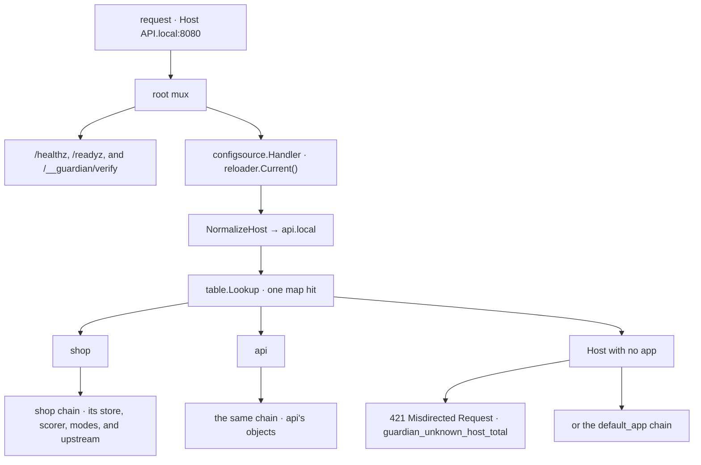

`NormalizeHost` strips the port and a trailing dot, and lowercases the name. `API.local:8080` becomes `api.local`. When the `Host` is already lowercase, that function allocates nothing. With uppercase, it makes one copy. A name longer than 253 characters is not looked up. Precedence is an exact host, then the longest wildcard suffix, then `default_app`. `*.shop.local` covers `a.shop.local` and does not cover `shop.local`. IDNA to punycode runs when the config is loaded. The request lookup does not run it again. Without `default_app`, the 421 body is `host desconocido` and `Cache-Control` is `no-store`. The log writes `host_desconocido` at debug, with the `Host` truncated to 255 characters. The counter does not carry the `Host`: the client writes that value.

Each app inherits a whole section from the parent YAML when it does not write that section. `scoring`, `rules`, and `modes` are not mixed field by field. `rate` and `burst` of 0 inherit. An empty `upstream` inherits. The name is `[a-z0-9-]`, starts with a letter or digit, and is at most 32 characters. A repeated host, a wildcard over an IP, or a `default_app` that is not in `apps` fails the load. `apps` and `default_app` hot-reload. The app name is stored by `middleware.App`, right after `Init`, and from there the rate limit, the ACL, reputation, metrics, events, and the log read it. `internal/ratelimit.Pool` keeps one store per app and reuses it across reloads when `rate` and `burst` do not change. The circuit breaker and the local buckets survive that reload.

```bash
cd deploy/compose
docker compose -f docker-compose.yml -f docker-compose.apps.yml up -d --build
```

That override uses `config/guardian.apps.yml`. `shop.local` and `*.shop.local` are `shop` and inherit the upstream, the rate, and `enforce`. `api.local` is `api`, with upstream `http://upstream-api:9000`, 20 per second, burst 40, mode `monitor`, and its own honeypots. There is no `default_app`. The Compose file adds the `upstream-api` service.

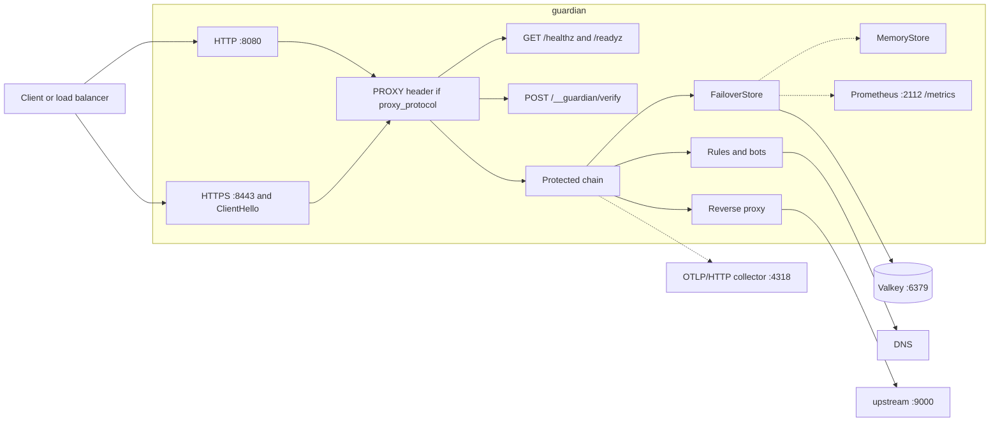

Each app's chain runs in this order. `App` stores the name of the app that owns the chain on the verdict. `ConfigVersion` stores the hash of the file the chain was built from. `Metrics` measures the request on the way back. `Events` emits the closed verdict, also on the way back. `Trace` opens the root span, copies its `trace_id` onto the verdict, and closes the span after the response has gone out. `Logger` wraps what follows and writes the verdict on the way back. Until `Score`, middleware only marks signals. The score and the decision come from `Score`. The rate limit, the scorer, the modes, and the reverse proxy belong to that app.

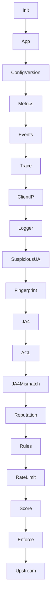

`newUpstreamProxy` shares `http.DefaultTransport` and an `httputil.BufferPool` of 32 KB buffers (`cmd/guardian/bufpool.go`). There is one pool in the process: each reload creates a new `ReverseProxy` and the pool stays, the same as the transport. Without the pool, `ReverseProxy` does `make([]byte, 32*1024)` on every response. `Get` returns a buffer of that length. `Put` drops one whose capacity is not 32 KB. Storing the slice in `sync.Pool` allocates the 24-byte header on every `Put` (staticcheck SA6002). The `BufferPool` interface hands over the slice and not the pointer, so the code keeps it that way. The measurement is in [docs/perf.en.md](docs/perf.en.md).

| Piece | Package | What it does |
| --- | --- | --- |
| Proxy and servers | `cmd/guardian` | YAML with hot reload, HTTP, HTTPS, PROXY protocol, metrics, traces, Valkey, and shutdown |
| Aggregator | `cmd/aggregator` | Reads SQS or Kafka, counts distinct IPs per JA4, and marks reputation in Valkey |
| Reputation | `internal/reputation` | HyperLogLog per JA4 and the mark the proxy looks up |
| ACL | `internal/acl` | Admin API blocks and allowlist in Valkey, with a local cache |
| Admin API | `internal/admin` | Internal HTTP with a token, to write the ACL and request a reload |
| ClientHello | `internal/tlshello` | Snapshot of the TLS handshake, JA4, and one `tls_hello` line per connection |
| Test upstream | `cmd/upstream` | Plain-text response. `/lento` waits 10 seconds |
| Configuration | `internal/config` | Parse, validation, and the list of fields that can reload |
| Apps | `internal/apps` | Host table, wildcards, and the 421 for an unknown Host |
| Config source | `internal/configsource` | Reads the file, watches the directory, and publishes an immutable snapshot per reload |
| Client IP | `internal/clientip` | Picks the real IP from the peer and the configured header |
| Fingerprint | `internal/fingerprint` | Summarizes the headers and compares the JA4 with known tools |
| JA4 source | `internal/ja4source` | Chooses the JA4 from the ClientHello, from CloudFront, or from neither |
| Rules | `internal/rules` | Honeypots, denied CIDRs, and routes with an allowlist |
| Bots | `internal/goodbot` | DNS check for user-agents that claim to be a known bot |
| Score | `internal/scoring` | Turns signals into a score and a decision |
| Challenge | `internal/challenge` | Proof of work, HMAC tokens, and a signed pass |
| Modes | `internal/policy` | Picks `monitor` or `enforce` by the longest prefix, and that prefix is the `route` label |
| Middleware | `internal/middleware` | Chain, signals, challenge page, and the cut on `block` |
| Metrics | `internal/metrics` | Counters, histogram, and gauge of the protected chain |
| Traces | `internal/tracing` | OTLP/HTTP exporter, sampling, and `Traceparent` toward the upstream |
| Events | `internal/events` | Verdict to log, SQS, Kinesis, or Kafka, with the IP as an HMAC and a buffer that drops when full |
| Verdict | `internal/verdict` | IP, fingerprint, signals, score, decision, `trace_id`, and `config_version` |
| Rate limit | `internal/ratelimit` | Token bucket in Valkey, memory, and failover |

### Client IP

`ClientIP` stores the IP on the verdict. The rate limit, the rules, and bot verification use that IP. The log includes it and the proxy writes it in the `X-Forwarded-For` the upstream sees.

If the peer is not in `trusted_proxies`, or if `x_forwarded_for_header` is empty, the IP is the connection's IP. A direct client cannot forge the header. If the peer is trusted, the header is walked from right to left and the client IP is the first one that does not belong to `trusted_proxies`. A value that is not an IP stops the walk.

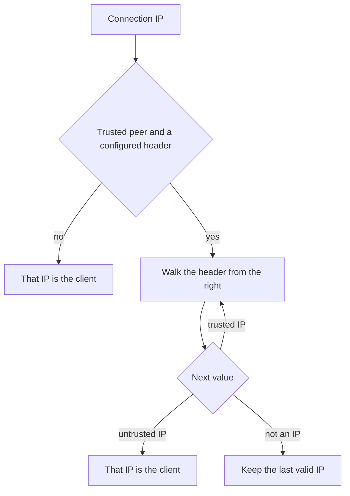

With `proxy_protocol` on, the connection IP is the one in the PROXY header, not the socket's. It is accepted only when the peer is in `trusted_proxies`; any other origin is rejected.

### Header fingerprint

`Fingerprint` stores on the verdict the first 16 hexadecimal characters of a SHA-256. The summarized text carries, in this order, the normalized value of `User-Agent`, `Accept`, `Accept-Language`, `Accept-Encoding`, `Sec-Ch-Ua`, and `Sec-Ch-Ua-Platform`, and then the sorted list of header names. Normalization lowercases the value and collapses spaces.

These headers are not in the name list, so changing them does not change the fingerprint: `Cookie`, `Content-Length`, `Content-Type`, `Referer`, `Authorization`, `Cache-Control`, `Pragma`, `If-None-Match`, `If-Modified-Since`, `X-Forwarded-For`, `X-Forwarded-Proto`, `X-Forwarded-Host`, `Forwarded`, `X-Amzn-Trace-Id`, `Origin`, `Sec-Fetch-User`, and `Sec-Fetch-Site`.

If the `User-Agent` contains `Mozilla/` and `Accept`, `Accept-Language`, or `Accept-Encoding` is missing, the incomplete-headers signal is set. The comparison looks for that text as written, with a capital `M`.

### JA4

On HTTPS, `tlshello` computes the JA4 from what the client offered, without counting GREASE. The shape is `A_B_C`: `A` is 10 characters (protocol `t`, version, `d` if there is SNI or `i` if there is not, cipher count, extension count, and ALPN), `B` is 12 hex digits of the hash of the sorted ciphers, and `C` is 12 hex digits of the hash of the sorted extensions, without SNI or ALPN, plus the signature algorithms in the order they arrived. `ja4_r` carries those lists in the clear and sorted. `ja4_ro` carries them in the original order.

`ja4.source` says where that value comes from. If it is omitted, it is `tls`.

| `source` | Where the JA4 comes from |
| --- | --- |
| `tls` | From the ClientHello guardian sees. Plain HTTP has no value |
| `cloudfront` | From the `CloudFront-Viewer-JA4-Fingerprint` header, if the TCP neighbor is in `trusted_proxies`. If the header is missing, repeated, not shaped `10_12_12`, or the neighbor is not trusted, the ClientHello is used |
| `none` | There is no JA4 and the signal stays off |

`cloudfront` requires `trusted_proxies` to be non-empty. The header is trusted only from the immediate peer, not from the client IP already resolved. A discarded header leaves a `ja4_header_rechazado` warning with reason `peer_no_confiable`, `formato_invalido`, or `header_repetido`. After the decision, guardian deletes that header so the upstream does not see it. `POST /__guardian/verify` also goes through that step.

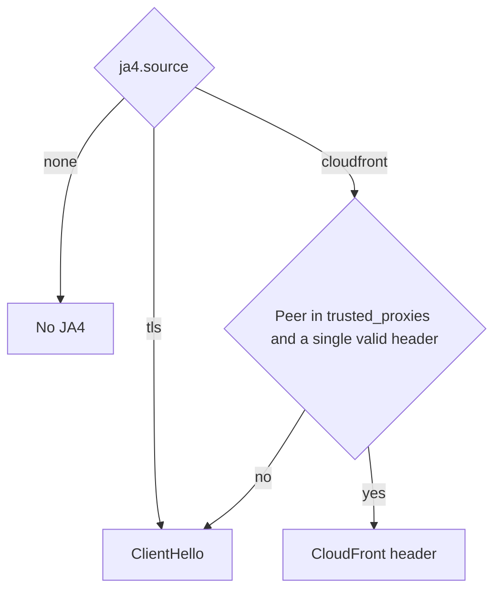

`JA4Mismatch` marks `ja4_incoherente` when the `User-Agent` starts with `Mozilla/` and the chosen JA4 is in `ja4.tools`. A `curl` that keeps its own `User-Agent` does not enter here: `ua_herramienta` already covers it. Each entry needs `name` and a lowercase JA4 shaped `10_12_12`. A repeated JA4, or a `source` other than `tls`, `cloudfront`, and `none`, fails startup. The example carries the JA4 measured from curl on macOS; it changes with the version and the TLS library.

`guardian-cf.yml` uses `source: cloudfront` and treats `10.0.0.0/8`, `127.0.0.0/8`, and `::1` as trusted neighbors. `guardian-cf-untrusted.yml` leaves localhost out, so a header sent from the local machine is discarded.

### Rules and bots

`Rules` marks the honeypot when the path is in `rules.honeypots`. The comparison is exact. It can also leave a deny reason:

- `ip_denegada`, if the IP is in `rules.deny_cidrs`.
- `ruta_privada`, if the path starts with the `prefix` of a `rules.routes` entry and the IP is not in its `allow_cidrs`.

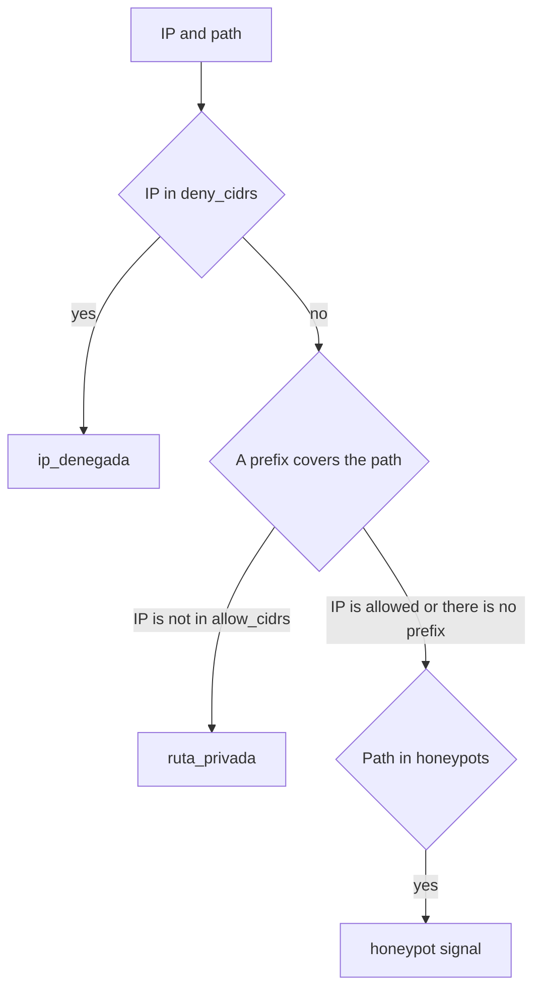

If the `User-Agent` contains the `ua_contains` of a bot in `good_bots`, the proxy does a DNS check with a 300 ms cap. The result of a finished lookup is kept for one hour per IP and bot name.

1. Reverse DNS of the client IP.
2. The name has to be one of `domains` or a subdomain of one of them.
3. Forward DNS of that name has to return the same IP.

If all three close, the signal is a verified bot. If the user-agent claims the bot and the check does not close, or if DNS fails, the signal is a fake bot.

### Score

`Score` reads the signals and writes the score, the reasons, and the decision.

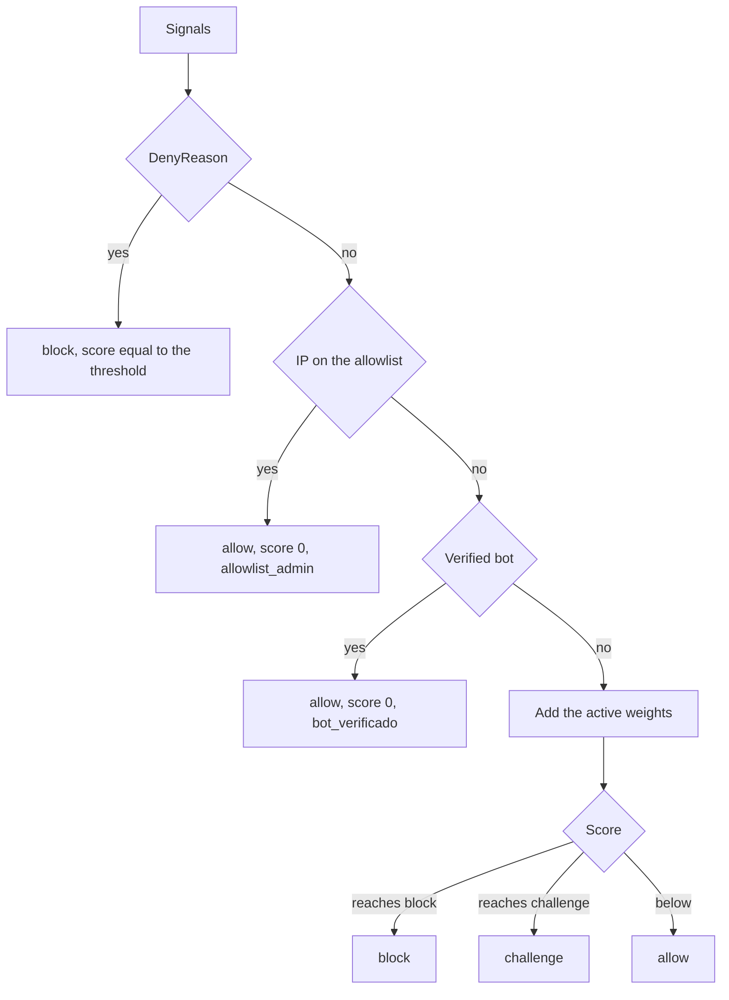

With the example YAML the weights and thresholds are:

| Signal | Weight | Reason | Decision if it acts alone |
| --- | --- | --- | --- |
| Empty User-Agent, or one that contains `curl` | 90 | `ua_herramienta` | `block` |
| Claimed bot that is not verified | 90 | `bot_falso` | `block` |
| Incomplete browser headers | 30 | `headers_incompletos` | `allow` |
| Path in `rules.honeypots` | 50 | `honeypot` | `challenge` |
| Rate limit exceeded | 100 | `rate_limit` | `block` |
| Browser User-Agent with a JA4 from `ja4.tools` | 60 | `ja4_incoherente` | `challenge` |
| JA4 marked with bad reputation | 0 in `guardian-config.yml`; 50 in `guardian.sqs.yml` | `ja4_reputacion` | `allow` at weight 0. At 50 points, `challenge` |
| Browser ratio below `browser_ratio_min` | 15 | `ratio_navegador_bajo` | `allow` |
| IP or JA4 on the Admin API `block` list | the `block` threshold | `bloqueo_admin_ip` or `bloqueo_admin_ja4` | `block`, also in `monitor` |
| IP on the Admin API `allow` list | 0 | `allowlist_admin` | `allow` |

`ip_denegada`, `ruta_privada`, `bloqueo_admin_ip`, and `bloqueo_admin_ja4` do not add a weight: the score stays at the `block` threshold and the decision is `block`, even if the bot was verified or the IP is on the allowlist. An IP on the allowlist, without those denials, stays at `allow` with score 0 and reason `allowlist_admin`. A verified bot, without a denial or an allowlist entry, stays at `allow` with score 0 even after visiting a honeypot.

`Enforce` looks at the route mode before it acts. The mode is the `modes.routes` entry whose prefix is the longest and matches the path. If none matches, it uses `modes.default`. A prefix matches when the path is equal or continues with `/`. `/api` covers `/api` and `/api/precios`, and does not cover `/apiv2`. `/api/checkout` wins over `/api` on `/api/checkout/pagar`.

In `monitor`, if the decision is not `allow` and there is neither `ip_denegada` nor `ruta_privada`, the request continues to the upstream with `shadow` true. The log keeps the score and the decision. `ip_denegada` and `ruta_privada` also apply in `monitor`.

In `enforce`, `block` responds `403` with the body `acceso denegado`. A pass does not change that result.

When the decision is `challenge`, it looks for the `guardian_pass` cookie. If the pass is signed, unexpired, and bound to the same IP and the same fingerprint, it adds the reason `pase_valido` and continues to the upstream. If there is no pass, it responds `403` with an HTML page that solves a SHA-256 proof of work in the browser: it looks for a nonce whose hash of `seed + nonce` has at least `challenge.difficulty` leading zero bits.

The form does `POST /__guardian/verify` with the token, the nonce, and the return path. That path goes through `Init`, `ClientIP`, `Logger`, `Fingerprint`, and `JA4`. Redemption requires a POST; another method responds `405`. The token has to be signed, inside `challenge.ttl`, bound to the IP and the fingerprint of that request, and the nonce cannot be longer than 20 characters. If the proof closes, the proxy sets the cookie and responds `303` toward `next`. `next` has to be a relative path that starts with `/`. An absolute URL, `//...`, or a value that is not a path goes back to `/`.

The cookie is `HttpOnly`, `SameSite=Lax`, with `Path=/` and `Max-Age` equal to `challenge.pass_ttl`. It carries `Secure` when the request arrives over TLS. The pass is bound to the IP and the fingerprint, so another IP or different headers cannot reuse it.

Tokens are signed by the first key in `GUARDIAN_PASS_KEYS`. The format is `kid:base64` and, to rotate, `kidNuevo:base64,kidAnterior:base64`: the first signs and the rest only verify. Each key, once decoded, is at least 32 bytes. The `kid` cannot contain dots. Without that variable the process does not start.

The chain does not set the browser-ratio signal. The `low_browser_ratio` weight applies when that signal is present and is below `browser_ratio_min`.

## Request flow

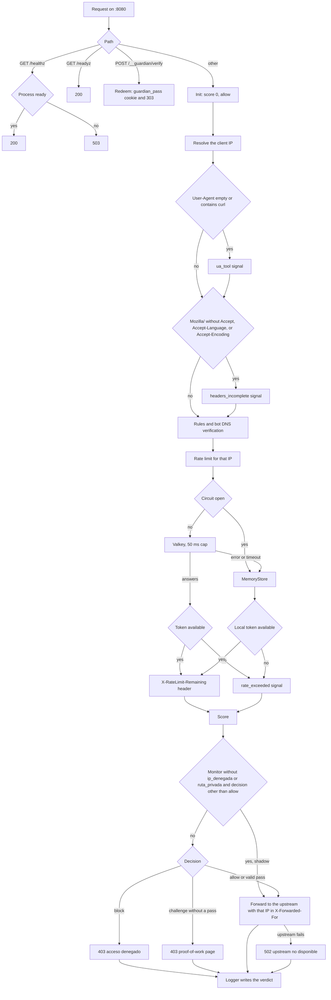

Valkey stores the bucket in `gd:<app>:{ip}:tokens` and `gd:<app>:{ip}:ts`. If Valkey fails, the request is decided in memory. After 5 failures in a row the circuit stays open for 10 seconds and every decision comes from the local limiter. Those jumps increment `guardian_fail_open_total` with reason `timeout`, `error`, or `circuit_open`, and leave a `fail_open` event with that `reason` on the `mw.ratelimit` span.

The log of every request that enters the chain is JSON on stdout: `app`, `client_ip`, `mode`, `shadow`, `fingerprint`, method, path, score, decision, reasons, duration, and `config_version`. If there was a JA4 source, it adds `ja4` and `ja4_source`. On HTTPS it also adds `tls_version` and `sni`. If the request span is valid, it adds `trace_id`. The span stores `guardian.app`.

### Traces

`tracing.enabled` false leaves the exporter off. The process still starts and validation does not require `endpoint` or `sample_ratio`. In the example YAML it is true and points at `localhost:4318`.

With the block on, guardian creates a batch `TracerProvider` and sends it over OTLP/HTTP to `tracing.endpoint` (`host:port`, with no scheme or path). Each send has a 5 second cap. `insecure` uses plain HTTP. The resource carries `service.name` `guardian` and `service.version`: `dev` by default, and it can be set at build time with `-ldflags "-X main.version=..."`. The sampler is `ParentBased` over `TraceIDRatioBased`. A `sample_ratio` of 0 does not keep new traces. A parent that was already sampled is continued.

`Trace` wraps only the protected chain. `/healthz`, `/readyz`, and `POST /__guardian/verify` do not open a span. The root span name is the method and the winning `modes.routes` prefix, the same `route` label as the metrics: `GET /api`, `GET /api/checkout`, or `GET default`. The method accepts `GET`, `HEAD`, `POST`, `PUT`, `PATCH`, `DELETE`, `OPTIONS`, `CONNECT`, and `TRACE`. Anything else becomes `_OTHER`. On close, the span stores `http.response.status_code` and, if there is a verdict, `guardian.decision`, `guardian.score`, `guardian.mode`, `guardian.shadow`, `guardian.reasons`, and `guardian.ja4_source`. A status of 500 or more marks the span as an error.

Each wrapped step hangs from that root and ends when it calls the next one, so they do not overlap and they do not include the time of the rest of the chain. `Init`, `ConfigVersion`, `Metrics`, `Events`, and `Logger` have no span of their own. The root stays open until the response comes back, including the upstream.

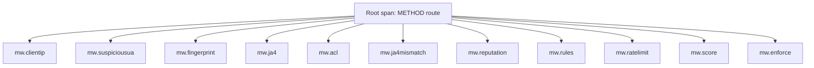

`trust_incoming` reads the incoming `Traceparent` only when the immediate TCP peer is also in `trusted_proxies`. With the example at `false`, a `Traceparent` from `127.0.0.1` opens a new trace. Before forwarding, guardian deletes `Traceparent`, `Tracestate`, and `Baggage` from the outgoing request and writes the root span's `Traceparent`. The test upstream prints it in the body. When the span opens, if the context is valid, `Trace` stores that `trace_id` on the verdict. The event reads it from there on the way back.

### Events

`events.enabled` false does not require a salt and the step emits nothing. The example leaves it true, with sink `log` and a buffer of 1024. A buffer of 0 or absent is also 1024. That size holds about one second at 1000 requests per second.

The event leaves when the protected chain has returned. `/healthz`, `/readyz`, and `POST /__guardian/verify` do not generate one. It carries the UTC time, `app`, `ip_hash`, `ja4`, `ja4_source`, `fingerprint`, `route`, `method`, `score`, `decision`, `reasons`, `mode`, `shadow`, and `trace_id`. `app` is the name `middleware.App` stored. If that name is not valid, the aggregator counts the event under the `app` of its own YAML. `route` is the same prefix the metrics use. `method` is the request's method, without Prometheus normalization. An empty mode becomes `none`.

`ip_hash` is the HMAC-SHA256 of the IP, with `GUARDIAN_EVENT_SALT` as the key, trimmed to 16 bytes and written in hexadecimal. The salt is at least 16 characters. An invalid IP leaves the field empty. Changing the salt stops matching previous hashes. The event does not carry the IP. The `request` log still carries `client_ip`.

```bash
export GUARDIAN_EVENT_SALT="$(openssl rand -hex 32)"
```

The `log` sink writes one JSON line with the message `event`. The `none` sink walks the same buffer and does not write that line.

`sqs`, `kinesis`, and `kafka` accumulate events and flush them when they reach `batch_size` or when `flush_interval` elapses. The default is 100 events or 1 second. The maximum `batch_size` is 500. `0` goes back to 100. Each send, retries included, has a 5 second cap. The body is the event JSON.

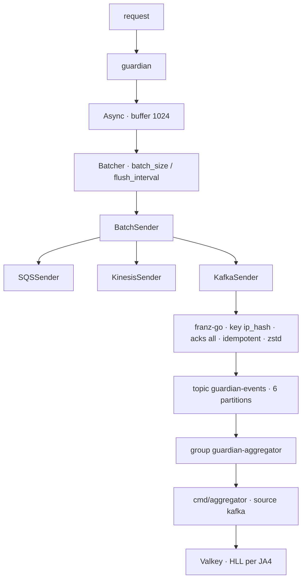

SQS splits that batch into `SendMessageBatch` calls of up to 10 messages and 1 MiB. The Floci YAML uses `batch_size: 10`, so one batch is one call. Kinesis uses `PutRecords`, up to 500 records and 10 MiB. The partition key is the JA4. If there is no JA4, it uses `ip_hash`. If there is no hash either, it uses `unknown`. A key longer than 256 characters is trimmed.

A failed SQS or Kinesis entry is retried on its own, up to `max_retries` times. The wait starts at `retry_backoff` and doubles, with a cap of 2 seconds and a jitter between half and the full wait. The defaults are 3 retries and 100 ms. In SQS, a failure marked as the message's fault is not retried. What still fails increments `guardian_events_send_failures_total`. On Kafka that `max_retries` is not used: franz-go retries until `delivery_timeout`.

Kafka uses the same batch and the franz-go client. The topic has to exist; guardian does not create it. The client does not connect when it is built. At startup it pings for 3 seconds and, if the broker does not answer, it logs `events: kafka no responde al arrancar` and continues. Acks ask every in-sync replica. The producer is idempotent. The default compression is `zstd`; `none`, `gzip`, `snappy`, and `lz4` are also valid. `linger` waits 5 ms per partition before closing a request. `0` goes back to those 5 ms. `delivery_timeout` is 4 seconds and, if written, has to be between 1 and 5 seconds.

The default key is `ip_hash`. `ja4` uses the same key as Kinesis: the JA4, or `ip_hash` if there is none, or `unknown`. `none` sends no key and the partitioner spreads records without keeping order. Each record carries the header `content-type: application/json` and, if there is a trace, `trace_id`. The event time stays in the JSON `ts` field. The record timestamp is the send time, so an event that waited in the buffer is not born already expired.

`tls.enabled` speaks TLS 1.2 or higher. `ca_file` adds a PEM of a private CA. An empty `sasl.mechanism` does not authenticate. `scram-sha-512` requires TLS and the variables `GUARDIAN_KAFKA_USERNAME` and `GUARDIAN_KAFKA_PASSWORD`. `aws_msk_iam` requires TLS and the same AWS credential chain as SQS. The default consumer group is `guardian-aggregator`.

Region, endpoint, and credentials come from the SDK: `AWS_REGION`, `AWS_ENDPOINT_URL`, `AWS_ACCESS_KEY_ID`, and `AWS_SECRET_ACCESS_KEY`, or a role. They are not in the YAML. At startup, guardian requires a region and credentials, and the credential read has a 5 second cap. With Floci, `AWS_ENDPOINT_URL` is `http://floci:4566` and the test credentials are `test` / `test` in `us-east-1`.

`Emit` does not wait for the destination. If the channel is full, it drops the event and increments `guardian_events_dropped_total` with reason `buffer_full`. If the sink already closed, the reason is `closed`. A destination error, once the event is out of the channel, increments `guardian_events_sink_errors_total`.

### JA4 reputation

`reputation.enabled` false does not query Valkey, and the aggregator refuses to start. The root `guardian-config.yml` leaves it off. `deploy/compose/config/guardian.sqs.yml` turns it on, with weight `ja4_reputation` 50. If it is on and that weight is 0, loading the YAML fails: the signal would be computed and would not add anything.

The aggregator, `cmd/aggregator`, reads the same sink guardian writes when it is `sqs` or `kafka`. It does not consume Kinesis yet. With SQS it long-polls for 20 seconds, up to 10 messages, with a visibility timeout of 30 seconds. It applies the batch in Valkey and only then deletes the messages. If Valkey fails, the messages come back when that visibility expires. With Kafka it joins the group `events.kafka.consumer_group`, fetches up to 500 records, and does not autocommit. The offset is committed after `Apply`. If Valkey fails, it retries every 2 seconds without committing, and that partition does not move forward. A group with no previous offsets starts at the oldest record the topic still keeps. On both sinks, `Apply` is idempotent: a repeated `ip_hash` does not inflate the count. JSON that does not decode is discarded, and its offset or its delete continues with the rest of the batch.

Each event with a JA4 and an `ip_hash` enters a HyperLogLog `gd:<app>:ja4ips:{<ja4>}:<bucket>`. The bucket is `ev.Time`, aligned to `reputation.bucket`. The key lives for `window` plus one bucket. `{ja4}` is a hash tag: in a cluster, the buckets of one JA4 land on the same slot and `PFCOUNT` can merge them. The default window is 1 hour in 10-minute buckets, six keys. The window has to be a multiple of the bucket and the quotient cannot exceed 24.

If the distinct IPs in the window reach `min_distinct_ips` (50 by default), the aggregator writes `gd:<app>:ja4rep:{<ja4>}` with that count and TTL `ttl` (30 minutes). The log leaves a `ja4_marcado` line.

On the protected chain, `Reputation` comes after `JA4Mismatch`. If the verdict has a JA4, it does a `GET` of that mark with a cap of `lookup_timeout` (20 ms). A present value sets `JA4Reputation` and the scorer adds `ja4_reputacion`. A missing key leaves the signal false. A Valkey error also leaves it false, writes `reputation no disponible`, and does not store that response: the next request asks again. Good responses and absences are cached for `cache_ttl` (10 seconds), up to 10,000 JA4; past that cap the cache is wiped. `POST /__guardian/verify` does not consult reputation.

### Admin API

`admin.enabled` false does not open the port, and the `ACL` step lets the request through. The root `guardian-config.yml` leaves it off. The YAML files in `deploy/compose/config` turn it on at `:9091`. The whole block needs a restart: the listener and the store are created once.

The token comes only from `GUARDIAN_ADMIN_TOKEN`. There is no token field in the YAML: a `token` field is unknown and startup fails. One or two comma-separated tokens are required, each at least 32 characters. Two are for rotation: deploy `nuevo,viejo`, clients move to the new one, and then only the new one remains. Guardian stores the SHA-256, compares in constant time, and the log writes `Tokens(n, redactados)`.

```bash
export GUARDIAN_ADMIN_TOKEN="$(openssl rand -hex 32)"
```

The API listens on its own HTTP process. `ReadHeaderTimeout` is 5 seconds, the read is 10 seconds, the write is 2 minutes, idle is 60 seconds, and the header cap is 16 KiB. Those 2 minutes cover `GET /debug/pprof/profile`: the default CPU profile lasts 30 seconds, and a `WriteTimeout` of 10 seconds used to cut it in half. An empty `admin.listen` becomes `127.0.0.1:9091`. The port cannot match `listen`, `tls.listen`, or `:2112`. In Compose the process listens on `:9091` inside the container and the host sees it only at `127.0.0.1:9091`. Shutdown of that API is part of the same `Shutdown` as HTTP and HTTPS.

`/debug/pprof/` lives on that same mux, behind the Bearer. `:8080` and `:2112` do not serve it. Importing `net/http/pprof` also registers the profiles on `http.DefaultServeMux`, and this process does not listen on that mux. Without a token the response is `401`, the same as the rest of the API. With a token, the index lists `heap`, `goroutine`, `allocs`, `mutex`, `block`, and the rest. `profile`, `trace`, `cmdline`, and `symbol` have their own handler. The CPU profile is requested with `seconds`. A value near 2 minutes hits `WriteTimeout`.

`mutex` and `block` come from that index, and the runtime ships them off. `admin.mutex_profile_fraction` and `admin.block_profile_rate` turn them on only when `admin.enabled` is true and the value is greater than 0. `ApplyProfiling` runs once at startup. A 0 does not touch the runtime. A negative value, with the API on, fails the load. The `admin` log writes `mutex_profile_fraction` and `block_profile_rate`. `guardian.load.yml` uses fraction 5 and rate `1ms`. The rest of the config leaves them at 0. `scripts/pprof-capture.sh` downloads those profiles while the load is running. `allocs`, `mutex`, and `block` accumulate from startup; the comparison subtracts the earlier snapshot with `go tool pprof -base`.

```bash
curl -sH "Authorization: Bearer $GUARDIAN_ADMIN_TOKEN" \
  "http://127.0.0.1:9091/debug/pprof/profile?seconds=30" > cpu.pb.gz
go tool pprof cpu.pb.gz
```

Without a valid `Authorization: Bearer` the response is `401`, with `WWW-Authenticate` and the body `no autorizado`, before the route is even checked. The log leaves `admin_auth_fallida` with reason `sin_bearer` or `token_invalido` and does not write the header. `X-Guardian-Actor` is an audit-log label, capped at 64 characters. Empty becomes `desconocido`. It does not authenticate anyone.

| Method | Path | What it does |
| --- | --- | --- |
| `GET` | `/v1/apps` | App names and `default_app` |
| `GET` | `/v1/blocks` and `/v1/allowlist` | Lists the entries of the default app. Without `default_app`, `404` and the list of apps |
| `GET` | `/v1/apps/{app}/blocks` and `/v1/apps/{app}/allowlist` | The same list, for that app. An unknown name is `404` |
| `GET` | `/v1/blocks/{kind}/{value}` and `/v1/allowlist/{kind}/{value}` | One entry. `404` if it does not exist or has already expired |
| `PUT` | the same path of one entry | Creates or replaces. The body requires `ttl` and `reason` |
| `DELETE` | the same path of one entry | `204` if it deleted it, `404` if it was not there |
| `POST` | `/v1/reload` | The same reload as fsnotify and `SIGHUP`, with reason `admin_api` |
| `GET` | `/v1/config` | `version`, `loaded_at`, and the `reloadable` list. It does not return YAML values |
| `GET` | `/debug/pprof/` | Index. It serves `heap`, `goroutine`, `allocs`, `mutex`, and `block`. `profile`, `trace`, `cmdline`, and `symbol` have their own handler |

`GET`, `PUT`, and `DELETE` of one entry exist at `/v1/{lista}/{kind}/{value}` and at `/v1/apps/{app}/{lista}/{kind}/{value}`.

`kind` is `ip` or `ja4`. The allowlist only accepts `ip`. An allowlist JA4 responds `400`: that JA4 is shared by anyone with the same browser. The IP is stored without a zone and without the IPv4-mapped prefix, so `::ffff:1.2.3.4` and `1.2.3.4` are the same key. The JA4 is lowercase and shaped `10_12_12`.

The `PUT` requires JSON of at most 4 KiB, with no extra fields. `ttl` is a Go duration greater than 0 and at most `admin.max_ttl` (168 hours). Permanent entries go in `rules.deny_cidrs`. `reason` is required and at most 200 characters. That text stays in the `admin_audit` audit log. The request signal is fixed: `bloqueo_admin_ip`, `bloqueo_admin_ja4`, or `allowlist_admin`. The free text does not enter `guardian_signals_total`.

Valkey stores each entry in `gd:<app>:acl:<lista>:<kind>:<valor>` and deletes it on its own with the TTL. The listing uses the ZSET `gd:<app>:acl:index:<lista>`, with the expiry in the score. The keys have no hash tag: in a cluster they spread across slots. The `PUT` writes the entry and the index in one pipeline. If the process dies between the two commands, `List` ignores a member whose value no longer exists.

A proxy read and an API write do not fail the same way. A `PUT` or `DELETE` with Valkey down responds `503` and the body says the change was not applied. A `Check` with Valkey down lets the request continue, increments `guardian_acl_lookup_errors_total`, and writes `acl no disponible`. If that key was read less than `admin.stale_ttl` ago (1 minute), that copy is used and `guardian_acl_stale_served_total` increments. The fresh cache lasts `admin.cache_ttl` (2 seconds) and is wiped past 10,000 entries. The replica that wrote forgets its copy immediately. The others see it within 2 seconds. `0` in `cache_ttl`, `stale_ttl`, `lookup_timeout`, or `max_ttl` goes back to the default. A `stale_ttl` shorter than `cache_ttl` fails startup.

`ACL` comes after `JA4`. It looks up the IP in allow and in block, and the JA4 only in block, in one pipeline and with a cap of `lookup_timeout` (20 ms). If the IP and the JA4 are both blocked, the IP block wins. A block fills `DenyReason` and `Enforce` responds `403` even when the route is in `monitor`. The allowlist sets `Allowlisted`. If both lists have the same IP, the block wins. `Rules` does not overwrite a `DenyReason` the ACL already set. `POST /__guardian/verify` does not consult the ACL.

`POST /v1/reload` returns `200` with `changed`, `version_anterior`, and `version`. If the file cannot be applied, it responds `422`, `changed` stays false, and the previous config remains. `GET /v1/config` does not show CIDRs or routes from the YAML.

```bash
curl -s -H "Authorization: Bearer $GUARDIAN_ADMIN_TOKEN" -H "X-Guardian-Actor: fabio" \
  -H "Content-Type: application/json" \
  -d '{"ttl":"30m","reason":"abuso de checkout"}' \
  http://127.0.0.1:9091/v1/blocks/ip/203.0.113.8
```

In `deploy/compose/config/guardian.yml` the API is on and `redis_addr` is still `localhost:6379`. Inside the container that address is guardian itself, so a `PUT` responds `503` and the proxy logs `acl no disponible`. `guardian.sqs.yml`, `guardian.kinesis.yml`, and `guardian.kafka.yml` point at `valkey:6379`, and there the ACL writes and reads.

`docker-compose.replicas.yml` starts `guardian-b` with the same Kafka YAML, the same Valkey, and the same token. The proxy is at `127.0.0.1:8081` and the Admin API at `127.0.0.1:9191`. A block written on one replica is applied by the other when its 2-second cache expires. The two do not talk to each other: they share Valkey.

### HTTPS and the ClientHello

The `tls` block turns the listener on when it has `listen`, `cert_file`, or `key_file`. If one appears, all three are required. The process exits at startup if the certificate or the key cannot be read.

Each HTTPS connection leaves a single `tls_hello` line: `sni`, negotiated version and cipher, ALPN, offered versions and ciphers, extensions, curves, offered ALPN, `ja4`, `ja4_r`, and `ja4_ro`. A GREASE value comes out as `grease:0x????`. An extension with no known name comes out in hexadecimal. That line is also written for `/healthz` and `/readyz` on the TLS port. The HTTP port has no ClientHello.

## What is here

```
cmd/guardian/                 proxy binary
cmd/aggregator/               consumes SQS and marks JA4 in Valkey
cmd/upstream/                 test binary
internal/challenge/           proof of work, tokens, and the pass
internal/clientip/            client IP resolution
internal/config/              parsing, validation, and reloadable fields
internal/configsource/        file, fsnotify, poll, SIGHUP, and the chain snapshot
internal/apps/                host table and the 421
internal/acl/                 blocks and allowlist in Valkey
internal/admin/               Admin API: token, ACL, and reload
internal/events/              verdict event, IP HMAC, buffer, SQS, Kinesis, and Kafka
internal/fingerprint/         HTTP fingerprint and JA4 policy
internal/ja4source/           where the JA4 comes from: tls, cloudfront, or none
internal/goodbot/             DNS verification of known bots
internal/metrics/             RED, decisions, and Prometheus signals
internal/middleware/          chain, signals, challenge, mode, and spans
internal/tracing/             OTLP/HTTP, sampling, and Traceparent toward the upstream
internal/policy/              monitor or enforce by prefix; the route label
internal/ratelimit/           Valkey, memory, failover, and one store per app
internal/reputation/          HyperLogLog per JA4 and the mark the proxy reads
internal/rules/               honeypots, denials, and routes
internal/scoring/             weights, thresholds, and the decision
internal/testutil/            Valkey container for tests with -tags=integration
internal/tlshello/            ClientHello and the JA4 calculation
internal/verdict/             IP, fingerprint, signals, and decision
guardian-config.yml           example for go run, with TLS on :8443
deploy/compose/               local stack: guardian, upstream, Valkey, Jaeger, Prometheus, and Grafana
scripts/ci-local.sh           format, vet, race, fuzz, and integration when asked
scripts/k6/                   k6 load: proxy and the upstream directly
scripts/pprof-capture.sh      Admin API profiles captured during the load
docs/perf.md                  measured overhead and the buffer pool, in Spanish
docs/perf.en.md               the same note, in English
README.md                     this documentation, in Spanish
Dockerfile                    distroless image of guardian or the upstream
```

## Third-party tools

These services do not live inside the binary. Compose starts them next to guardian, and on real AWS, SQS or Kinesis take Floci's place.


| | Tool | Where it comes in |
| --- | --- | --- |
|  | Valkey `9.1.3` in Compose and `8` in the standalone `docker run` | Token bucket for the rate limit, at `redis_addr`. If it does not answer, failover moves to memory |
|  | Prometheus `v3.16.0` | Reads guardian's `GET /metrics` on `:2112` every 15 seconds and evaluates the alerts |
|  | Grafana `13.0.12` | Dashboard `guardian · overview` on `:3000`, with Prometheus and Jaeger already provisioned |
|  | Jaeger `2.23.0` | UI on `:16686`. Receives traces over OTLP/HTTP on `:4318` |
|  | OpenTelemetry | Spans from the protected chain and the `Traceparent` guardian writes toward the upstream |
|  | Amazon SQS | Sink `events.sink: sqs`. Batches leave with `SendMessageBatch`, up to 10 messages |
|  | Amazon Kinesis | Sink `events.sink: kinesis`. `PutRecords` uses the JA4 as the partition key and, if there is none, `ip_hash` |
|  | Apache Kafka `4.4.0` | Sink `events.sink: kafka` and the aggregator. Locally, one KRaft broker. On AWS, the same client talks to MSK |
|  | Floci `2.4.0` | Local AWS for the `aws` profile, at `127.0.0.1:4566`. Creates the queue and the stream `guardian-events` |
|  | Grafana k6 `2.4.0` | Load for the `load` profile. Compares the proxy with the upstream directly |
|  | Docker Compose | Stack in `deploy/compose`: proxy, upstream, Valkey, Jaeger, Prometheus, Grafana, and, with the `aws` profile, Floci |
|   | Alpine and Distroless | The image builds with `golang:1.27.4-alpine` and runs on `gcr.io/distroless/static-debian13:nonroot` |

The region, endpoint, and credentials for SQS and Kinesis come from `AWS_REGION`, `AWS_ENDPOINT_URL`, `AWS_ACCESS_KEY_ID`, and `AWS_SECRET_ACCESS_KEY`. With Floci the endpoint is `http://floci:4566` and the test credentials are `test` / `test`.

## Requirements

- Go 1.27 or newer
- Docker, for standalone Valkey and Jaeger, Docker Compose for the `deploy/compose` stack, and the tests with `-tags=integration`

## Tests

`./scripts/ci-local.sh` runs the same thing as the GitHub Actions job. From the repository root:

```bash
./scripts/ci-local.sh
INTEGRATION=1 ./scripts/ci-local.sh
FUZZTIME=2m ./scripts/ci-local.sh
```

The script requires an empty `gofmt -l`, `go vet` also with `-tags=integration`, and `go test -race -shuffle=on -count=1 ./...`. Then it runs each fuzzer for 20 seconds. `FUZZTIME` changes that duration. `INTEGRATION=1` requires Docker to answer and runs `go test -race -count=1 -tags=integration` in `internal/ratelimit` and `internal/reputation`.

Those tests start `valkey/valkey:8` with testcontainers and destroy it when they finish. The `integration` tag keeps testcontainers out of `go test` and the normal build. Without Docker, the test fails with `no pude levantar valkey`.

| Fuzzer | Package | What it requires |
| --- | --- | --- |
| `FuzzVerify` | `internal/challenge` | An arbitrary token does not panic. A valid one has four parts. What was signed comes back the same, expires with `ErrExpired`, and an altered signature gives `ErrBadSig` |
| `FuzzClientIP` | `internal/clientip` | A broken `RemoteAddr` leaves the IP invalid. A peer that is not a trusted proxy does not change its IP with `X-Forwarded-For` |
| `FuzzProxyProtoRead` | `cmd/guardian` | Arbitrary PROXY protocol bytes do not panic. A header that can be written is read back the same |

`cmd/guardian/build_test.go` builds the real chain with `chainDeps.build`, without starting the process, and checks multi-app routing and the 421.

`./scripts/ci-local.sh` does not run benchmarks. These measure the hot path and report allocations:

```bash
go test -bench=. -benchmem ./internal/clientip ./internal/fingerprint ./internal/scoring ./internal/apps
```

| Benchmark | What it measures |
| --- | --- |
| `BenchmarkClientIP` | A direct IP and an `X-Forwarded-For` chain from a trusted peer |
| `BenchmarkCompute` | The header fingerprint of a Chrome |
| `BenchmarkEvaluate` | `allow`, a bot with several signals, `DenyReason`, and the allowlist |
| `BenchmarkLookup` | An exact host, a wildcard, and the same host with capitals |
| `BenchmarkUpstreamProxy` | One pass through the real `ReverseProxy`, with bodies of 256 B, 16 KiB, and 64 KiB. The `allocs/op` include the `httptest.Server` |

`BenchmarkUpstreamProxy` is not part of the command above. It runs on its own:

```bash
go test ./cmd/guardian -run '^$' -bench BenchmarkUpstreamProxy -benchmem -count=10
```

## Configuration

`guardian` reads `guardian-config.yml` by default. Another path is passed with `-config`. `-config-poll` waits 10 seconds between re-reads; `0` leaves only fsnotify and `SIGHUP`. The aggregator uses the same `-config` and reads it once at startup.

```yaml
listen: ":8080"
upstream: "http://localhost:9000"
read_header_timeout: 5s
read_timeout: 20s
write_timeout: 20s
idle_timeout: 10s
shutdown_timeout: 20s
drain_delay: 5s
preserve_host: true
honeypot_paths:
  - "/robots.txt"
  - "/favicon.ico"
  - "/admin-oculto"
app: "shop"
redis_addr: "localhost:6379"
rate: 1
burst: 2
trusted_proxies:
  - "10.0.0.0/8"
  - "::1/128"
  - "127.0.0.0/8"
x_forwarded_for_header: "X-Forwarded-For"
proxy_protocol: false
scoring:
  weights:
    ua_tool: 90
    headers_incomplete: 30
    honeypot: 50
    rate_exceeded: 100
    low_browser_ratio: 15
    fake_bot: 90
    ja4_mismatch: 60
  browser_ratio_min: 0.3
  thresholds:
    challenge: 40
    block: 85
rules:
  honeypots: ["/admin-oculto", "/wp-login.php", "/.env"]
  deny_cidrs: ["198.51.100.0/24"]
  routes:
    - prefix: /interno
      allow_cidrs: ["10.0.0.0/8", "127.0.0.1/32"]
good_bots:
  - name: googlebot
    ua_contains: Googlebot
    domains: ["googlebot.com", "google.com"]
  - name: bingbot
    ua_contains: bingbot
    domains: ["search.msn.com"]
challenge:
  difficulty: 16
  ttl: 2m
  pass_ttl: 1h
modes:
  default: enforce
  routes:
    - prefix: /api
      mode: monitor
    - prefix: /api/checkout
      mode: enforce
    - prefix: /interno
      mode: monitor
tls:
  listen: ":8443"
  cert_file: "certs/localhost.pem"
  key_file: "certs/localhost-key.pem"
ja4:
  source: "tls"
  tools:
    - name: curl-mac
      ja4: "t13d4907h2_0d8feac7bc37_7395dae3b2f3"
```

| Field | Required | Default | Description |
| --- | --- | --- | --- |
| `listen` | no | `:8080` | Address the proxy listens on |
| `upstream` | yes | — | Full destination URL (`http://host:port`) |
| `read_header_timeout` | no | `5s` | Maximum time to read the client headers. It has to be greater than 0 |
| `read_timeout` | no | `10s` | Maximum time to read the whole request |
| `write_timeout` | no | `10s` | Maximum time to write the response. It cannot exceed `shutdown_timeout` |
| `idle_timeout` | no | `10s` | Wait for the next request on a keep-alive connection |
| `shutdown_timeout` | no | `10s` | Maximum shutdown time to finish requests in flight |
| `drain_delay` | no | `10s` | Wait after leaving ready and before closing the server |
| `preserve_host` | no | `false` | If `true`, the `Host` the upstream sees is the client's |
| `honeypot_paths` | no | empty | The YAML accepts it. The traps that score are `rules.honeypots` |
| `app` | no | `shop` | Prefix of the bucket keys in Valkey |
| `redis_addr` | no | `localhost:6379` | Valkey address |
| `rate` | no | `1` | Tokens per second. It has to be greater than 0 |
| `burst` | no | `10` | Bucket capacity. It has to be greater than 0 |
| `trusted_proxies` | no | empty | CIDRs that may report the client IP |
| `x_forwarded_for_header` | no | empty | Header walked when the peer is trusted |
| `proxy_protocol` | no | `false` | Requires the PROXY header from `trusted_proxies` and rejects the rest |
| `scoring.weights` | no | 0 | Points for each signal. A weight of 0 does not add |
| `scoring.browser_ratio_min` | no | 0 | Browser-ratio threshold, between 0 and 1 |
| `scoring.thresholds.challenge` | yes | — | From this score the decision is `challenge`. It has to be greater than 0 and less than `block` |
| `scoring.thresholds.block` | yes | — | From this score the decision is `block` |
| `rules.honeypots` | no | empty | Exact paths that set the honeypot signal |
| `rules.deny_cidrs` | no | empty | CIDRs that produce `ip_denegada` |
| `rules.routes` | no | empty | Prefixes that require the IP to be in `allow_cidrs` |
| `good_bots` | no | empty | Bots whose user-agent is checked by DNS |
| `challenge.difficulty` | yes | — | Leading zero bits the proof of work requires. It has to be between 8 and 24 |
| `challenge.ttl` | no | `0s` | Lifetime of the challenge token |
| `challenge.pass_ttl` | no | `0s` | Lifetime of the `guardian_pass` cookie |
| `modes.default` | yes | — | `monitor` or `enforce` when no prefix matches |
| `modes.routes` | no | empty | Prefixes with their mode. The longest wins. They cannot repeat |
| `tls.listen` | no | empty | HTTPS address. Empty, together with the certificate and the key, leaves TLS off |
| `tls.cert_file` | no | empty | PEM certificate. Required if the `tls` block is active |
| `tls.key_file` | no | empty | PEM private key. Required if the `tls` block is active |
| `scoring.weights.ja4_mismatch` | no | 0 | Points when a browser `User-Agent` brings a JA4 from `ja4.tools` |
| `ja4.source` | no | `tls` | `tls`, `cloudfront`, or `none` |
| `ja4.tools` | no | empty | JA4 measured from tools, with `name` and lowercase `ja4` |
| `tracing.enabled` | no | `false` | Turns the OTLP/HTTP exporter on |
| `tracing.endpoint` | if `enabled` | empty | Collector `host:port`. In the example, `localhost:4318` |
| `tracing.insecure` | no | `false` | Plain HTTP toward the collector |
| `tracing.sample_ratio` | no | `0` | Fraction of new traces, from 0 to 1. The example uses `1` |
| `tracing.trust_incoming` | no | `false` | Continues the `Traceparent` of a peer in `trusted_proxies` |
| `events.enabled` | no | `false` | Emits one event per request of the protected chain |
| `events.sink` | no | `log` | `log`, `none`, `sqs`, `kinesis`, or `kafka`. Another value fails startup |
| `events.buffer` | no | `1024` | Channel capacity. `0` goes back to 1024. A negative value fails startup |
| `events.batch_size` | no | `100` | Events per batch in SQS, Kinesis, and Kafka. `0` goes back to 100. Outside 1 to 500 fails startup |
| `events.flush_interval` | no | `1s` | An incomplete batch leaves anyway when this deadline elapses. A negative value fails startup |
| `events.max_retries` | no | `3` | Retries for SQS and Kinesis. Kafka retries until `delivery_timeout`. A negative value fails startup |
| `events.retry_backoff` | no | `100ms` | Base retry wait. It doubles each round, with a cap of 2 s |
| `events.sqs.queue_url` | with `sqs` | empty | Full `http` or `https` URL of the queue |
| `events.kinesis.stream_name` | with `kinesis` | empty | Stream name |
| `events.kafka.brokers` | with `kafka` | empty | `host:port` list. Locally, `kafka:9092`. On MSK with IAM, port `9098` |
| `events.kafka.topic` | with `kafka` | empty | Topic that already exists. The example uses `guardian-events` |
| `events.kafka.client_id` | no | `guardian` | Name the broker sees in logs and quotas |
| `events.kafka.key` | no | `ip_hash` | `ip_hash`, `ja4`, or `none` |
| `events.kafka.compression` | no | `zstd` | `none`, `gzip`, `snappy`, `lz4`, or `zstd` |
| `events.kafka.linger` | no | `5ms` | Wait per partition. `0` goes back to 5 ms. More than 1 s fails startup |
| `events.kafka.delivery_timeout` | no | `4s` | Delivery cap for one record, between 1 s and 5 s |
| `events.kafka.consumer_group` | no | `guardian-aggregator` | Aggregator group |
| `events.kafka.tls.enabled` | no | `false` | TLS 1.2 or higher. Required if there is SASL |
| `events.kafka.tls.ca_file` | no | empty | PEM of a private CA. The system roots cover MSK |
| `events.kafka.sasl.mechanism` | no | empty | Empty, `scram-sha-512`, or `aws_msk_iam` |
| `scoring.weights.ja4_reputation` | no | 0 | Points if the JA4 is marked. With `reputation.enabled`, it has to be greater than 0 |
| `reputation.enabled` | no | `false` | The proxy looks up the mark and the aggregator requires it to be true |
| `reputation.window` | no | `1h` | Window of distinct IPs. A multiple of `bucket`, and the quotient does not exceed 24 |
| `reputation.bucket` | no | `10m` | Size of each HyperLogLog |
| `reputation.min_distinct_ips` | no | `50` | Distinct IPs required to mark the JA4. Minimum 2 |
| `reputation.ttl` | no | `30m` | Lifetime of the mark. It has to be greater than 0 |
| `reputation.cache_ttl` | no | `10s` | Local cache of the proxy. `0` or absent goes back to `10s` |
| `reputation.lookup_timeout` | no | `20ms` | Cap of the `GET` in the proxy |
| `admin.enabled` | no | `false` | Opens the Admin API and consults the ACL. Off, the step does nothing |
| `admin.listen` | no | `127.0.0.1:9091` | Its own port. It clashes with `listen`, `tls.listen`, or `:2112` and startup fails |
| `admin.max_ttl` | no | `168h` | Maximum TTL of a `PUT`. `0` goes back to 168 h |
| `admin.cache_ttl` | no | `2s` | Local ACL cache. `0` goes back to 2 s. Past 10,000 entries it is wiped |
| `admin.stale_ttl` | no | `1m` | If Valkey fails, how long an old read is served. It has to be greater than or equal to `cache_ttl` |
| `admin.lookup_timeout` | no | `20ms` | Cap of the ACL `GET` on the request |
| `admin.mutex_profile_fraction` | no | `0` | 1 of every N mutex contentions in `/debug/pprof/mutex`. `0` leaves it off. It needs `admin.enabled` and a restart |
| `admin.block_profile_rate` | no | `0` | Samples blocks of at least this duration in `/debug/pprof/block`. `0` leaves it off. It needs `admin.enabled` and a restart |

Unknown fields in the YAML fail startup. `upstream` has to be a URL with a scheme and a host. Each entry of `trusted_proxies`, `rules.deny_cidrs`, and `allow_cidrs` has to be a valid CIDR. Each `prefix` of `rules.routes` and of `modes.routes` has to start with `/`. Each `modes.routes.mode` has to be `monitor` or `enforce`.

Loading also rejects the configuration when:

- `shutdown_timeout` + `drain_delay` is greater than or equal to 30 seconds.
- `write_timeout` is greater than `shutdown_timeout`.
- `scoring.thresholds.challenge` or `block` are not greater than 0, or `challenge` is not less than `block`.
- `scoring.browser_ratio_min` is outside the interval from 0 to 1.
- `challenge.difficulty` is outside the interval from 8 to 24.
- `modes.default` is empty, is neither `monitor` nor `enforce`, or two routes end up with the same prefix.
- the `tls` block is incomplete: `listen`, `cert_file`, or `key_file` is missing.
- `ja4.source` is not `tls`, `cloudfront`, or `none`, or `cloudfront` is used without `trusted_proxies`.
- a `ja4.tools` entry has no `name`, the JA4 is not shaped `10_12_12` in lowercase, or the same JA4 appears twice.
- `tracing.enabled` is true and `tracing.endpoint` is missing, or `tracing.sample_ratio` is outside 0 to 1.
- `events.enabled` is true and `events.sink` is not `log`, `none`, `sqs`, `kinesis`, or `kafka`.
- `events.sink` is `sqs` and `events.sqs.queue_url` is not an `http` or `https` URL with a host.
- `events.sink` is `kinesis` and `events.kinesis.stream_name` is missing.
- `events.sink` is `kafka` and a `host:port` broker or the topic is missing, `key` is not `ip_hash`, `ja4`, or `none`, compression is not one of the five, `linger` is outside 0 to 1 s, or `delivery_timeout` is outside 1 s to 5 s.
- `events.kafka.sasl.mechanism` is not empty, `scram-sha-512`, or `aws_msk_iam`, or one of those two is used without `tls.enabled`.
- `events.buffer`, `events.batch_size`, `events.flush_interval`, `events.max_retries`, or `events.retry_backoff` is negative, or `events.batch_size` exceeds 500.
- `reputation.enabled` is true and `scoring.weights.ja4_reputation` is 0, the window is not a multiple of the bucket, the quotient exceeds 24, `min_distinct_ips` is less than 2, or `ttl` and `lookup_timeout` are not greater than 0.
- `events.enabled` is true and `GUARDIAN_EVENT_SALT` is shorter than 16 characters.
- `admin.enabled` is true and `admin.max_ttl` or `admin.lookup_timeout` are not greater than 0, `admin.cache_ttl` is negative, `admin.stale_ttl` is less than `admin.cache_ttl`, `admin.mutex_profile_fraction` or `admin.block_profile_rate` is negative, or `admin.listen` uses the port of `listen`, of `tls.listen`, or `:2112`.
- `admin.enabled` is true and `GUARDIAN_ADMIN_TOKEN` is empty, brings more than two tokens, or one of them is shorter than 32 characters.

`GUARDIAN_UPSTREAM` replaces the file's `upstream` value. `GUARDIAN_PASS_KEYS` is required and brings the keyring that signs the challenge and the pass. `GUARDIAN_EVENT_SALT` is required only when `events.enabled` is true. `GUARDIAN_ADMIN_TOKEN` is required only when `admin.enabled` is true.

## Hot reload

`guardian` watches the `-config` file and, without restarting, rebuilds the protected chain when `scoring`, `rules`, `modes`, `ja4.tools`, `apps`, or `default_app` change. Each request reads the snapshot once on entry and uses it until the end. `POST /__guardian/verify` and the aggregator stay on the startup config.

On each reload the scorer, the rules, the modes, and the JA4 policy are rebuilt. The rest was created at startup and is reused: listeners, TLS, upstream, Valkey, the rate limit, the challenge, the bots, the JA4 source, reputation, the ACL, events, and traces. The `ReverseProxy` buffer pool belongs to the process and is not recreated either. `admin.mutex_profile_fraction` and `admin.block_profile_rate` are applied once, at startup.

- The file's directory is watched with fsnotify. That is where an editor's atomic save (temp file and rename) and the `..data` symlink of a Kubernetes ConfigMap show up. A `chmod` does not trigger a reload.
- `-config-poll` (10 s by default, `0` turns it off) re-reads the file even if fsnotify does not notify. If the hash did not change, the debug log says `config_sin_cambios`.
- If fsnotify does not start and `-config-poll` is `0`, the log leaves `config_watch` and the reload that remains is `SIGHUP`.
- `SIGHUP` asks for a manual reload: `docker compose kill -s HUP guardian`. `POST /v1/reload` on the Admin API asks for the same reload, with reason `admin_api`. Guardian catches `SIGHUP`.
- Notices are grouped for 250 ms and one reload runs. That deadline has no flag.
- The version is the first 12 hexadecimal characters of the SHA-256 of the file bytes. `guardian_config_info` and the `config_version` field of the protected chain's `request` log show that value. The log of `POST /__guardian/verify` does not carry it.
- The new config is parsed and merged with what stayed fixed at startup. That merge is validated and the chain is built in full before it is published. If something fails, the previous one stays, `guardian_config_last_reload_successful` goes to 0, and the log says `config_recarga_fallida`. A later poll of the same rejected file does not repeat that error. A failure at startup ends the process, because there is no previous config yet.
- Lowering `scoring.weights.ja4_reputation` to 0 while `reputation.enabled` stayed true at startup is not applied: the merge does not pass validation.
- A change outside those blocks (`listen`, `tls`, `upstream`, timeouts, `redis_addr`, `rate`, `burst`, `trusted_proxies`, `ja4.source`, `challenge`, `good_bots`, `events`, `tracing`, `reputation`, `admin`) leaves the warning `config_requiere_reinicio` and the process keeps the startup value. If the file is still valid, the version moves forward, because the hash is the file's. In the log diff, a field whose name contains `password`, `secret`, `token`, or `key_file` comes out as `***`. Apps are compared by name: reordering the YAML is not a change.
- An applied reload leaves the line `config_recargada` with the previous version, the new one, the reason, the changes, and `dur_ms`. The `ok` and `error` series of `guardian_config_reloads_total` exist from startup.

| Metric | Type | What it says |
| --- | --- | --- |
| `guardian_config_reloads_total{result}` | counter | `ok` and `error` reloads. Both series exist from startup |
| `guardian_config_last_reload_successful` | gauge | 1 if the last one was applied, 0 if it was rejected. At startup it is 1 |
| `guardian_config_last_reload_success_timestamp_seconds` | gauge | when the active config was published, including the startup one |
| `guardian_config_info{version}` | gauge | always 1; `version` is the 12-hex hash of the published file |

## Health and shutdown

`GET /healthz` and `GET /readyz` do not go through the protected chain. While the process is ready, both respond `200`. After `SIGINT` or `SIGTERM`, `/healthz` responds `503`. `/readyz` does not write a status in that stretch, and the response the server completes is still `200`.

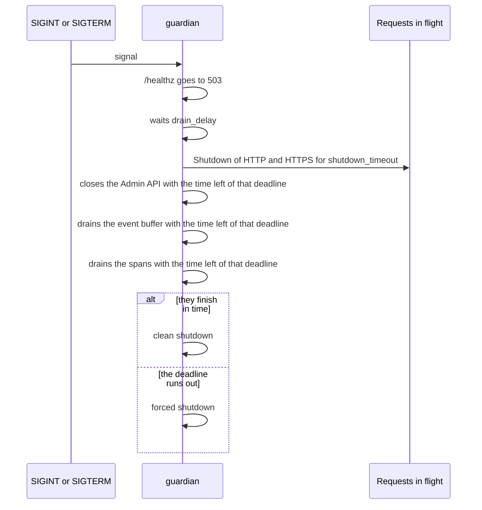

The in-memory limiter cleans, every minute, the keys that have already recovered the full burst. That cleanup stops with the same signal.

`GET /metrics` on `:2112` exposes Prometheus. That server has a `ReadHeaderTimeout` of 5 seconds and does not enter the HTTP or HTTPS `Shutdown`: it stays until the process exits. `/healthz`, `/readyz`, and `POST /__guardian/verify` do not go through the metrics middleware. The protected chain does.

The `route` label is the `modes.routes` prefix that wins for that path, the same rule as the mode: the longest, with the trailing slash trimmed, and the path has to match in full or continue with `/`. If none applies, the label is `default`. With the example YAML, `/api/precios` lands on `/api`, `/api/checkout/pagar` lands on `/api/checkout`, and `/salud` lands on `default`. The query does not enter the label.

The method is normalized to `GET`, `HEAD`, `POST`, `PUT`, `PATCH`, `DELETE`, or `OPTIONS`. Anything else becomes `OTHER`. The status is the one the handler writes; if it does not call `WriteHeader`, the counter uses `200`. The response wrapper still exposes the original `ResponseWriter`, so the reverse proxy can flush and the upstream can still stream.

| Metric | Type | Labels | What it counts |
| --- | --- | --- | --- |
| `guardian_http_requests_total` | counter | `app`, `route`, `method`, `code` | Requests that leave the protected chain. Without `middleware.App`, `app` stays `none` |
| `guardian_http_request_duration_seconds` | histogram | `app`, `route`, `method` | Time inside guardian, including the upstream. Buckets: 5 ms, 10 ms, 25 ms, 50 ms, 100 ms, 250 ms, 500 ms, 1 s, 2.5 s, and 5 s |
| `guardian_http_requests_in_flight` | gauge | — | Requests that have not yet returned from the rest of the chain |
| `guardian_decisions_total` | counter | `app`, `decision`, `mode`, `shadow` | Decision read from the verdict. `shadow` is `true` or `false`. An empty mode stays `none` |
| `guardian_signals_total` | counter | `app`, `reason` | Each reason the verdict carries in `Reasons` |
| `guardian_unknown_host_total` | counter | — | Hosts that `apps.Router` answers with 421. The log for that case is `host_desconocido` at debug |
| `guardian_fail_open_total` | counter | `reason` | Jumps to the in-memory limiter: `timeout`, `error`, or `circuit_open` |
| `guardian_events_enqueued_total` | counter | — | Events that entered the buffer |
| `guardian_events_dropped_total` | counter | `reason` | Dropped: `buffer_full` or `closed`. Both series exist from startup |
| `guardian_events_sink_errors_total` | counter | — | Destination errors while writing an event already taken from the buffer |
| `guardian_events_buffer_length` | gauge | — | Events waiting in the channel |
| `guardian_events_batches_total` | counter | `sink` | Batches flushed toward SQS or Kinesis |
| `guardian_events_batch_size` | histogram | `sink` | Events per batch. Buckets: 1, 2, 5, 10, 20, 50, 100, 200, and 500 |
| `guardian_events_retries_total` | counter | `sink` | Rounds that resent only the failed entries |
| `guardian_events_send_failures_total` | counter | `sink` | Events lost after the retries were exhausted |
| `guardian_events_api_requests_total` | counter | `sink` | `SendMessageBatch`, `PutRecords`, or Kafka Produce calls |
| `guardian_acl_matches_total` | counter | `list`, `kind` | Requests that matched an Admin API entry |
| `guardian_acl_lookup_errors_total` | counter | — | ACL reads that failed in Valkey. The request continued |
| `guardian_acl_stale_served_total` | counter | — | Times Valkey failed and an old cache entry was used |
| `guardian_admin_requests_total` | counter | `route`, `code` | Admin API requests. `route` is the pattern, or `unauthorized` on a `401` |
| `guardian_admin_request_duration_seconds` | histogram | `route` | Admin API latency. Buckets: 1 ms, 5 ms, 10 ms, 50 ms, 100 ms, 500 ms, 1 s, and 5 s |
| `guardian_admin_auth_failures_total` | counter | — | Admin API `401`s |
| `guardian_admin_changes_total` | counter | `action`, `app`, `list`, `kind`, `result` | Creates, deletes, and reloads, with the result |

## Run

Valkey, in the background and published on port `6379`:

```bash
docker run -d --name valkey -p 6379:6379 valkey/valkey:8
```

Jaeger, for the example `tracing`. The UI is at `http://localhost:16686` and OTLP/HTTP is on port `4318`. The `guardian` service shows up there with the build version. If the collector is not there, the process still starts and each batch send fails after 5 seconds.

```bash
docker run -d --name jaeger -p 16686:16686 -p 4318:4318 jaegertracing/jaeger:2.23.0
```

The version that travels in `service.version` is set at compile time. Without that flag it stays `dev`.

```bash
go build -ldflags "-X main.version=$(git rev-parse --short HEAD)" -o guardian ./cmd/guardian
```

In one terminal, the test upstream:

```bash
go run ./cmd/upstream
```

In another, the proxy:

```bash
go run ./cmd/guardian
# go run ./cmd/guardian -config /path/guardian-config.yml
```

The repository `guardian-config.yml` leaves `proxy_protocol` at `false`, so these tests accept a direct `curl`. If it is turned on, the listener requires the PROXY header from `127.0.0.0/8` and rejects that same connection.

Before starting the proxy the keyring is required. The first key signs; a previous one can stay behind it to verify passes already issued.

```bash
export GUARDIAN_PASS_KEYS="k1:$(openssl rand -base64 32 | tr -d '\n')"
export GUARDIAN_EVENT_SALT="$(openssl rand -hex 32)"
```

The example YAML turns HTTPS on at `:8443`. Without these files the process does not start:

```bash
mkdir -p certs
openssl req -x509 -newkey rsa:2048 -keyout certs/localhost-key.pem -out certs/localhost.pem -days 365 -nodes -subj "/CN=localhost"
```

A request to `/healthz` over HTTPS leaves the `tls_hello` line with `ja4`, `ja4_r`, and `ja4_ro`. That path does not enter the chain, so it does not score. The same request to `/salud`, with a browser `User-Agent` and the example `curl-mac` JA4, adds 60 points and the decision is `challenge`:

```bash
curl -sk https://localhost:8443/healthz
curl -sk -A "Mozilla/5.0" -H "Accept: text/html" -H "Accept-Language: es" -H "Accept-Encoding: gzip" https://localhost:8443/salud
```

`curl` with no other `User-Agent` sets `ua_herramienta` and receives `403` with the body `acceso denegado`:

```bash
curl -s -D - http://localhost:8080/salud
```

A `User-Agent` with `Mozilla/` and without `Accept`, `Accept-Language`, or `Accept-Encoding` adds 30 points and continues to the upstream. With those three headers the score stays at 0. The example YAML allows a burst of 2; the third in a row adds `rate_limit` and responds `403`. From localhost, and without a header forwarded by a trusted proxy, the limited IP is `127.0.0.1`.

`/admin-oculto` adds 50 points and the default mode is `enforce`. The decision is `challenge`: without the `guardian_pass` cookie the response is `403` and the proof-of-work HTML. `curl` does not run that JavaScript.

`/api` is in `monitor`, so a `curl` to `/api/precios` reaches the upstream and the log marks `shadow`. `/api/checkout` is in `enforce` and that same `curl` receives `403`. `/interno` is also in `monitor`, but an IP outside `10.0.0.0/8` and `127.0.0.1` still receives `403` because of `ruta_privada`.

```bash
curl -s -A "Mozilla/5.0" -H "Accept: text/html" -H "Accept-Language: es" -H "Accept-Encoding: gzip" http://localhost:8080/healthz
curl -s -D - -o /dev/null -A "Mozilla/5.0" -H "Accept: text/html" -H "Accept-Language: es" -H "Accept-Encoding: gzip" http://localhost:8080/admin-oculto
curl -s -o /dev/null -w "%{http_code}\n" http://localhost:8080/healthz
curl -s -o /dev/null -w "%{http_code}\n" http://localhost:8080/readyz
curl -s http://localhost:2112/metrics
```

The forwarded response includes the path, the `Host`, the `Traceparent` guardian wrote, `X-Forwarded-Host`, and `X-Forwarded-Proto`. `X-Forwarded-For` carries the resolved client IP. If the upstream does not answer, the proxy returns `502` with the body `upstream no disponible`.

`/lento` is there to see the effect of the timeouts: the upstream waits 10 seconds before writing the response.

```bash
curl -s -A "Mozilla/5.0" -H "Accept: text/html" -H "Accept-Language: es" -H "Accept-Encoding: gzip" http://localhost:8080/lento
```

## Local stack

`deploy/compose/docker-compose.yml` starts Valkey `9.1.3` with no persistence, the test upstream, Jaeger `2.23.0`, guardian, Prometheus `v3.16.0`, and Grafana `13.0.12`. The `demo` profile adds a `curl` loop.

The image comes from the `Dockerfile`: Go `1.27.4` on Alpine, a static binary, and the runtime `gcr.io/distroless/static-debian13:nonroot`. `CMD` chooses `./cmd/guardian` or `./cmd/upstream`. `VERSION` is written into `main.version`; compose leaves it at `dev`. The guardian container mounts the directory `deploy/compose/config` at `/etc/guardian`, read-only, and starts with `-config /etc/guardian/guardian.yml`. The mount is the directory so an atomic save on the host is visible inside the container. The container starts `read_only`, with no capabilities and with `no-new-privileges`.

The published ports listen only on `127.0.0.1`:

| Service | Port on the host | What it is for |
| --- | --- | --- |
| guardian | `8080` | Proxy HTTP |
| Admin API | `9091` | Only `127.0.0.1`. Token `GUARDIAN_ADMIN_TOKEN` |
| Jaeger | `16686` | UI at `http://localhost:16686` |
| Prometheus | `9090` | UI and API |
| Grafana | `3000` | UI. User signup is closed |
| Floci | `4566` | Only with the `aws` profile. Emulator at `127.0.0.1`, with no real authentication |

`:2112`, OTLP `:4318`, and Valkey `:6379` stay on the Compose network. The upstream `:9000` does too, except the load override, which publishes it at `127.0.0.1:9000`. Prometheus reads `guardian:2112` every 15 seconds, evaluates the rules every 15 seconds, and keeps 7 days in the `prom-data` volume.

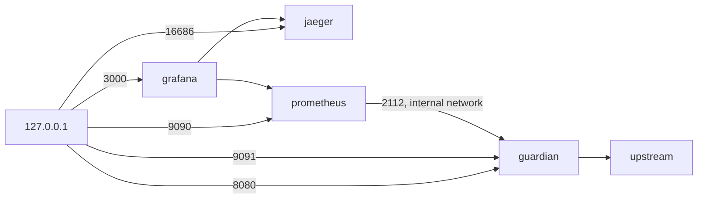

`deploy/compose/config/guardian.yml` is the example YAML with the upstream at `http://upstream:9000` and the `tls` block commented out, so this stack does not open `:8443`. `redis_addr` is still `localhost:6379` and `tracing.endpoint` is `localhost:4318`. Inside the container those addresses are guardian itself. Valkey is the `valkey` service and Jaeger receives OTLP at `jaeger:4318`. With the file as it is, the rate limit uses the in-memory limiter and the spans do not reach Jaeger.

`deploy/compose/.env` is required, copied from `.env.example`. Compose does not start if `GUARDIAN_PASS_KEYS`, `GRAFANA_ADMIN_PASSWORD`, `GUARDIAN_EVENT_SALT`, or `GUARDIAN_ADMIN_TOKEN` are missing. The stack YAML leaves `events.enabled` and `admin.enabled` true, so the salt has to be at least 16 characters and the token at least 32. The example token value has to be changed: with fewer than 32 characters guardian does not start. `.env` is not versioned.

```bash
cd deploy/compose
cp .env.example .env
# GUARDIAN_PASS_KEYS=k1:$(openssl rand -base64 32 | tr -d '\n')
# GUARDIAN_EVENT_SALT=$(openssl rand -hex 32)
# GUARDIAN_ADMIN_TOKEN=$(openssl rand -hex 32)
docker compose up --build
```

The `demo` profile hits three requests every 0.3 seconds: `Mozilla/5.0` to `/api/prices`, `curl` with no other user-agent to `/api/prices`, and `Mozilla/5.0` to `/`.

```bash
docker compose --profile demo up --build
```

Grafana provisions Prometheus as the default datasource and Jaeger at `http://jaeger:16686`. The dashboard `guardian · overview` (`uid` `guardian-overview`) refreshes every 10 seconds and looks at the last 30 minutes: requests by route, 5xx ratio, p50/p95/p99 latency, decisions by type, mode, and shadow, blocks that would have happened in shadow, the five most frequent signals, fail-open by reason, requests in flight, events queued against dropped, batches per second with their average size, and retries against lost events. The UI cannot delete or edit that dashboard.

### Floci

The `aws` profile adds Floci `2.4.0` and an init that creates the queue and the stream `guardian-events`. Floci listens at `127.0.0.1:4566` and, inside the network, at `http://floci:4566`. It does not mount the Docker socket: SQS and Kinesis run inside the process, and the notice that Docker is not available is the expected behavior. The init uses the image `amazon/aws-cli:2.40.3`, the region `us-east-1`, and the credentials `test` / `test`.

`deploy/compose/config/guardian.yml` stays on sink `log`. To send events to Floci, overlay `docker-compose.aws.yml`, which starts guardian with `config/guardian.sqs.yml` or, with `GUARDIAN_EVENTS_SINK=kinesis`, `guardian.kinesis.yml`. Both point Valkey at `valkey:6379` and traces at `jaeger:4318`. `guardian.sqs.yml` leaves `ja4.source` at `cloudfront` and turns `reputation` on. `guardian.kinesis.yml` leaves `ja4.source` at `none`. The SQS queue is `http://floci:4566/000000000000/guardian-events`. The `aws` profile is required: `floci` and `aws-init` live there, and guardian waits until the init finishes well.

The same override starts `cmd/aggregator`. It always reads `config/guardian.sqs.yml`, waits for a healthy Valkey and for the init, and publishes no ports. It runs read-only, with no capabilities and with `no-new-privileges`. With `GUARDIAN_EVENTS_SINK=kinesis`, guardian writes to the stream and the aggregator keeps reading the SQS queue.

### Local Kafka

`docker-compose.kafka.yml` does not use the `aws` profile. It starts Apache Kafka `4.4.0` in KRaft, a single process that is broker and controller, with no ZooKeeper and no authentication. Containers see it at `kafka:9092`. The laptop sees it at `127.0.0.1:9094`. The controller listener stays on `:9093` and is not published. `kafka-init` creates the topic `guardian-events` with 6 partitions, replication factor 1, and one day of retention. The broker does not create topics on its own.

Guardian and the aggregator read `config/guardian.kafka.yml`. That file turns reputation on with weight 50, leaves `ja4.source` at `cloudfront`, and points Valkey at `valkey:6379` and traces at `jaeger:4318`. `trusted_proxies` add `172.16.0.0/12` and `192.168.65.0/24` to the loopback. The sink is `kafka`, the broker is `kafka:9092`, the key is `ip_hash`, and the group is `guardian-aggregator`.

```bash
cd deploy/compose
docker compose -f docker-compose.yml -f docker-compose.kafka.yml up -d --build
```

```bash
cd deploy/compose
docker compose --profile aws -f docker-compose.yml -f docker-compose.aws.yml up -d --build --force-recreate guardian
GUARDIAN_EVENTS_SINK=kinesis docker compose --profile aws -f docker-compose.yml -f docker-compose.aws.yml up -d --force-recreate guardian
```

To look at the queue and the stream without installing the AWS CLI, this function runs the CLI inside the Compose network. It lasts only for that terminal session:

```bash
awsl() { docker compose --profile aws run --rm -T --no-deps --entrypoint aws aws-init --endpoint-url http://floci:4566 "$@"; }
awsl sqs list-queues
awsl kinesis list-streams
```

### Load

`docker-compose.load.yml` and `config/guardian.load.yml` measure the `allow` path, not the rate limit. The YAML points Valkey at `valkey:6379`, leaves `rate` and `burst` at 100000, turns events off, and samples 1% of the traces. The `request` log stays at Info. `admin.enabled` stays true, so the base compose `.env` is still required.

There are two apps and there is no `default_app`. k6 sends `Host: shop.local`. A `Host` of `127.0.0.1` receives `421`. `shop` inherits `enforce`. `api.local` is in `monitor` and these scripts do not call it. The load is HTTP, so `ja4.source: tls` does not compute a JA4. The browser brings a Chrome `User-Agent` and the `Accept` headers, and the threshold leaves it at `200`. `curl/8.5.0` adds `ua_herramienta` (90) and, with a block threshold of 85, receives `403`.

k6 is the image `grafana/k6:2.4.0` and it only starts with the `load` profile. Inside the network it uses `http://guardian:8080` and `http://upstream:9000`. `load.js` holds 100 browsers and 40 bots per second. The duration comes from `DURATION` and, if it is absent, it is 45 seconds. Compose passes it to the container: `DURATION=90s docker compose ... run --rm k6`. Each request carries the tag `kind:browser` or `kind:bot`. k6 counts a `4xx` as a failure; the bot declares `403` as an expected status, so that `403` does not break the threshold. The browser p95 has to stay under 500 ms. That number includes the upstream. `upstream.js` repeats only the 100 per second against the upstream directly. They are run separately. The overhead is the p99 of `http_req_duration{kind:browser}` minus the upstream p99. `--summary-trend-stats` shows p99 and the maximum. The measured numbers and the before and after of the pool are in [docs/perf.en.md](docs/perf.en.md).

`guardian.load.yml` leaves `admin.mutex_profile_fraction` at 5 and `admin.block_profile_rate` at `1ms`. The rest of the YAML files leave them at 0. The load override also accepts `GODEBUG` on the guardian service. Empty does not change the runtime.

```bash
cd deploy/compose
docker compose -f docker-compose.yml -f docker-compose.load.yml up -d --build
docker compose -f docker-compose.yml -f docker-compose.load.yml --profile load run --rm k6 \
  run --summary-trend-stats="avg,med,p(95),p(99),max" /scripts/load.js
docker compose -f docker-compose.yml -f docker-compose.load.yml --profile load run --rm k6 \
  run --summary-trend-stats="avg,med,p(95),p(99),max" /scripts/upstream.js
```

With k6 installed on the laptop, the same scripts use the published ports:

```bash
BASE_URL=http://127.0.0.1:8080 HOST=shop.local k6 run scripts/k6/load.js
UPSTREAM_URL=http://127.0.0.1:9000 HOST=shop.local k6 run scripts/k6/upstream.js
```

With the load running, from the repository root:

```bash
export GUARDIAN_ADMIN_TOKEN="$(grep GUARDIAN_ADMIN_TOKEN deploy/compose/.env | cut -d= -f2)"
./scripts/pprof-capture.sh
```

`scripts/pprof-capture.sh` asks `:9091` for a snapshot of `allocs`, `mutex`, and `block`, then the CPU profile (30 seconds, `CPU_SECONDS`) and the trace (5 seconds, `TRACE_SECONDS`), and then `allocs`, `heap`, `goroutine`, `mutex`, and `block` again. It leaves them in `prof-<date>/`. That directory is not versioned. `ADMIN_URL` defaults to `http://127.0.0.1:9091`.

`deploy/compose/prometheus/alerts.yml` defines five alerts for the `guardian` job:

| Alert | Condition | For | Severity |
| --- | --- | --- | --- |
| `GuardianDown` | `up == 0` | 1 minute | `critical` |
| `GuardianHighErrorRate` | more than 5% of the requests in 5xx for the same `app` | 5 minutes | `critical` |
| `GuardianHighLatencyP99` | p99 above 500 ms | 10 minutes | `warning` |
| `GuardianFailOpen` | any `guardian_fail_open_total` in the 5-minute window | 2 minutes | `warning` |
| `GuardianConfigReloadFailing` | `guardian_config_last_reload_successful == 0` | 5 minutes | `warning` |

`alerts_test.yml` is the `promtool` test and Prometheus does not load it. It is run from `deploy/compose/prometheus`:

```bash
docker run --rm -v "$PWD":/work -w /work prom/prometheus:v3.16.0 promtool test rules alerts_test.yml
```
