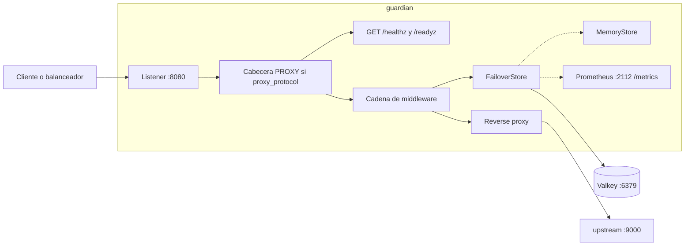
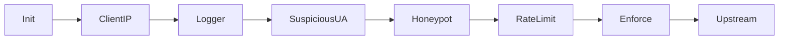
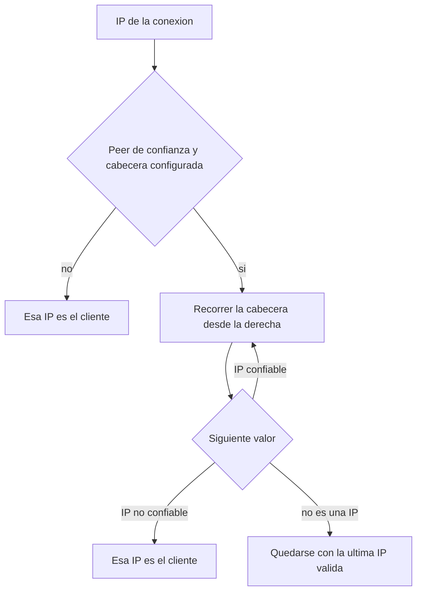
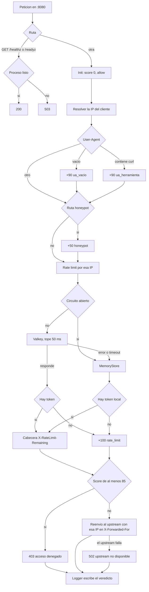
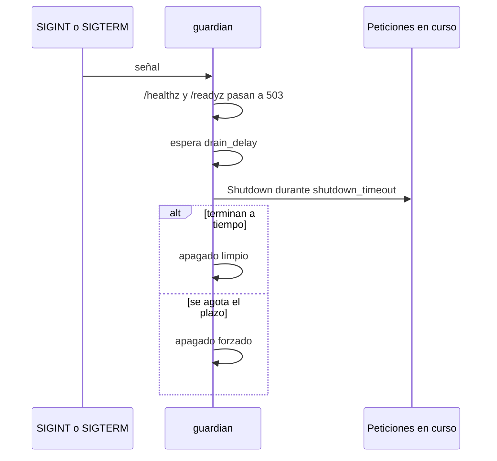

# guardian-scrapy


 

Proxy inverso en Go. Resuelve la IP del cliente, puntúa cada petición y la reenvía al upstream si el veredicto no llega al umbral de bloqueo. El límite de tasa vive en Valkey y, si Valkey no responde, pasa a un limitador en memoria.

## Arquitectura

`guardian` escucha en `:8080`. Con `proxy_protocol` activo, el listener solo acepta conexiones de `trusted_proxies` y les exige la cabecera PROXY; el plazo para leerla es de 2 segundos. Las rutas de salud salen antes de la cadena de middleware. El resto entra en la cadena y, si el veredicto lo permite, el reverse proxy habla con el upstream. Las métricas de Prometheus van en otro puerto.



La cadena se ejecuta en este orden. `Logger` envuelve al resto y escribe el veredicto al volver.



| Pieza | Paquete | Qué hace |
| --- | --- | --- |
| Proxy y servidores | `cmd/guardian` | YAML, listener, PROXY protocol, métricas, Valkey y apagado |
| Upstream de prueba | `cmd/upstream` | Respuesta en texto. `/lento` espera 10 segundos |
| Configuración | `internal/config` | Carga y validación del YAML |
| IP del cliente | `internal/clientip` | Elige la IP real a partir del peer y de la cabecera configurada |
| Middleware | `internal/middleware` | IP, puntuación, honeypots, límite y bloqueo |
| Veredicto | `internal/verdict` | IP, score, motivos y decisión de la petición |
| Límite de tasa | `internal/ratelimit` | Token bucket en Valkey, memoria y failover |

### IP del cliente

`ClientIP` guarda la IP en el veredicto. El límite de tasa usa esa IP, el log la incluye y el proxy la escribe en el `X-Forwarded-For` que ve el upstream.

Si el peer no está en `trusted_proxies`, o si `x_forwarded_for_header` está vacío, la IP es la de la conexión. Un cliente directo no puede falsificar la cabecera. Si el peer es de confianza, la cabecera se recorre de derecha a izquierda y la IP del cliente es la primera que no pertenece a `trusted_proxies`. Un valor que no es una IP corta el recorrido.



Con `proxy_protocol` activo, la IP de la conexión es la que trae la cabecera PROXY, no la del socket. Solo se acepta si el peer está en `trusted_proxies`; cualquier otro origen se rechaza.

## Flujo de una petición

`Init` deja el veredicto en `allow` con score 0. Cada señal suma puntos. `Enforce` corta la cadena cuando el score llega a 85 y responde `403` con el cuerpo `acceso denegado`.

| Señal | Puntos | Motivo |
| --- | --- | --- |
| `User-Agent` vacío | 90 | `ua_vacio` |
| `User-Agent` que contiene `curl` | 90 | `ua_herramienta` |
| Ruta listada en `honeypot_paths` | 50 | `honeypot` |
| Límite de tasa superado | 100 | `rate_limit` |

Un honeypot solo no bloquea: 50 está por debajo de 85. El `User-Agent` de `curl` y un límite superado sí bloquean por sí solos.



Valkey guarda el bucket en `gd:<app>:{ip}:tokens` y `gd:<app>:{ip}:ts`. Si Valkey falla, la petición se resuelve en memoria. Tras 5 fallos seguidos el circuito queda abierto 10 segundos y todas las decisiones salen del limitador local. Esos saltos incrementan `guardian_fail_open_total` con el motivo `timeout`, `error` o `circuit_open`.

El log de cada petición que entra en la cadena es JSON en stdout: `client_ip`, método, ruta, score, decisión, motivos y duración.

## Qué hay

```
cmd/guardian/                 binario del proxy
cmd/upstream/                 binario de prueba
internal/clientip/            resolución de la IP del cliente
internal/config/              carga y validación del YAML
internal/middleware/          cadena, señales y bloqueo
internal/ratelimit/           Valkey, memoria y failover
internal/verdict/             IP, score y decisión
guardian-config.yml
```

## Requisitos

- Go 1.27 o superior
- Docker, para el Valkey local

## Configuración

`guardian` lee `guardian-config.yml` por defecto. Otra ruta se pasa con `-config`.

```yaml
listen: ":8080"
upstream: "http://localhost:9000"
read_header_timeout: 5s
read_timeout: 20s
write_timeout: 20s
idle_timeout: 10s
shutdown_timeout: 20s
drain_delay: 5s
preserve_host: true
honeypot_paths:
  - "/robots.txt"
  - "/favicon.ico"
  - "/admin-oculto"
app: "shop"
redis_addr: "localhost:6379"
rate: 1
burst: 2
trusted_proxies:
  - "10.0.0.0/8"
  - "::1/128"
  - "127.0.0.0/8"
x_forwarded_for_header: "X-Forwarded-For"
proxy_protocol: true
```

| Campo | Obligatorio | Por defecto | Descripción |
| --- | --- | --- | --- |
| `listen` | no | `:8080` | Dirección en la que escucha el proxy |
| `upstream` | sí | — | URL completa del destino (`http://host:puerto`) |
| `read_header_timeout` | no | `5s` | Tiempo máximo para leer las cabeceras del cliente. Tiene que ser mayor que 0 |
| `read_timeout` | no | `10s` | Tiempo máximo para leer la petición completa |
| `write_timeout` | no | `10s` | Tiempo máximo para escribir la respuesta. No puede superar `shutdown_timeout` |
| `idle_timeout` | no | `10s` | Espera de la siguiente petición en una conexión keep-alive |
| `shutdown_timeout` | no | `10s` | Tiempo máximo del apagado para terminar las peticiones en curso |
| `drain_delay` | no | `10s` | Espera tras dejar de estar listo y antes de cerrar el servidor |
| `preserve_host` | no | `false` | Si es `true`, el `Host` que ve el upstream es el del cliente |
| `honeypot_paths` | no | vacío | Rutas que suman 50 puntos |
| `app` | no | `shop` | Prefijo de las claves del bucket en Valkey |
| `redis_addr` | no | `localhost:6379` | Dirección de Valkey |
| `rate` | no | `1` | Tokens por segundo. Tiene que ser mayor que 0 |
| `burst` | no | `10` | Capacidad del bucket. Tiene que ser mayor que 0 |
| `trusted_proxies` | no | vacío | CIDR que pueden informar la IP del cliente |
| `x_forwarded_for_header` | no | vacío | Cabecera que se recorre cuando el peer es de confianza |
| `proxy_protocol` | no | `false` | Exige la cabecera PROXY a `trusted_proxies` y rechaza el resto |

Campos desconocidos en el YAML hacen fallar el arranque. `upstream` tiene que ser una URL con esquema y host. Cada entrada de `trusted_proxies` tiene que ser un CIDR válido.

La carga también rechaza la configuración cuando:

- `shutdown_timeout` + `drain_delay` es mayor o igual a 30 segundos.
- `write_timeout` es mayor que `shutdown_timeout`.

La variable de entorno `GUARDIAN_UPSTREAM` sustituye el valor de `upstream` del archivo.

## Salud y apagado

`GET /healthz` y `GET /readyz` responden `200` mientras el proceso está listo. No pasan por la cadena de middleware.



El limitador en memoria limpia cada minuto las claves que ya recuperaron el burst completo. Esa limpieza se detiene con la misma señal.

`GET /metrics` en `:2112` expone las métricas de Prometheus, incluido `guardian_fail_open_total`.

## Ejecutar

Valkey, en segundo plano y publicado en el puerto `6379`:

```bash
docker run -d --name valkey -p 6379:6379 valkey/valkey:8
```

En una terminal, el upstream de prueba:

```bash
go run ./cmd/upstream
```

En otra, el proxy:

```bash
go run ./cmd/guardian
# go run ./cmd/guardian -config /ruta/guardian-config.yml
```

El `guardian-config.yml` del repositorio deja `proxy_protocol` en `true` y trata a `127.0.0.0/8` como proxy de confianza. Un `curl` directo a localhost no envía la cabecera PROXY, así que el listener rechaza la conexión. Para estas pruebas locales, pon `proxy_protocol: false`.

`curl` sin otro `User-Agent` suma 90 puntos y recibe `403`:

```bash
curl -s -D - http://localhost:8080/salud
```

Con un `User-Agent` de navegador la petición sigue hacia el upstream. El YAML de ejemplo permite una ráfaga de 2; la tercera seguida suma `rate_limit` y también responde `403`. Desde localhost, y sin una cabecera reenviada por un proxy de confianza, la IP limitada es `127.0.0.1`.

```bash
curl -s -A "Mozilla/5.0" http://localhost:8080/salud
curl -s -D - -o /dev/null -A "Mozilla/5.0" http://localhost:8080/salud
curl -s -o /dev/null -w "%{http_code}\n" http://localhost:8080/healthz
curl -s http://localhost:2112/metrics
```

La respuesta reenviada incluye la ruta, el `Host`, `X-Forwarded-Host` y `X-Forwarded-Proto`. `X-Forwarded-For` lleva la IP resuelta del cliente. Si el upstream no responde, el proxy devuelve `502` con el cuerpo `upstream no disponible`.

`/lento` sirve para ver el efecto de los timeouts: el upstream espera 10 segundos antes de escribir la respuesta.

```bash
curl -s -A "Mozilla/5.0" http://localhost:8080/lento
```
