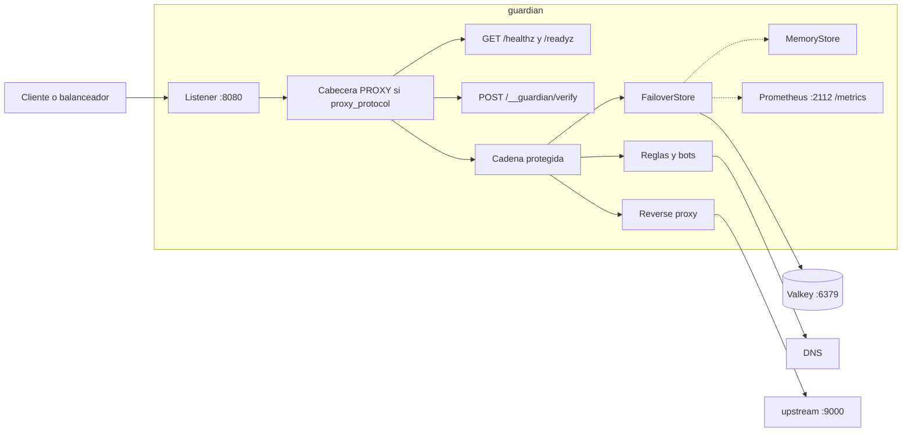
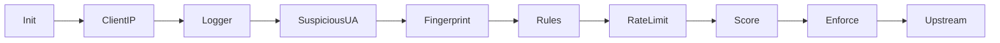
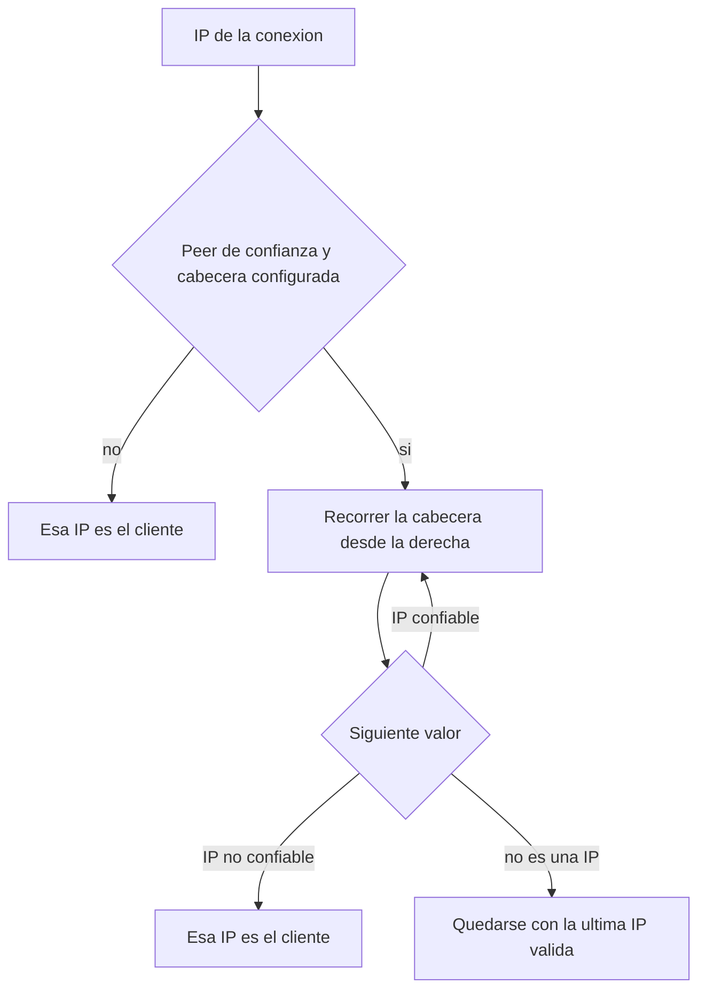
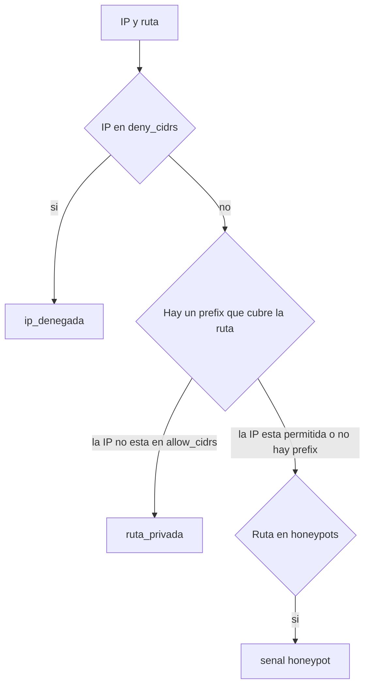
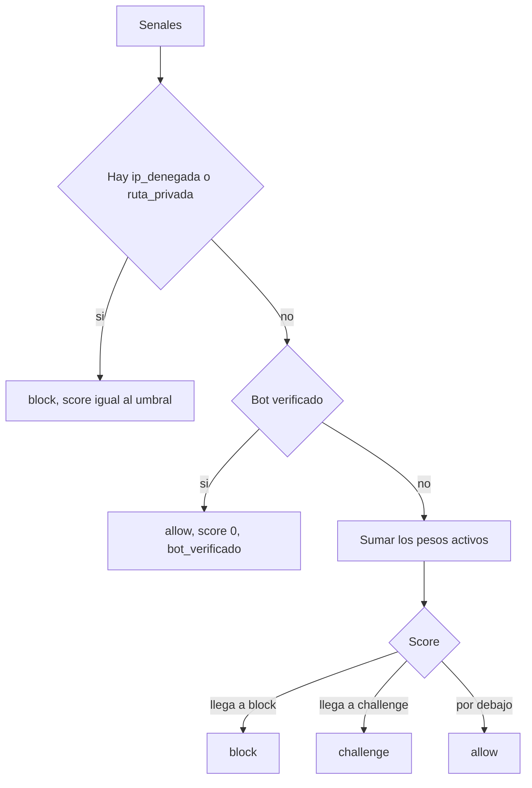
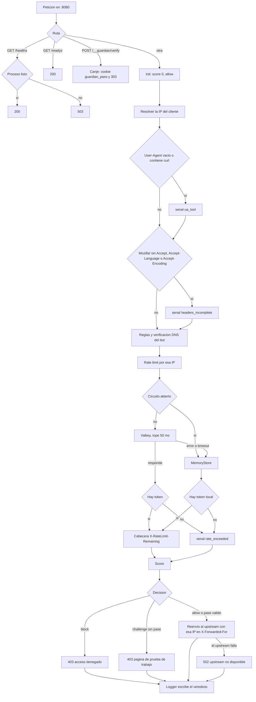
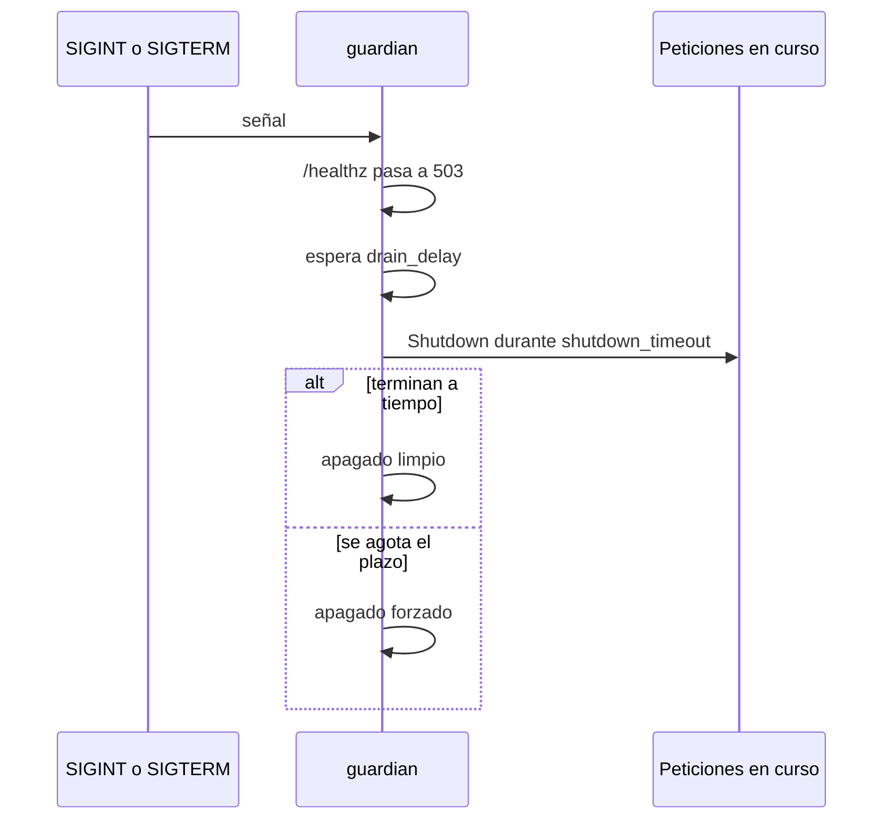

# guardian-scrapy


 

Proxy inverso en Go. Resuelve la IP del cliente, junta señales de la petición y las convierte en `allow`, `challenge` o `block`. `block` responde `403`. `challenge` pide una prueba de trabajo y, si sale bien, deja una cookie de pase. El límite de tasa vive en Valkey y, si Valkey no responde, pasa a un limitador en memoria.

## Arquitectura

`guardian` escucha en `:8080`. Con `proxy_protocol` activo, el listener solo acepta conexiones de `trusted_proxies` y les exige la cabecera PROXY; el plazo para leerla es de 2 segundos. `GET /healthz`, `GET /readyz` y `POST /__guardian/verify` salen antes de la cadena protegida. El resto entra en esa cadena. `allow`, y `challenge` con un pase válido, siguen al upstream. Las métricas de Prometheus van en otro puerto.



La cadena se ejecuta en este orden. `Logger` envuelve al resto y escribe el veredicto al volver. Hasta `Score`, los middleware solo marcan señales. El puntaje y la decisión salen de `Score`.



| Pieza | Paquete | Qué hace |
| --- | --- | --- |
| Proxy y servidores | `cmd/guardian` | YAML, listener, PROXY protocol, métricas, Valkey y apagado |
| Upstream de prueba | `cmd/upstream` | Respuesta en texto. `/lento` espera 10 segundos |
| Configuración | `internal/config` | Carga y validación del YAML |
| IP del cliente | `internal/clientip` | Elige la IP real a partir del peer y de la cabecera configurada |
| Huella | `internal/fingerprint` | Resume las cabeceras y detecta las que faltan en un navegador |
| Reglas | `internal/rules` | Honeypots, CIDR denegados y rutas con allowlist |
| Bots | `internal/goodbot` | Comprueba por DNS los user-agent que dicen ser un bot conocido |
| Puntaje | `internal/scoring` | Convierte las señales en score y decisión |
| Desafío | `internal/challenge` | Prueba de trabajo, tokens HMAC y pase firmado |
| Middleware | `internal/middleware` | Cadena, señales, página de desafío y corte en `block` |
| Veredicto | `internal/verdict` | IP, huella, señales, score y decisión |
| Límite de tasa | `internal/ratelimit` | Token bucket en Valkey, memoria y failover |

### IP del cliente

`ClientIP` guarda la IP en el veredicto. El límite de tasa, las reglas y la verificación de bots usan esa IP. El log la incluye y el proxy la escribe en el `X-Forwarded-For` que ve el upstream.

Si el peer no está en `trusted_proxies`, o si `x_forwarded_for_header` está vacío, la IP es la de la conexión. Un cliente directo no puede falsificar la cabecera. Si el peer es de confianza, la cabecera se recorre de derecha a izquierda y la IP del cliente es la primera que no pertenece a `trusted_proxies`. Un valor que no es una IP corta el recorrido.



Con `proxy_protocol` activo, la IP de la conexión es la que trae la cabecera PROXY, no la del socket. Solo se acepta si el peer está en `trusted_proxies`; cualquier otro origen se rechaza.

### Huella de cabeceras

`Fingerprint` guarda en el veredicto los primeros 16 caracteres hexadecimales de un SHA-256. El texto que se resume lleva, en este orden, el valor normalizado de `User-Agent`, `Accept`, `Accept-Language`, `Accept-Encoding`, `Sec-Ch-Ua` y `Sec-Ch-Ua-Platform`, y después la lista ordenada de nombres de cabecera. La normalización pasa el valor a minúsculas y colapsa los espacios.

Estas cabeceras no entran en la lista de nombres, así que cambiarlas no cambia la huella: `Cookie`, `Content-Length`, `Content-Type`, `Referer`, `Authorization`, `Cache-Control`, `Pragma`, `If-None-Match`, `If-Modified-Since`, `X-Forwarded-For`, `X-Forwarded-Proto`, `X-Forwarded-Host`, `Forwarded`, `X-Amzn-Trace-Id`, `Origin`, `Sec-Fetch-User` y `Sec-Fetch-Site`.

Si el `User-Agent` contiene `Mozilla/` y falta `Accept`, `Accept-Language` o `Accept-Encoding`, queda marcada la señal de cabeceras incompletas. La comparación busca ese texto tal cual, con la `M` mayúscula.

### Reglas y bots

`Rules` marca el honeypot cuando la ruta está en `rules.honeypots`. La comparación es exacta. También puede dejar un motivo de denegación:

- `ip_denegada`, si la IP está en `rules.deny_cidrs`.
- `ruta_privada`, si la ruta empieza por el `prefix` de una entrada de `rules.routes` y la IP no está en su `allow_cidrs`.



Si el `User-Agent` contiene el `ua_contains` de un bot de `good_bots`, el proxy hace una comprobación DNS con un tope de 300 ms. El resultado de una consulta terminada se guarda una hora por IP y nombre de bot.

1. DNS inverso de la IP del cliente.
2. El nombre tiene que ser uno de `domains` o un subdominio suyo.
3. El DNS directo de ese nombre tiene que devolver la misma IP.

Si las tres cosas cierran, la señal es bot verificado. Si el user-agent reclama el bot y la comprobación no cierra, o si el DNS falla, la señal es bot falso.

### Puntaje

`Score` lee las señales y escribe score, motivos y decisión.



Con el YAML de ejemplo los pesos y los umbrales son estos:

| Señal | Peso | Motivo | Decisión si actúa sola |
| --- | --- | --- | --- |
| User-Agent vacío o que contiene `curl` | 90 | `ua_herramienta` | `block` |
| Bot reclamado y no verificado | 90 | `bot_falso` | `block` |
| Cabeceras de navegador incompletas | 30 | `headers_incompletos` | `allow` |
| Ruta en `rules.honeypots` | 50 | `honeypot` | `challenge` |
| Límite de tasa superado | 100 | `rate_limit` | `block` |
| Ratio de navegador por debajo de `browser_ratio_min` | 15 | `ratio_navegador_bajo` | `allow` |

`ip_denegada` y `ruta_privada` no suman un peso: el score queda en el umbral de `block` y la decisión es `block`, también si el bot estaba verificado. Un bot verificado, sin esas denegaciones, queda en `allow` con score 0 aunque haya visitado un honeypot.

`Enforce` responde `403` con el cuerpo `acceso denegado` cuando la decisión es `block`. Un pase no cambia ese resultado.

Cuando la decisión es `challenge`, busca la cookie `guardian_pass`. Si el pase está firmado, vigente y atado a la misma IP y a la misma huella, agrega el motivo `pase_valido` y sigue al upstream. Si no hay pase, responde `403` con una página HTML que resuelve en el navegador una prueba de trabajo SHA-256: busca un nonce cuyo hash de `semilla + nonce` tenga al menos `challenge.difficulty` bits en cero a la izquierda.

El formulario hace `POST /__guardian/verify` con el token, el nonce y la ruta de vuelta. Esa ruta pasa por `Init`, `ClientIP`, `Logger` y `Fingerprint`. El canje exige un POST; otro método responde `405`. El token tiene que estar firmado, dentro de `challenge.ttl`, atado a la IP y a la huella de esa petición, y el nonce no puede pasar de 20 caracteres. Si la prueba cierra, el proxy deja la cookie y responde `303` hacia `next`. `next` tiene que ser una ruta relativa que empiece por `/`. Una URL absoluta, `//...` o un valor que no es una ruta vuelve a `/`.

La cookie es `HttpOnly`, `SameSite=Lax`, con `Path=/` y `Max-Age` igual a `challenge.pass_ttl`. Lleva `Secure` cuando la petición llega por TLS. El pase queda atado a la IP y a la huella, así que otra IP o unas cabeceras distintas no lo reutilizan.

Los tokens los firma la primera llave de `GUARDIAN_PASS_KEYS`. El formato es `kid:base64` y, para rotar, `kidNuevo:base64,kidAnterior:base64`: la primera firma y el resto solo verifica. Cada llave, ya decodificada, mide al menos 32 bytes. El `kid` no puede llevar puntos. Sin esa variable el proceso no arranca.

La cadena no asigna la señal de ratio de navegador. El peso `low_browser_ratio` se aplica cuando esa señal viene informada y está por debajo de `browser_ratio_min`.

## Flujo de una petición



Valkey guarda el bucket en `gd:<app>:{ip}:tokens` y `gd:<app>:{ip}:ts`. Si Valkey falla, la petición se resuelve en memoria. Tras 5 fallos seguidos el circuito queda abierto 10 segundos y todas las decisiones salen del limitador local. Esos saltos incrementan `guardian_fail_open_total` con el motivo `timeout`, `error` o `circuit_open`.

El log de cada petición que entra en la cadena es JSON en stdout: `client_ip`, `fingerprint`, método, ruta, score, decisión, motivos y duración.

## Qué hay

```
cmd/guardian/                 binario del proxy
cmd/upstream/                 binario de prueba
internal/challenge/           prueba de trabajo, tokens y pase
internal/clientip/            resolución de la IP del cliente
internal/config/              carga y validación del YAML
internal/fingerprint/         huella de cabeceras
internal/goodbot/             verificación DNS de bots conocidos
internal/middleware/          cadena, señales y corte
internal/ratelimit/           Valkey, memoria y failover
internal/rules/               honeypots, denegaciones y rutas
internal/scoring/             pesos, umbrales y decisión
internal/verdict/             IP, huella, señales y decisión
guardian-config.yml
```

## Requisitos

- Go 1.27 o superior
- Docker, para el Valkey local

## Configuración

`guardian` lee `guardian-config.yml` por defecto. Otra ruta se pasa con `-config`.

```yaml
listen: ":8080"
upstream: "http://localhost:9000"
read_header_timeout: 5s
read_timeout: 20s
write_timeout: 20s
idle_timeout: 10s
shutdown_timeout: 20s
drain_delay: 5s
preserve_host: true
honeypot_paths:
  - "/robots.txt"
  - "/favicon.ico"
  - "/admin-oculto"
app: "shop"
redis_addr: "localhost:6379"
rate: 1
burst: 2
trusted_proxies:
  - "10.0.0.0/8"
  - "::1/128"
  - "127.0.0.0/8"
x_forwarded_for_header: "X-Forwarded-For"
proxy_protocol: false
scoring:
  weights:
    ua_tool: 90
    headers_incomplete: 30
    honeypot: 50
    rate_exceeded: 100
    low_browser_ratio: 15
    fake_bot: 90
  browser_ratio_min: 0.3
  thresholds:
    challenge: 40
    block: 85
rules:
  honeypots: ["/admin-oculto", "/wp-login.php", "/.env"]
  deny_cidrs: ["198.51.100.0/24"]
  routes:
    - prefix: /interno
      allow_cidrs: ["10.0.0.0/8", "127.0.0.1/32", "::1/128"]
good_bots:
  - name: googlebot
    ua_contains: Googlebot
    domains: ["googlebot.com", "google.com"]
  - name: bingbot
    ua_contains: bingbot
    domains: ["search.msn.com"]
challenge:
  difficulty: 16
  ttl: 2m
  pass_ttl: 1h
```

| Campo | Obligatorio | Por defecto | Descripción |
| --- | --- | --- | --- |
| `listen` | no | `:8080` | Dirección en la que escucha el proxy |
| `upstream` | sí | — | URL completa del destino (`http://host:puerto`) |
| `read_header_timeout` | no | `5s` | Tiempo máximo para leer las cabeceras del cliente. Tiene que ser mayor que 0 |
| `read_timeout` | no | `10s` | Tiempo máximo para leer la petición completa |
| `write_timeout` | no | `10s` | Tiempo máximo para escribir la respuesta. No puede superar `shutdown_timeout` |
| `idle_timeout` | no | `10s` | Espera de la siguiente petición en una conexión keep-alive |
| `shutdown_timeout` | no | `10s` | Tiempo máximo del apagado para terminar las peticiones en curso |
| `drain_delay` | no | `10s` | Espera tras dejar de estar listo y antes de cerrar el servidor |
| `preserve_host` | no | `false` | Si es `true`, el `Host` que ve el upstream es el del cliente |
| `honeypot_paths` | no | vacío | El YAML lo acepta. Las trampas que puntúan son `rules.honeypots` |
| `app` | no | `shop` | Prefijo de las claves del bucket en Valkey |
| `redis_addr` | no | `localhost:6379` | Dirección de Valkey |
| `rate` | no | `1` | Tokens por segundo. Tiene que ser mayor que 0 |
| `burst` | no | `10` | Capacidad del bucket. Tiene que ser mayor que 0 |
| `trusted_proxies` | no | vacío | CIDR que pueden informar la IP del cliente |
| `x_forwarded_for_header` | no | vacío | Cabecera que se recorre cuando el peer es de confianza |
| `proxy_protocol` | no | `false` | Exige la cabecera PROXY a `trusted_proxies` y rechaza el resto |
| `scoring.weights` | no | 0 | Puntos de cada señal. Un peso 0 no suma |
| `scoring.browser_ratio_min` | no | 0 | Umbral del ratio de navegador, entre 0 y 1 |
| `scoring.thresholds.challenge` | sí | — | A partir de este score la decisión es `challenge`. Tiene que ser mayor que 0 y menor que `block` |
| `scoring.thresholds.block` | sí | — | A partir de este score la decisión es `block` |
| `rules.honeypots` | no | vacío | Rutas exactas que marcan la señal honeypot |
| `rules.deny_cidrs` | no | vacío | CIDR que producen `ip_denegada` |
| `rules.routes` | no | vacío | Prefijos que exigen que la IP esté en `allow_cidrs` |
| `good_bots` | no | vacío | Bots cuyo user-agent se comprueba por DNS |
| `challenge.difficulty` | sí | — | Bits en cero que exige la prueba de trabajo. Tiene que estar entre 8 y 24 |
| `challenge.ttl` | no | `0s` | Vigencia del token del desafío |
| `challenge.pass_ttl` | no | `0s` | Vigencia de la cookie `guardian_pass` |

Campos desconocidos en el YAML hacen fallar el arranque. `upstream` tiene que ser una URL con esquema y host. Cada entrada de `trusted_proxies`, `rules.deny_cidrs` y `allow_cidrs` tiene que ser un CIDR válido. Cada `prefix` de `rules.routes` tiene que empezar por `/`.

La carga también rechaza la configuración cuando:

- `shutdown_timeout` + `drain_delay` es mayor o igual a 30 segundos.
- `write_timeout` es mayor que `shutdown_timeout`.
- `scoring.thresholds.challenge` o `block` no son mayores que 0, o `challenge` no es menor que `block`.
- `scoring.browser_ratio_min` está fuera del intervalo de 0 a 1.
- `challenge.difficulty` está fuera del intervalo de 8 a 24.

`GUARDIAN_UPSTREAM` sustituye el valor de `upstream` del archivo. `GUARDIAN_PASS_KEYS` es obligatoria y trae el llavero con el que se firman el desafío y el pase.

## Salud y apagado

`GET /healthz` y `GET /readyz` no pasan por la cadena protegida. Mientras el proceso está listo, las dos responden `200`. Después de `SIGINT` o `SIGTERM`, `/healthz` responde `503`. `/readyz` no escribe un estado en ese tramo, y la respuesta que completa el servidor sigue siendo `200`.



El limitador en memoria limpia cada minuto las claves que ya recuperaron el burst completo. Esa limpieza se detiene con la misma señal.

`GET /metrics` en `:2112` expone las métricas de Prometheus, incluido `guardian_fail_open_total`.

## Ejecutar

Valkey, en segundo plano y publicado en el puerto `6379`:

```bash
docker run -d --name valkey -p 6379:6379 valkey/valkey:8
```

En una terminal, el upstream de prueba:

```bash
go run ./cmd/upstream
```

En otra, el proxy:

```bash
go run ./cmd/guardian
# go run ./cmd/guardian -config /ruta/guardian-config.yml
```

El `guardian-config.yml` del repositorio deja `proxy_protocol` en `false`, así que estas pruebas aceptan un `curl` directo. Si se activa, el listener exige la cabecera PROXY a `127.0.0.0/8` y rechaza esa misma conexión.

Antes de arrancar el proxy hace falta el llavero. La primera llave firma; se puede dejar una anterior detrás para verificar pases ya emitidos.

```bash
export GUARDIAN_PASS_KEYS="k1:$(openssl rand -base64 32 | tr -d '\n')"
```

`curl` sin otro `User-Agent` marca `ua_herramienta` y recibe `403` con el cuerpo `acceso denegado`:

```bash
curl -s -D - http://localhost:8080/salud
```

Un `User-Agent` con `Mozilla/` y sin `Accept`, `Accept-Language` ni `Accept-Encoding` suma 30 puntos y sigue hacia el upstream. Con esas tres cabeceras el score queda en 0. El YAML de ejemplo permite una ráfaga de 2; la tercera seguida suma `rate_limit` y responde `403`. Desde localhost, y sin una cabecera reenviada por un proxy de confianza, la IP limitada es `127.0.0.1`.

`/admin-oculto` suma 50 puntos. La decisión es `challenge`: sin la cookie `guardian_pass` la respuesta es `403` y el HTML de la prueba de trabajo. `curl` no ejecuta ese JavaScript. `/interno` desde una IP fuera de `10.0.0.0/8`, `127.0.0.1` y `::1` responde `403` por `ruta_privada`.

```bash
curl -s -A "Mozilla/5.0" -H "Accept: text/html" -H "Accept-Language: es" -H "Accept-Encoding: gzip" http://localhost:8080/salud
curl -s -D - -o /dev/null -A "Mozilla/5.0" -H "Accept: text/html" -H "Accept-Language: es" -H "Accept-Encoding: gzip" http://localhost:8080/admin-oculto
curl -s -o /dev/null -w "%{http_code}\n" http://localhost:8080/healthz
curl -s -o /dev/null -w "%{http_code}\n" http://localhost:8080/readyz
curl -s http://localhost:2112/metrics
```

La respuesta reenviada incluye la ruta, el `Host`, `X-Forwarded-Host` y `X-Forwarded-Proto`. `X-Forwarded-For` lleva la IP resuelta del cliente. Si el upstream no responde, el proxy devuelve `502` con el cuerpo `upstream no disponible`.

`/lento` sirve para ver el efecto de los timeouts: el upstream espera 10 segundos antes de escribir la respuesta.

```bash
curl -s -A "Mozilla/5.0" -H "Accept: text/html" -H "Accept-Language: es" -H "Accept-Encoding: gzip" http://localhost:8080/lento
```
