# Guardian - Enterprise Anti-scraping reverse proxy


 

Proxy inverso en Go. Resuelve la IP del cliente, junta señales de la petición y las convierte en `allow`, `challenge` o `block`. En modo `enforce`, `block` responde `403` y `challenge` pide una prueba de trabajo. En modo `monitor`, esa misma decisión queda en el log y la petición sigue. Si el bloque `tls` está presente, también escucha HTTPS y guarda el ClientHello. El límite de tasa vive en Valkey y, si Valkey no responde, pasa a un limitador en memoria.

## Arquitectura

`guardian` escucha HTTP en `:8080`. Con el bloque `tls` del ejemplo, también escucha HTTPS en `:8443`. Con `proxy_protocol` activo, cada listener solo acepta conexiones de `trusted_proxies` y les exige la cabecera PROXY; el plazo para leerla es de 2 segundos. En HTTPS el orden es TCP, cabecera PROXY si aplica, captura del ClientHello y luego TLS 1.2 como mínimo. `GET /healthz`, `GET /readyz` y `POST /__guardian/verify` salen antes de la cadena protegida. El resto entra en esa cadena. `allow`, y `challenge` con un pase válido, siguen al upstream. Las métricas de Prometheus van en otro puerto. Con `tracing.enabled`, los spans de la cadena protegida salen por OTLP/HTTP.

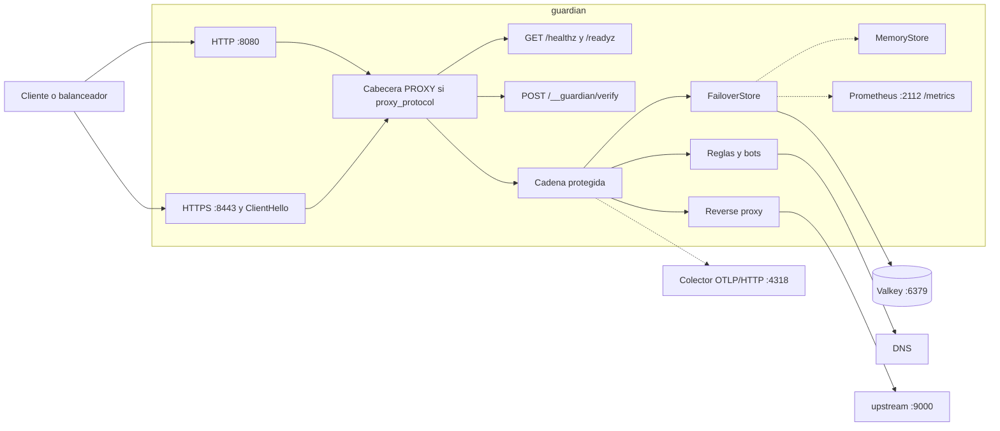

La cadena se ejecuta en este orden. `ConfigVersion` deja en el veredicto el hash del archivo con el que se armó esta cadena. `Metrics` mide la petición al volver del resto. `Events` emite el veredicto ya cerrado, también al volver. `Trace` abre el span raíz, copia su `trace_id` al veredicto y lo cierra cuando la respuesta ya salió. `Logger` envuelve lo que sigue y escribe el veredicto al volver. Hasta `Score`, los middleware solo marcan señales. El puntaje y la decisión salen de `Score`.

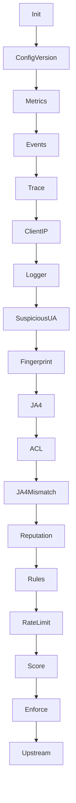

| Pieza | Paquete | Qué hace |
| --- | --- | --- |
| Proxy y servidores | `cmd/guardian` | YAML con recarga en caliente, HTTP, HTTPS, PROXY protocol, métricas, trazas, Valkey y apagado |
| Agregador | `cmd/aggregator` | Lee SQS o Kafka, cuenta IPs distintas por JA4 y marca la reputación en Valkey |
| Reputación | `internal/reputation` | HyperLogLog por JA4 y la marca que el proxy consulta |
| ACL | `internal/acl` | Bloqueos y allowlist de la Admin API en Valkey, con caché local |
| Admin API | `internal/admin` | HTTP interno con token para escribir la ACL y pedir una recarga |
| ClientHello | `internal/tlshello` | Foto del saludo TLS, JA4 y una línea `tls_hello` por conexión |
| Upstream de prueba | `cmd/upstream` | Respuesta en texto. `/lento` espera 10 segundos |
| Configuración | `internal/config` | Parseo, validación y la lista de campos que se pueden recargar |
| Fuente de config | `internal/configsource` | Lee el archivo, vigila el directorio y publica un snapshot inmutable por recarga |
| IP del cliente | `internal/clientip` | Elige la IP real a partir del peer y de la cabecera configurada |
| Huella | `internal/fingerprint` | Resume las cabeceras y compara el JA4 con herramientas conocidas |
| Origen del JA4 | `internal/ja4source` | Elige el JA4 del ClientHello, de CloudFront o de ninguno |
| Reglas | `internal/rules` | Honeypots, CIDR denegados y rutas con allowlist |
| Bots | `internal/goodbot` | Comprueba por DNS los user-agent que dicen ser un bot conocido |
| Puntaje | `internal/scoring` | Convierte las señales en score y decisión |
| Desafío | `internal/challenge` | Prueba de trabajo, tokens HMAC y pase firmado |
| Modos | `internal/policy` | Elige `monitor` o `enforce` según el prefijo más largo y ese prefijo es el label `route` |
| Middleware | `internal/middleware` | Cadena, señales, página de desafío y corte en `block` |
| Métricas | `internal/metrics` | Contadores, histograma y gauge de la cadena protegida |
| Trazas | `internal/tracing` | Exporter OTLP/HTTP, muestreo y `Traceparent` hacia el upstream |
| Eventos | `internal/events` | Veredicto hacia log, SQS, Kinesis o Kafka, con la IP en HMAC y un buffer que descarta si se llena |
| Veredicto | `internal/verdict` | IP, huella, señales, score, decisión, `trace_id` y `config_version` |
| Límite de tasa | `internal/ratelimit` | Token bucket en Valkey, memoria y failover |

### IP del cliente

`ClientIP` guarda la IP en el veredicto. El límite de tasa, las reglas y la verificación de bots usan esa IP. El log la incluye y el proxy la escribe en el `X-Forwarded-For` que ve el upstream.

Si el peer no está en `trusted_proxies`, o si `x_forwarded_for_header` está vacío, la IP es la de la conexión. Un cliente directo no puede falsificar la cabecera. Si el peer es de confianza, la cabecera se recorre de derecha a izquierda y la IP del cliente es la primera que no pertenece a `trusted_proxies`. Un valor que no es una IP corta el recorrido.

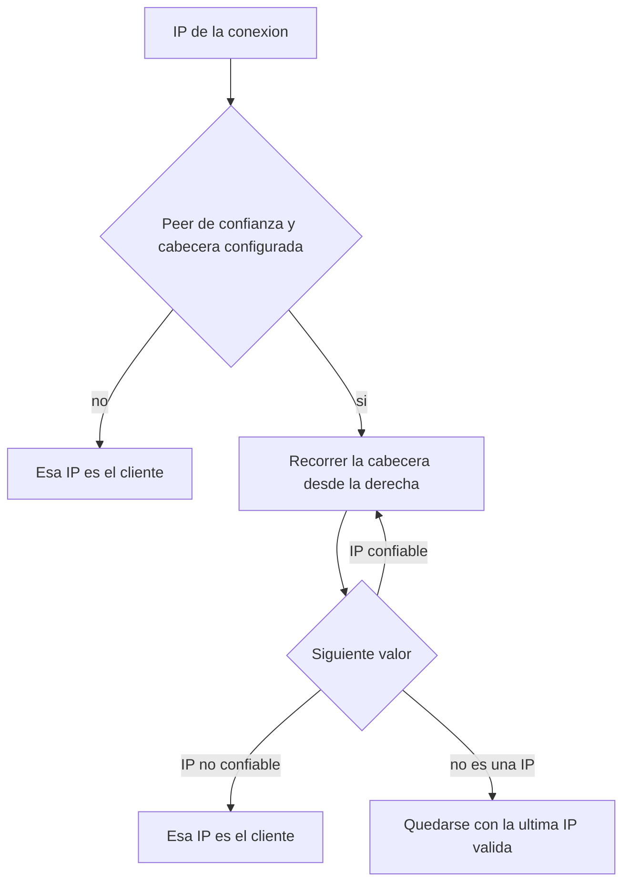

Con `proxy_protocol` activo, la IP de la conexión es la que trae la cabecera PROXY, no la del socket. Solo se acepta si el peer está en `trusted_proxies`; cualquier otro origen se rechaza.

### Huella de cabeceras

`Fingerprint` guarda en el veredicto los primeros 16 caracteres hexadecimales de un SHA-256. El texto que se resume lleva, en este orden, el valor normalizado de `User-Agent`, `Accept`, `Accept-Language`, `Accept-Encoding`, `Sec-Ch-Ua` y `Sec-Ch-Ua-Platform`, y después la lista ordenada de nombres de cabecera. La normalización pasa el valor a minúsculas y colapsa los espacios.

Estas cabeceras no entran en la lista de nombres, así que cambiarlas no cambia la huella: `Cookie`, `Content-Length`, `Content-Type`, `Referer`, `Authorization`, `Cache-Control`, `Pragma`, `If-None-Match`, `If-Modified-Since`, `X-Forwarded-For`, `X-Forwarded-Proto`, `X-Forwarded-Host`, `Forwarded`, `X-Amzn-Trace-Id`, `Origin`, `Sec-Fetch-User` y `Sec-Fetch-Site`.

Si el `User-Agent` contiene `Mozilla/` y falta `Accept`, `Accept-Language` o `Accept-Encoding`, queda marcada la señal de cabeceras incompletas. La comparación busca ese texto tal cual, con la `M` mayúscula.

### JA4

En HTTPS, `tlshello` calcula el JA4 de lo que el cliente ofreció, sin contar GREASE. La forma es `A_B_C`: `A` tiene 10 caracteres (protocolo `t`, versión, `d` si hay SNI o `i` si no, cantidad de ciphers, cantidad de extensiones y ALPN), `B` son 12 hexadecimales del hash de los ciphers ordenados y `C` son 12 hexadecimales del hash de las extensiones ordenadas, sin SNI ni ALPN, más los algoritmos de firma en el orden en que llegaron. `ja4_r` trae esas listas en claro y ordenadas. `ja4_ro` las trae en el orden original.

`ja4.source` dice de dónde sale ese valor. Si se omite, vale `tls`.

| `source` | De dónde sale el JA4 |
| --- | --- |
| `tls` | Del ClientHello que ve guardian. En HTTP plano no hay valor |
| `cloudfront` | Del header `CloudFront-Viewer-JA4-Fingerprint`, si el vecino TCP está en `trusted_proxies`. Si el header no está, se repite, no tiene la forma `10_12_12` o el vecino no es de confianza, se usa el ClientHello |
| `none` | No hay JA4 y la señal queda apagada |

`cloudfront` exige que `trusted_proxies` no esté vacío. El header solo se cree del peer inmediato, no de la IP del cliente ya resuelta. Un header descartado deja un aviso `ja4_header_rechazado` con el motivo `peer_no_confiable`, `formato_invalido` o `header_repetido`. Después de decidir, guardian borra ese header para que el upstream no lo vea. `POST /__guardian/verify` también pasa por ese paso.

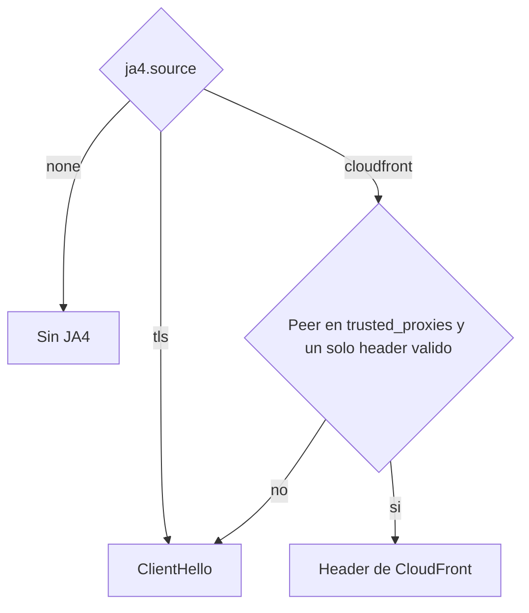

`JA4Mismatch` marca `ja4_incoherente` cuando el `User-Agent` empieza por `Mozilla/` y el JA4 elegido está en `ja4.tools`. Un `curl` que deja su propio `User-Agent` no entra por aquí: ya lo cubre `ua_herramienta`. Cada entrada necesita `name` y un JA4 en minúsculas con la forma `10_12_12`. Un JA4 repetido o un `source` distinto de `tls`, `cloudfront` y `none` hace fallar el arranque. El ejemplo trae el JA4 medido de curl en macOS; cambia con la versión y con la librería TLS.

`guardian-cf.yml` usa `source: cloudfront` y trata como vecinos de confianza a `10.0.0.0/8`, `127.0.0.0/8` y `::1`. `guardian-cf-untrusted.yml` deja fuera a localhost, así que un header enviado desde la máquina local se descarta.

### Reglas y bots

`Rules` marca el honeypot cuando la ruta está en `rules.honeypots`. La comparación es exacta. También puede dejar un motivo de denegación:

- `ip_denegada`, si la IP está en `rules.deny_cidrs`.
- `ruta_privada`, si la ruta empieza por el `prefix` de una entrada de `rules.routes` y la IP no está en su `allow_cidrs`.

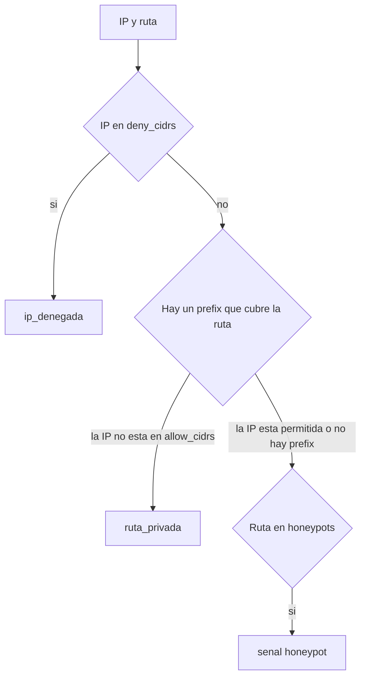

Si el `User-Agent` contiene el `ua_contains` de un bot de `good_bots`, el proxy hace una comprobación DNS con un tope de 300 ms. El resultado de una consulta terminada se guarda una hora por IP y nombre de bot.

1. DNS inverso de la IP del cliente.
2. El nombre tiene que ser uno de `domains` o un subdominio suyo.
3. El DNS directo de ese nombre tiene que devolver la misma IP.

Si las tres cosas cierran, la señal es bot verificado. Si el user-agent reclama el bot y la comprobación no cierra, o si el DNS falla, la señal es bot falso.

### Puntaje

`Score` lee las señales y escribe score, motivos y decisión.

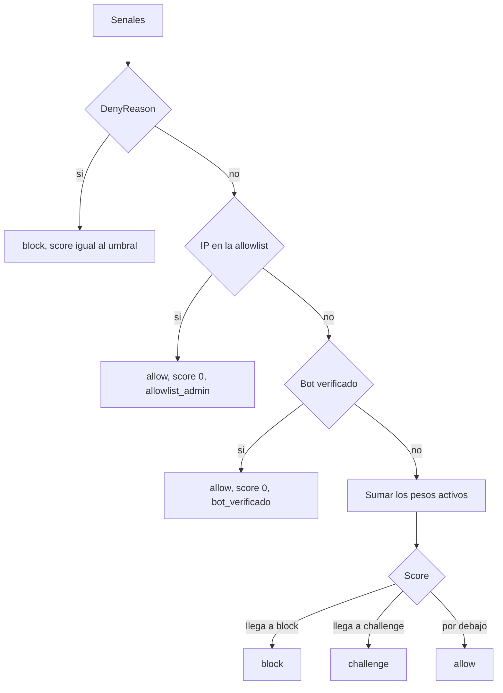

Con el YAML de ejemplo los pesos y los umbrales son estos:

| Señal | Peso | Motivo | Decisión si actúa sola |
| --- | --- | --- | --- |
| User-Agent vacío o que contiene `curl` | 90 | `ua_herramienta` | `block` |
| Bot reclamado y no verificado | 90 | `bot_falso` | `block` |
| Cabeceras de navegador incompletas | 30 | `headers_incompletos` | `allow` |
| Ruta en `rules.honeypots` | 50 | `honeypot` | `challenge` |
| Límite de tasa superado | 100 | `rate_limit` | `block` |
| User-Agent de navegador con un JA4 de `ja4.tools` | 60 | `ja4_incoherente` | `challenge` |
| JA4 marcado con mala reputación | 0 en `guardian-config.yml`; 50 en `guardian.sqs.yml` | `ja4_reputacion` | `allow` con peso 0. Con 50 puntos, `challenge` |
| Ratio de navegador por debajo de `browser_ratio_min` | 15 | `ratio_navegador_bajo` | `allow` |
| IP o JA4 en la lista `block` de la Admin API | el umbral de `block` | `bloqueo_admin_ip` o `bloqueo_admin_ja4` | `block`, también en `monitor` |
| IP en la lista `allow` de la Admin API | 0 | `allowlist_admin` | `allow` |

`ip_denegada`, `ruta_privada`, `bloqueo_admin_ip` y `bloqueo_admin_ja4` no suman un peso: el score queda en el umbral de `block` y la decisión es `block`, también si el bot estaba verificado o la IP está en la allowlist. Una IP en la allowlist, sin esas denegaciones, queda en `allow` con score 0 y el motivo `allowlist_admin`. Un bot verificado, sin denegación ni allowlist, queda en `allow` con score 0 aunque haya visitado un honeypot.

`Enforce` mira el modo de la ruta antes de actuar. El modo es el de `modes.routes` cuyo prefijo es el más largo y coincide con la ruta. Si ninguno coincide, usa `modes.default`. Un prefijo coincide cuando la ruta es igual o continúa con `/`. `/api` cubre `/api` y `/api/precios`, y no cubre `/apiv2`. `/api/checkout` gana sobre `/api` en `/api/checkout/pagar`.

En `monitor`, si la decisión no es `allow` y no hay `ip_denegada` ni `ruta_privada`, la petición sigue al upstream con `shadow` en verdadero. El log conserva el score y la decisión. `ip_denegada` y `ruta_privada` se aplican también en `monitor`.

En `enforce`, `block` responde `403` con el cuerpo `acceso denegado`. Un pase no cambia ese resultado.

Cuando la decisión es `challenge`, busca la cookie `guardian_pass`. Si el pase está firmado, vigente y atado a la misma IP y a la misma huella, agrega el motivo `pase_valido` y sigue al upstream. Si no hay pase, responde `403` con una página HTML que resuelve en el navegador una prueba de trabajo SHA-256: busca un nonce cuyo hash de `semilla + nonce` tenga al menos `challenge.difficulty` bits en cero a la izquierda.

El formulario hace `POST /__guardian/verify` con el token, el nonce y la ruta de vuelta. Esa ruta pasa por `Init`, `ClientIP`, `Logger`, `Fingerprint` y `JA4`. El canje exige un POST; otro método responde `405`. El token tiene que estar firmado, dentro de `challenge.ttl`, atado a la IP y a la huella de esa petición, y el nonce no puede pasar de 20 caracteres. Si la prueba cierra, el proxy deja la cookie y responde `303` hacia `next`. `next` tiene que ser una ruta relativa que empiece por `/`. Una URL absoluta, `//...` o un valor que no es una ruta vuelve a `/`.

La cookie es `HttpOnly`, `SameSite=Lax`, con `Path=/` y `Max-Age` igual a `challenge.pass_ttl`. Lleva `Secure` cuando la petición llega por TLS. El pase queda atado a la IP y a la huella, así que otra IP o unas cabeceras distintas no lo reutilizan.

Los tokens los firma la primera llave de `GUARDIAN_PASS_KEYS`. El formato es `kid:base64` y, para rotar, `kidNuevo:base64,kidAnterior:base64`: la primera firma y el resto solo verifica. Cada llave, ya decodificada, mide al menos 32 bytes. El `kid` no puede llevar puntos. Sin esa variable el proceso no arranca.

La cadena no asigna la señal de ratio de navegador. El peso `low_browser_ratio` se aplica cuando esa señal viene informada y está por debajo de `browser_ratio_min`.

## Flujo de una petición

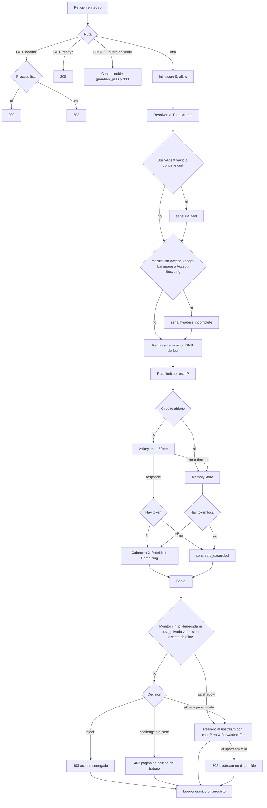

Valkey guarda el bucket en `gd:<app>:{ip}:tokens` y `gd:<app>:{ip}:ts`. Si Valkey falla, la petición se resuelve en memoria. Tras 5 fallos seguidos el circuito queda abierto 10 segundos y todas las decisiones salen del limitador local. Esos saltos incrementan `guardian_fail_open_total` con el motivo `timeout`, `error` o `circuit_open`, y dejan un evento `fail_open` con ese `reason` en el span `mw.ratelimit`.

El log de cada petición que entra en la cadena es JSON en stdout: `client_ip`, `mode`, `shadow`, `fingerprint`, método, ruta, score, decisión, motivos, duración y `config_version`. Si hubo un origen de JA4, suma `ja4` y `ja4_source`. En HTTPS suma también `tls_version` y `sni`. Si el span de la petición es válido, suma `trace_id`.

### Trazas

`tracing.enabled` en falso deja el exporter apagado. El proceso arranca igual y la validación no exige `endpoint` ni `sample_ratio`. En el YAML de ejemplo está en verdadero y apunta a `localhost:4318`.

Con el bloque activo, guardian crea un `TracerProvider` por lotes y lo envía por OTLP/HTTP a `tracing.endpoint` (`host:puerto`, sin esquema ni ruta). Cada envío tiene un tope de 5 segundos. `insecure` usa HTTP plano. El recurso lleva `service.name` `guardian` y `service.version`: por defecto `dev`, y se puede fijar al compilar con `-ldflags "-X main.version=..."`. El sampler es `ParentBased` sobre `TraceIDRatioBased`. Un `sample_ratio` de 0 no guarda trazas nuevas. Un padre ya muestreado sí se continúa.

`Trace` solo envuelve la cadena protegida. `/healthz`, `/readyz` y `POST /__guardian/verify` no abren span. El nombre del span raíz es el método y el prefijo de `modes.routes` que gana, el mismo label `route` de las métricas: `GET /api`, `GET /api/checkout` o `GET default`. El método admite `GET`, `HEAD`, `POST`, `PUT`, `PATCH`, `DELETE`, `OPTIONS`, `CONNECT` y `TRACE`. Cualquier otro queda en `_OTHER`. Al cerrar, el span guarda `http.response.status_code` y, si hay veredicto, `guardian.decision`, `guardian.score`, `guardian.mode`, `guardian.shadow`, `guardian.reasons` y `guardian.ja4_source`. Un status de 500 o más marca el span como error.

Cada paso envuelto cuelga de ese raíz y termina cuando llama al siguiente, así que no se solapan y no incluyen el tiempo del resto de la cadena. `Init`, `ConfigVersion`, `Metrics`, `Events` y `Logger` no tienen span propio. El raíz sigue abierto hasta que la respuesta vuelve, incluido el upstream.

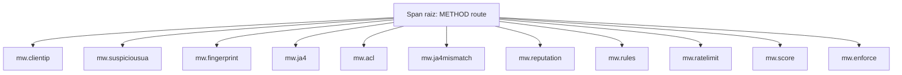

`trust_incoming` solo lee el `Traceparent` entrante cuando además el peer TCP inmediato está en `trusted_proxies`. Con el ejemplo en `false`, un `Traceparent` de `127.0.0.1` abre una traza nueva. Antes de reenviar, guardian borra `Traceparent`, `Tracestate` y `Baggage` del request saliente y escribe el `Traceparent` del span raíz. El upstream de prueba lo imprime en el cuerpo. Al abrir el span, si el contexto es válido, `Trace` guarda ese `trace_id` en el veredicto. El evento lo lee de ahí al volver de la cadena.

### Eventos

`events.enabled` en falso no exige sal y el paso no emite nada. El ejemplo lo deja en verdadero, con sink `log` y un buffer de 1024. Un buffer 0 o ausente también vale 1024. Ese tamaño cabe cerca de un segundo a 1000 peticiones por segundo.

El evento sale cuando la cadena protegida ya volvió. `/healthz`, `/readyz` y `POST /__guardian/verify` no lo generan. Lleva la hora UTC, `ip_hash`, `ja4`, `ja4_source`, `fingerprint`, `route`, `method`, `score`, `decision`, `reasons`, `mode`, `shadow` y `trace_id`. `route` es el mismo prefijo que usan las métricas. `method` es el de la petición, sin pasar por la normalización de Prometheus. Un modo vacío queda en `none`.

`ip_hash` es el HMAC-SHA256 de la IP, con `GUARDIAN_EVENT_SALT` como clave, recortado a 16 bytes y escrito en hexadecimal. La sal mide al menos 16 caracteres. Una IP inválida deja el campo vacío. Cambiar la sal deja de coincidir con los hashes anteriores. El evento no trae la IP. El log `request` sigue llevando `client_ip`.

```bash
export GUARDIAN_EVENT_SALT="$(openssl rand -hex 32)"
```

El sink `log` escribe una línea JSON con el mensaje `event`. El sink `none` recorre el mismo buffer y no escribe esa línea.

`sqs`, `kinesis` y `kafka` acumulan eventos y los vacían al llegar a `batch_size` o al cumplirse `flush_interval`. El valor por defecto es 100 eventos o 1 segundo. El máximo de `batch_size` es 500. `0` vuelve a 100. Cada envío, retries incluidos, tiene un tope de 5 segundos. El cuerpo es el JSON del evento.

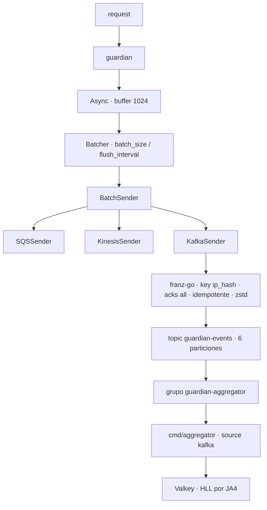

SQS parte ese lote en llamadas `SendMessageBatch` de hasta 10 mensajes y 1 MiB. El YAML de Floci usa `batch_size: 10`, así un lote es una sola llamada. Kinesis usa `PutRecords`, hasta 500 registros y 10 MiB. La partition key es el JA4. Si no hay JA4, usa `ip_hash`. Si tampoco hay hash, usa `unknown`. Una key de más de 256 caracteres se recorta.

Un fallo de una entrada de SQS o Kinesis se reintenta sola, hasta `max_retries` veces. La espera empieza en `retry_backoff` y se duplica, con tope de 2 segundos y una variación entre la mitad y el total. Los valores por defecto son 3 reintentos y 100 ms. En SQS, un fallo marcado como culpa del mensaje no se reintenta. Lo que sigue fallando suma `guardian_events_send_failures_total`. En Kafka ese `max_retries` no se usa: franz-go reintenta hasta `delivery_timeout`.

Kafka usa el mismo lote y el cliente franz-go. El topic tiene que existir; guardian no lo crea. El cliente no conecta al armarse. Al arrancar hace un ping de 3 segundos y, si el broker no responde, deja el aviso `events: kafka no responde al arrancar` y sigue. Los acks piden a todas las réplicas in-sync. El productor es idempotente. La compresión por defecto es `zstd`; también valen `none`, `gzip`, `snappy` y `lz4`. `linger` espera 5 ms por partición antes de cerrar un request. `0` vuelve a esos 5 ms. `delivery_timeout` es 4 segundos y, si se escribe, tiene que estar entre 1 y 5 segundos.

La key por defecto es `ip_hash`. `ja4` usa la misma clave que Kinesis: el JA4, o `ip_hash` si no hay, o `unknown`. `none` no manda key y el particionador reparte sin conservar orden. Cada record lleva el header `content-type: application/json` y, si hay traza, `trace_id`. La hora del evento sigue en el campo `ts` del JSON. El timestamp del record es el del envío, para que un evento que esperó en el buffer no nazca ya vencido.

`tls.enabled` habla TLS 1.2 o superior. `ca_file` añade un PEM de una CA propia. `sasl.mechanism` vacío no autentica. `scram-sha-512` exige TLS y las variables `GUARDIAN_KAFKA_USERNAME` y `GUARDIAN_KAFKA_PASSWORD`. `aws_msk_iam` exige TLS y la misma cadena de credenciales de AWS que SQS. El grupo de consumo por defecto es `guardian-aggregator`.

La región, el endpoint y las credenciales salen del SDK: `AWS_REGION`, `AWS_ENDPOINT_URL`, `AWS_ACCESS_KEY_ID` y `AWS_SECRET_ACCESS_KEY`, o un rol. No van en el YAML. Al arrancar, guardian exige región y credenciales, y la lectura de credenciales tiene 5 segundos de tope. Con Floci, `AWS_ENDPOINT_URL` es `http://floci:4566` y las credenciales de prueba son `test` / `test` en `us-east-1`.

`Emit` no espera al destino. Si el canal está lleno, descarta el evento y suma `guardian_events_dropped_total` con el motivo `buffer_full`. Si el sink ya cerró, el motivo es `closed`. Un error del destino, ya con el evento fuera del canal, suma `guardian_events_sink_errors_total`.

### Reputación de JA4

`reputation.enabled` en falso no consulta Valkey y el aggregator se niega a arrancar. El `guardian-config.yml` de la raíz lo deja apagado. `deploy/compose/config/guardian.sqs.yml` lo enciende, con peso `ja4_reputation` 50. Si está encendido y ese peso es 0, la carga del YAML falla: la señal se calcularía y no sumaría.

El aggregator, `cmd/aggregator`, lee el mismo sink que guardian escribe cuando es `sqs` o `kafka`. Kinesis todavía no lo consume. Con SQS hace long poll de 20 segundos, de hasta 10 mensajes, con visibility timeout de 30 segundos. Aplica el lote en Valkey y solo entonces borra los mensajes. Si Valkey falla, los mensajes vuelven cuando vence esa visibilidad. Con Kafka entra al grupo `events.kafka.consumer_group`, pide hasta 500 records y no hace autocommit. El offset se confirma después de `Apply`. Si Valkey falla, reintenta cada 2 segundos sin confirmar, y esa partición no avanza. Un grupo sin offsets previos empieza en el record más viejo que el topic aún guarda. En los dos sinks, `Apply` es idempotente: un `ip_hash` repetido no infla el conteo. Un JSON que no decodifica se descarta y su offset o su borrado siguen con el resto del lote.

Cada evento con JA4 e `ip_hash` entra en un HyperLogLog `gd:<app>:ja4ips:{<ja4>}:<bucket>`. El bucket es el de `ev.Time`, alineado a `reputation.bucket`. La llave vive `window` más un bucket. El `{ja4}` es un hash tag: en un cluster, los buckets de un mismo JA4 caen en el mismo slot y `PFCOUNT` puede unirlos. La ventana por defecto es 1 hora en buckets de 10 minutos, seis llaves. La ventana tiene que ser múltiplo del bucket y el cociente no puede pasar de 24.

Si las IPs distintas de la ventana llegan a `min_distinct_ips` (50 por defecto), el aggregator escribe `gd:<app>:ja4rep:{<ja4>}` con ese conteo y TTL `ttl` (30 minutos). El log deja una línea `ja4_marcado`.

En la cadena protegida, `Reputation` va después de `JA4Mismatch`. Si el veredicto trae JA4, hace un `GET` de esa marca con tope `lookup_timeout` (20 ms). Un valor presente marca `JA4Reputation` y el scorer suma `ja4_reputacion`. Una clave ausente deja la señal en falso. Un error de Valkey también la deja en falso, escribe `reputation no disponible` y no guarda esa respuesta: el siguiente request vuelve a preguntar. Las respuestas buenas y las ausencias se cachean `cache_ttl` (10 segundos), hasta 10 000 JA4; al pasar de ese tope la caché se vacía. `POST /__guardian/verify` no consulta la reputación.

### Admin API

`admin.enabled` en falso no abre el puerto y el paso `ACL` deja pasar el request. El `guardian-config.yml` de la raíz lo deja apagado. Los YAML de `deploy/compose/config` lo encienden en `:9091`. El bloque entero pide reinicio: el listener y el store se crean una vez.

El token sale solo de `GUARDIAN_ADMIN_TOKEN`. No hay campo de token en el YAML: un campo `token` es desconocido y el arranque falla. Hacen falta uno o dos tokens separados por coma, cada uno de al menos 32 caracteres. Dos sirven para rotar: se despliega `nuevo,viejo`, los clientes pasan al nuevo y después queda solo el nuevo. Guardian guarda el SHA-256, compara en tiempo constante y el log escribe `Tokens(n, redactados)`.

```bash
export GUARDIAN_ADMIN_TOKEN="$(openssl rand -hex 32)"
```

La API escucha en su propio proceso HTTP. `ReadHeaderTimeout` es 5 segundos, lectura y escritura 10 segundos, idle 60 segundos y el tope de cabeceras es 16 KiB. `admin.listen` vacío queda en `127.0.0.1:9091`. El puerto no puede coincidir con `listen`, `tls.listen` ni `:2112`. En Compose el proceso escucha en `:9091` dentro del contenedor y el host lo ve solo en `127.0.0.1:9091`. El apagado de esa API entra en el mismo `Shutdown` que HTTP y HTTPS.

Sin `Authorization: Bearer` válido la respuesta es `401`, con `WWW-Authenticate` y el cuerpo `no autorizado`, antes de mirar si la ruta existe. El log deja `admin_auth_fallida` con el motivo `sin_bearer` o `token_invalido` y no escribe el header. `X-Guardian-Actor` es una etiqueta del audit log, con tope de 64 caracteres. Vacío queda en `desconocido`. No autentica a nadie.

| Método | Ruta | Qué hace |
| --- | --- | --- |
| `GET` | `/v1/blocks` y `/v1/allowlist` | Lista las entradas vigentes |
| `GET` | `/v1/blocks/{kind}/{value}` y `/v1/allowlist/{kind}/{value}` | Una entrada. `404` si no existe o ya expiró |
| `PUT` | la misma ruta de una entrada | Crea o reemplaza. El cuerpo pide `ttl` y `reason` |
| `DELETE` | la misma ruta de una entrada | `204` si la borró, `404` si no estaba |
| `POST` | `/v1/reload` | La misma recarga que fsnotify y `SIGHUP`, con motivo `admin_api` |
| `GET` | `/v1/config` | `version`, `loaded_at` y la lista `reloadable`. No devuelve valores del YAML |

`kind` es `ip` o `ja4`. La allowlist solo acepta `ip`. Un JA4 de allowlist responde `400`: ese JA4 lo comparte cualquiera con el mismo navegador. La IP se guarda sin zona y sin el prefijo IPv4-mapeado, así `::ffff:1.2.3.4` y `1.2.3.4` son la misma llave. El JA4 va en minúsculas y con la forma `10_12_12`.

El `PUT` exige un JSON de hasta 4 KiB, sin campos de más. `ttl` es una duración de Go mayor que 0 y como máximo `admin.max_ttl` (168 horas). Lo permanente va en `rules.deny_cidrs`. `reason` es obligatorio y de hasta 200 caracteres. Ese texto queda en el audit log `admin_audit`. La señal del request es fija: `bloqueo_admin_ip`, `bloqueo_admin_ja4` o `allowlist_admin`. El texto libre no entra en `guardian_signals_total`.

Valkey guarda cada entrada en `gd:<app>:acl:<lista>:<kind>:<valor>` y la borra sola con el TTL. El listado usa el ZSET `gd:<app>:acl:index:<lista>`, con el vencimiento en el score. Las llaves no llevan hash tag: en un cluster se reparten entre los slots. El `PUT` escribe la entrada y el índice en un pipeline. Si el proceso cae entre los dos comandos, `List` ignora un miembro cuyo valor ya no existe.

La lectura del proxy y la escritura de la API no fallan igual. Un `PUT` o `DELETE` con Valkey caído responde `503` y el cuerpo dice que el cambio no se aplicó. Un `Check` con Valkey caído deja seguir el request, suma `guardian_acl_lookup_errors_total` y escribe `acl no disponible`. Si esa llave se leyó hace menos de `admin.stale_ttl` (1 minuto), se usa esa copia y suma `guardian_acl_stale_served_total`. La caché fresca dura `admin.cache_ttl` (2 segundos) y se vacía al pasar de 10 000 entradas. La réplica que escribió olvida su copia al momento. Las demás la ven como tarde a los 2 segundos. `0` en `cache_ttl`, `stale_ttl`, `lookup_timeout` o `max_ttl` vuelve al default. `stale_ttl` menor que `cache_ttl` falla el arranque.

`ACL` va después de `JA4`. Busca la IP en allow y en block, y el JA4 solo en block, en un solo pipeline y con tope `lookup_timeout` (20 ms). Si la IP y el JA4 están bloqueados, gana el bloqueo de la IP. Un bloqueo llena `DenyReason` y `Enforce` responde `403` aunque la ruta esté en `monitor`. La allowlist pone `Allowlisted`. Si las dos listas tienen la misma IP, el bloqueo gana. `Rules` no pisa un `DenyReason` que la ACL ya dejó. `POST /__guardian/verify` no consulta la ACL.

`POST /v1/reload` devuelve `200` con `changed`, `version_anterior` y `version`. Si el archivo no se puede aplicar, responde `422`, `changed` queda en falso y sigue la config anterior. `GET /v1/config` no muestra CIDRs ni rutas del YAML.

```bash
curl -s -H "Authorization: Bearer $GUARDIAN_ADMIN_TOKEN" -H "X-Guardian-Actor: fabio" \
  -H "Content-Type: application/json" \
  -d '{"ttl":"30m","reason":"abuso de checkout"}' \
  http://127.0.0.1:9091/v1/blocks/ip/203.0.113.8
```

En `deploy/compose/config/guardian.yml` la API está encendida y `redis_addr` sigue en `localhost:6379`. Dentro del contenedor esa dirección es el propio guardian, así que un `PUT` responde `503` y el proxy anota `acl no disponible`. `guardian.sqs.yml`, `guardian.kinesis.yml` y `guardian.kafka.yml` apuntan a `valkey:6379`, y ahí la ACL escribe y lee.

`docker-compose.replicas.yml` levanta `guardian-b` con el mismo YAML de Kafka, el mismo Valkey y el mismo token. El proxy queda en `127.0.0.1:8081` y la Admin API en `127.0.0.1:9191`. Un bloqueo escrito en una réplica lo aplica la otra cuando vence su caché de 2 segundos. Las dos no se hablan: comparten Valkey.

### HTTPS y ClientHello

El bloque `tls` enciende el listener cuando trae `listen`, `cert_file` o `key_file`. Si aparece uno, los tres son obligatorios. El proceso sale al arrancar si el certificado o la clave no se pueden leer.

Cada conexión HTTPS deja una sola línea `tls_hello`: `sni`, versión y cipher negociados, ALPN, versiones y ciphers ofrecidos, extensiones, curvas, ALPN ofrecido, `ja4`, `ja4_r` y `ja4_ro`. Un valor GREASE sale como `grease:0x????`. Una extensión sin nombre conocido sale en hexadecimal. Esa línea también se escribe en `/healthz` y `/readyz` del puerto TLS. El puerto HTTP no tiene ClientHello.

## Qué hay

```
cmd/guardian/                 binario del proxy
cmd/aggregator/               consume SQS y marca JA4 en Valkey
cmd/upstream/                 binario de prueba
internal/challenge/           prueba de trabajo, tokens y pase
internal/clientip/            resolución de la IP del cliente
internal/config/              parseo, validación y campos recargables
internal/configsource/        archivo, fsnotify, poll, SIGHUP y snapshot de la cadena
internal/acl/                 bloqueos y allowlist en Valkey
internal/admin/               Admin API: token, ACL y recarga
internal/events/              evento del veredicto, HMAC de la IP, buffer, SQS, Kinesis y Kafka
internal/fingerprint/         huella HTTP y política JA4
internal/ja4source/           origen del JA4: tls, cloudfront o none
internal/goodbot/             verificación DNS de bots conocidos
internal/metrics/             RED, decisiones y señales de Prometheus
internal/middleware/          cadena, señales, desafío, modo y spans
internal/tracing/             OTLP/HTTP, muestreo y Traceparent hacia el upstream
internal/policy/              monitor o enforce por prefijo; label route
internal/ratelimit/           Valkey, memoria y failover
internal/reputation/          HyperLogLog por JA4 y la marca que lee el proxy
internal/rules/               honeypots, denegaciones y rutas
internal/scoring/             pesos, umbrales y decisión
internal/tlshello/            ClientHello y cálculo del JA4
internal/verdict/             IP, huella, señales y decisión
guardian-config.yml           ejemplo para go run, con TLS en :8443
deploy/compose/               stack local: guardian, upstream, Valkey, Jaeger, Prometheus y Grafana
Dockerfile                    imagen distroless de guardian o del upstream
```

## Herramientas de terceros

Estos servicios no viven dentro del binario. Compose los levanta al lado de guardian, y en AWS real SQS o Kinesis ocupan el lugar de Floci.


| | Herramienta | Dónde entra |
| --- | --- | --- |
|  | Valkey `9.1.3` en Compose y `8` en el `docker run` suelto | Token bucket del límite de tasa, en `redis_addr`. Si no responde, el failover pasa a memoria |
|  | Prometheus `v3.16.0` | Lee `GET /metrics` de guardian en `:2112` cada 15 segundos y evalúa las alertas |
|  | Grafana `13.0.12` | Dashboard `guardian · overview` en `:3000`, con Prometheus y Jaeger ya provisionados |
|  | Jaeger `2.23.0` | UI en `:16686`. Recibe las trazas por OTLP/HTTP en `:4318` |
|  | OpenTelemetry | Spans de la cadena protegida y el `Traceparent` que guardian escribe hacia el upstream |
|  | Amazon SQS | Sink `events.sink: sqs`. Los lotes salen con `SendMessageBatch`, de hasta 10 mensajes |
|  | Amazon Kinesis | Sink `events.sink: kinesis`. `PutRecords` usa el JA4 como partition key y, si no hay, `ip_hash` |
|  | Apache Kafka `4.4.0` | Sink `events.sink: kafka` y el aggregator. En local, un broker KRaft. En AWS, el mismo cliente habla con MSK |
|  | Floci `2.4.0` | AWS local del perfil `aws`, en `127.0.0.1:4566`. Crea la cola y el stream `guardian-events` |
|  | Docker Compose | Stack de `deploy/compose`: proxy, upstream, Valkey, Jaeger, Prometheus, Grafana y, con el perfil `aws`, Floci |
|   | Alpine y Distroless | La imagen compila con `golang:1.27.4-alpine` y corre en `gcr.io/distroless/static-debian13:nonroot` |

La región, el endpoint y las credenciales de SQS y Kinesis salen de `AWS_REGION`, `AWS_ENDPOINT_URL`, `AWS_ACCESS_KEY_ID` y `AWS_SECRET_ACCESS_KEY`. Con Floci el endpoint es `http://floci:4566` y las credenciales de prueba son `test` / `test`.

## Requisitos

- Go 1.27 o superior
- Docker, para Valkey y Jaeger sueltos, y Docker Compose para el stack de `deploy/compose`

## Configuración

`guardian` lee `guardian-config.yml` por defecto. Otra ruta se pasa con `-config`. `-config-poll` espera 10 segundos entre relecturas; `0` deja solo fsnotify y `SIGHUP`. El aggregator usa el mismo `-config` y lo lee una sola vez al arrancar.

```yaml
listen: ":8080"
upstream: "http://localhost:9000"
read_header_timeout: 5s
read_timeout: 20s
write_timeout: 20s
idle_timeout: 10s
shutdown_timeout: 20s
drain_delay: 5s
preserve_host: true
honeypot_paths:
  - "/robots.txt"
  - "/favicon.ico"
  - "/admin-oculto"
app: "shop"
redis_addr: "localhost:6379"
rate: 1
burst: 2
trusted_proxies:
  - "10.0.0.0/8"
  - "::1/128"
  - "127.0.0.0/8"
x_forwarded_for_header: "X-Forwarded-For"
proxy_protocol: false
scoring:
  weights:
    ua_tool: 90
    headers_incomplete: 30
    honeypot: 50
    rate_exceeded: 100
    low_browser_ratio: 15
    fake_bot: 90
    ja4_mismatch: 60
  browser_ratio_min: 0.3
  thresholds:
    challenge: 40
    block: 85
rules:
  honeypots: ["/admin-oculto", "/wp-login.php", "/.env"]
  deny_cidrs: ["198.51.100.0/24"]
  routes:
    - prefix: /interno
      allow_cidrs: ["10.0.0.0/8", "127.0.0.1/32"]
good_bots:
  - name: googlebot
    ua_contains: Googlebot
    domains: ["googlebot.com", "google.com"]
  - name: bingbot
    ua_contains: bingbot
    domains: ["search.msn.com"]
challenge:
  difficulty: 16
  ttl: 2m
  pass_ttl: 1h
modes:
  default: enforce
  routes:
    - prefix: /api
      mode: monitor
    - prefix: /api/checkout
      mode: enforce
    - prefix: /interno
      mode: monitor
tls:
  listen: ":8443"
  cert_file: "certs/localhost.pem"
  key_file: "certs/localhost-key.pem"
ja4:
  source: "tls"
  tools:
    - name: curl-mac
      ja4: "t13d4907h2_0d8feac7bc37_7395dae3b2f3"
```

| Campo | Obligatorio | Por defecto | Descripción |
| --- | --- | --- | --- |
| `listen` | no | `:8080` | Dirección en la que escucha el proxy |
| `upstream` | sí | — | URL completa del destino (`http://host:puerto`) |
| `read_header_timeout` | no | `5s` | Tiempo máximo para leer las cabeceras del cliente. Tiene que ser mayor que 0 |
| `read_timeout` | no | `10s` | Tiempo máximo para leer la petición completa |
| `write_timeout` | no | `10s` | Tiempo máximo para escribir la respuesta. No puede superar `shutdown_timeout` |
| `idle_timeout` | no | `10s` | Espera de la siguiente petición en una conexión keep-alive |
| `shutdown_timeout` | no | `10s` | Tiempo máximo del apagado para terminar las peticiones en curso |
| `drain_delay` | no | `10s` | Espera tras dejar de estar listo y antes de cerrar el servidor |
| `preserve_host` | no | `false` | Si es `true`, el `Host` que ve el upstream es el del cliente |
| `honeypot_paths` | no | vacío | El YAML lo acepta. Las trampas que puntúan son `rules.honeypots` |
| `app` | no | `shop` | Prefijo de las claves del bucket en Valkey |
| `redis_addr` | no | `localhost:6379` | Dirección de Valkey |
| `rate` | no | `1` | Tokens por segundo. Tiene que ser mayor que 0 |
| `burst` | no | `10` | Capacidad del bucket. Tiene que ser mayor que 0 |
| `trusted_proxies` | no | vacío | CIDR que pueden informar la IP del cliente |
| `x_forwarded_for_header` | no | vacío | Cabecera que se recorre cuando el peer es de confianza |
| `proxy_protocol` | no | `false` | Exige la cabecera PROXY a `trusted_proxies` y rechaza el resto |
| `scoring.weights` | no | 0 | Puntos de cada señal. Un peso 0 no suma |
| `scoring.browser_ratio_min` | no | 0 | Umbral del ratio de navegador, entre 0 y 1 |
| `scoring.thresholds.challenge` | sí | — | A partir de este score la decisión es `challenge`. Tiene que ser mayor que 0 y menor que `block` |
| `scoring.thresholds.block` | sí | — | A partir de este score la decisión es `block` |
| `rules.honeypots` | no | vacío | Rutas exactas que marcan la señal honeypot |
| `rules.deny_cidrs` | no | vacío | CIDR que producen `ip_denegada` |
| `rules.routes` | no | vacío | Prefijos que exigen que la IP esté en `allow_cidrs` |
| `good_bots` | no | vacío | Bots cuyo user-agent se comprueba por DNS |
| `challenge.difficulty` | sí | — | Bits en cero que exige la prueba de trabajo. Tiene que estar entre 8 y 24 |
| `challenge.ttl` | no | `0s` | Vigencia del token del desafío |
| `challenge.pass_ttl` | no | `0s` | Vigencia de la cookie `guardian_pass` |
| `modes.default` | sí | — | `monitor` o `enforce` cuando ningún prefijo coincide |
| `modes.routes` | no | vacío | Prefijos con su modo. Gana el más largo. No se pueden repetir |
| `tls.listen` | no | vacío | Dirección HTTPS. Vacío, junto con el certificado y la clave, deja TLS apagado |
| `tls.cert_file` | no | vacío | Certificado PEM. Obligatorio si el bloque `tls` está activo |
| `tls.key_file` | no | vacío | Clave privada PEM. Obligatoria si el bloque `tls` está activo |
| `scoring.weights.ja4_mismatch` | no | 0 | Puntos cuando un `User-Agent` de navegador trae un JA4 de `ja4.tools` |
| `ja4.source` | no | `tls` | `tls`, `cloudfront` o `none` |
| `ja4.tools` | no | vacío | JA4 medidos de herramientas, con `name` y `ja4` en minúsculas |
| `tracing.enabled` | no | `false` | Enciende el exporter OTLP/HTTP |
| `tracing.endpoint` | si `enabled` | vacío | `host:puerto` del colector. En el ejemplo, `localhost:4318` |
| `tracing.insecure` | no | `false` | HTTP plano hacia el colector |
| `tracing.sample_ratio` | no | `0` | Fracción de trazas nuevas, de 0 a 1. El ejemplo usa `1` |
| `tracing.trust_incoming` | no | `false` | Continúa el `Traceparent` de un peer en `trusted_proxies` |
| `events.enabled` | no | `false` | Emite un evento por petición de la cadena protegida |
| `events.sink` | no | `log` | `log`, `none`, `sqs`, `kinesis` o `kafka`. Otro valor falla el arranque |
| `events.buffer` | no | `1024` | Capacidad del canal. `0` vuelve a 1024. Un valor negativo falla el arranque |
| `events.batch_size` | no | `100` | Eventos por lote en SQS, Kinesis y Kafka. `0` vuelve a 100. Fuera de 1 a 500 falla el arranque |
| `events.flush_interval` | no | `1s` | Un lote incompleto sale igual al cumplirse este plazo. Un valor negativo falla el arranque |
| `events.max_retries` | no | `3` | Reintentos de SQS y Kinesis. Kafka reintenta hasta `delivery_timeout`. Un valor negativo falla el arranque |
| `events.retry_backoff` | no | `100ms` | Espera base del reintento. Se duplica en cada ronda, con tope de 2 s |
| `events.sqs.queue_url` | con `sqs` | vacío | URL completa `http` o `https` de la cola |
| `events.kinesis.stream_name` | con `kinesis` | vacío | Nombre del stream |
| `events.kafka.brokers` | con `kafka` | vacío | Lista `host:puerto`. En local, `kafka:9092`. En MSK con IAM, el puerto `9098` |
| `events.kafka.topic` | con `kafka` | vacío | Topic que ya existe. El ejemplo usa `guardian-events` |
| `events.kafka.client_id` | no | `guardian` | Nombre que el broker ve en logs y cuotas |
| `events.kafka.key` | no | `ip_hash` | `ip_hash`, `ja4` o `none` |
| `events.kafka.compression` | no | `zstd` | `none`, `gzip`, `snappy`, `lz4` o `zstd` |
| `events.kafka.linger` | no | `5ms` | Espera por partición. `0` vuelve a 5 ms. Más de 1 s falla el arranque |
| `events.kafka.delivery_timeout` | no | `4s` | Tope de entrega de un record, entre 1 s y 5 s |
| `events.kafka.consumer_group` | no | `guardian-aggregator` | Grupo del aggregator |
| `events.kafka.tls.enabled` | no | `false` | TLS 1.2 o superior. Obligatorio si hay SASL |
| `events.kafka.tls.ca_file` | no | vacío | PEM de una CA propia. Las raíces del sistema cubren MSK |
| `events.kafka.sasl.mechanism` | no | vacío | Vacío, `scram-sha-512` o `aws_msk_iam` |
| `scoring.weights.ja4_reputation` | no | 0 | Puntos si el JA4 está marcado. Con `reputation.enabled`, tiene que ser mayor que 0 |
| `reputation.enabled` | no | `false` | El proxy consulta la marca y el aggregator exige que esté en verdadero |
| `reputation.window` | no | `1h` | Ventana de IPs distintas. Múltiplo de `bucket`, y el cociente no pasa de 24 |
| `reputation.bucket` | no | `10m` | Tamaño de cada HyperLogLog |
| `reputation.min_distinct_ips` | no | `50` | IPs distintas para marcar el JA4. Mínimo 2 |
| `reputation.ttl` | no | `30m` | Vida de la marca. Tiene que ser mayor que 0 |
| `reputation.cache_ttl` | no | `10s` | Caché local del proxy. `0` o ausente vuelve a `10s` |
| `reputation.lookup_timeout` | no | `20ms` | Tope del `GET` en el proxy |
| `admin.enabled` | no | `false` | Abre la Admin API y consulta la ACL. Apagado, el paso no hace nada |
| `admin.listen` | no | `127.0.0.1:9091` | Puerto propio. Choca con `listen`, `tls.listen` o `:2112` y el arranque falla |
| `admin.max_ttl` | no | `168h` | TTL máximo de un `PUT`. `0` vuelve a 168 h |
| `admin.cache_ttl` | no | `2s` | Caché local de la ACL. `0` vuelve a 2 s. Al pasar de 10 000 entradas se vacía |
| `admin.stale_ttl` | no | `1m` | Si Valkey falla, cuánto sirve una lectura vieja. Tiene que ser mayor o igual que `cache_ttl` |
| `admin.lookup_timeout` | no | `20ms` | Tope del `GET` de la ACL en el request |

Campos desconocidos en el YAML hacen fallar el arranque. `upstream` tiene que ser una URL con esquema y host. Cada entrada de `trusted_proxies`, `rules.deny_cidrs` y `allow_cidrs` tiene que ser un CIDR válido. Cada `prefix` de `rules.routes` y de `modes.routes` tiene que empezar por `/`. Cada `modes.routes.mode` tiene que ser `monitor` o `enforce`.

La carga también rechaza la configuración cuando:

- `shutdown_timeout` + `drain_delay` es mayor o igual a 30 segundos.
- `write_timeout` es mayor que `shutdown_timeout`.
- `scoring.thresholds.challenge` o `block` no son mayores que 0, o `challenge` no es menor que `block`.
- `scoring.browser_ratio_min` está fuera del intervalo de 0 a 1.
- `challenge.difficulty` está fuera del intervalo de 8 a 24.
- `modes.default` está vacío, no es `monitor` ni `enforce`, o dos rutas quedan con el mismo prefijo.
- el bloque `tls` está a medias: falta `listen`, `cert_file` o `key_file`.
- `ja4.source` no es `tls`, `cloudfront` ni `none`, o `cloudfront` se usa sin `trusted_proxies`.
- una entrada de `ja4.tools` no tiene `name`, el JA4 no tiene la forma `10_12_12` en minúsculas o el mismo JA4 aparece dos veces.
- `tracing.enabled` es verdadero y falta `tracing.endpoint`, o `tracing.sample_ratio` queda fuera de 0 a 1.
- `events.enabled` es verdadero y `events.sink` no es `log`, `none`, `sqs`, `kinesis` ni `kafka`.
- `events.sink` es `sqs` y `events.sqs.queue_url` no es una URL `http` o `https` con host.
- `events.sink` es `kinesis` y falta `events.kinesis.stream_name`.
- `events.sink` es `kafka` y falta un broker `host:puerto` o el topic, `key` no es `ip_hash`, `ja4` ni `none`, la compresión no es una de las cinco, `linger` sale de 0 a 1 s, o `delivery_timeout` sale de 1 s a 5 s.
- `events.kafka.sasl.mechanism` no es vacío, `scram-sha-512` ni `aws_msk_iam`, o uno de esos dos se usa sin `tls.enabled`.
- `events.buffer`, `events.batch_size`, `events.flush_interval`, `events.max_retries` o `events.retry_backoff` es negativo, o `events.batch_size` pasa de 500.
- `reputation.enabled` es verdadero y `scoring.weights.ja4_reputation` es 0, la ventana no es múltiplo del bucket, el cociente pasa de 24, `min_distinct_ips` es menor que 2, o `ttl` y `lookup_timeout` no son mayores que 0.
- `events.enabled` es verdadero y `GUARDIAN_EVENT_SALT` mide menos de 16 caracteres.
- `admin.enabled` es verdadero y `admin.max_ttl` o `admin.lookup_timeout` no son mayores que 0, `admin.cache_ttl` es negativo, `admin.stale_ttl` es menor que `admin.cache_ttl`, o `admin.listen` usa el puerto de `listen`, de `tls.listen` o el `:2112`.
- `admin.enabled` es verdadero y `GUARDIAN_ADMIN_TOKEN` está vacío, trae más de dos tokens, o alguno mide menos de 32 caracteres.

`GUARDIAN_UPSTREAM` sustituye el valor de `upstream` del archivo. `GUARDIAN_PASS_KEYS` es obligatoria y trae el llavero con el que se firman el desafío y el pase. `GUARDIAN_EVENT_SALT` es obligatoria solo cuando `events.enabled` es verdadero. `GUARDIAN_ADMIN_TOKEN` es obligatoria solo cuando `admin.enabled` es verdadero.

## Recarga en caliente

`guardian` vigila el archivo de `-config` y, sin reiniciar, vuelve a armar la cadena protegida cuando cambian `scoring`, `rules`, `modes` o `ja4.tools`. Cada request lee el snapshot una vez al entrar y lo usa hasta el final. `POST /__guardian/verify` y el aggregator quedan con la config de arranque.

En cada recarga se reconstruyen el scorer, las reglas, los modos y la política de JA4. El resto se creó al arrancar y se reutiliza: listeners, TLS, upstream, Valkey, el límite de tasa, el desafío, los bots, el origen del JA4, la reputación, la ACL, los eventos y las trazas.

- Se vigila el directorio del archivo con fsnotify. Ahí se ven el guardado atómico de un editor (temporal y rename) y el symlink `..data` de un ConfigMap de Kubernetes. Un `chmod` no dispara recarga.
- `-config-poll` (10 s por defecto, `0` lo apaga) relee el archivo aunque fsnotify no avise. Si el hash no cambió, el log de debug dice `config_sin_cambios`.
- Si fsnotify no arranca y `-config-poll` es `0`, el log deja `config_watch` y la recarga que queda es `SIGHUP`.
- `SIGHUP` pide una recarga a mano: `docker compose kill -s HUP guardian`. `POST /v1/reload` de la Admin API pide la misma recarga, con motivo `admin_api`. Guardian captura `SIGHUP`.
- Los avisos se agrupan 250 ms y se recarga una sola vez. Ese plazo no tiene flag.
- La versión son los primeros 12 hexadecimales del SHA-256 de los bytes del archivo. `guardian_config_info` y el campo `config_version` del log `request` de la cadena protegida muestran ese valor. El log de `POST /__guardian/verify` no lo lleva.
- La config nueva se parsea y se mezcla con lo que quedó fijo al arrancar. Esa mezcla se valida y la cadena se construye entera antes de publicarse. Si algo falla, sigue la anterior, `guardian_config_last_reload_successful` pasa a 0 y el log dice `config_recarga_fallida`. Un poll posterior del mismo archivo rechazado no repite ese error. Un fallo al arrancar termina el proceso, porque todavía no hay config anterior.
- Bajar `scoring.weights.ja4_reputation` a 0 mientras `reputation.enabled` quedó en verdadero al arrancar no se aplica: la mezcla no pasa la validación.
- Un cambio fuera de esos cuatro bloques (`listen`, `tls`, `upstream`, timeouts, `redis_addr`, `rate`, `burst`, `trusted_proxies`, `ja4.source`, `challenge`, `good_bots`, `events`, `tracing`, `reputation`, `admin`) deja el warning `config_requiere_reinicio` y el proceso sigue con el valor de arranque. Si el archivo igual es válido, la versión avanza, porque el hash es el del archivo. En el diff del log, un campo cuyo nombre contiene `password`, `secret`, `token` o `key_file` sale como `***`.
- Una recarga aplicada deja la línea `config_recargada` con la versión anterior, la nueva, el motivo, los cambios y `dur_ms`. Las series `ok` y `error` de `guardian_config_reloads_total` existen desde el arranque.

| Métrica | Tipo | Qué dice |
| --- | --- | --- |
| `guardian_config_reloads_total{result}` | counter | recargas `ok` y `error`. Las dos series existen desde el arranque |
| `guardian_config_last_reload_successful` | gauge | 1 si la última se aplicó, 0 si se rechazó. Al arrancar vale 1 |
| `guardian_config_last_reload_success_timestamp_seconds` | gauge | cuándo se publicó la config activa, incluida la de arranque |
| `guardian_config_info{version}` | gauge | siempre 1; `version` es el hash de 12 hex del archivo publicado |

## Salud y apagado

`GET /healthz` y `GET /readyz` no pasan por la cadena protegida. Mientras el proceso está listo, las dos responden `200`. Después de `SIGINT` o `SIGTERM`, `/healthz` responde `503`. `/readyz` no escribe un estado en ese tramo, y la respuesta que completa el servidor sigue siendo `200`.

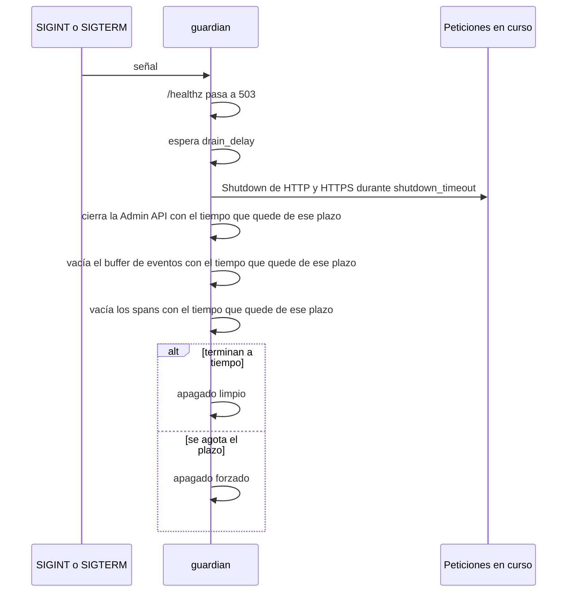

El limitador en memoria limpia cada minuto las claves que ya recuperaron el burst completo. Esa limpieza se detiene con la misma señal.

`GET /metrics` en `:2112` expone Prometheus. Ese servidor tiene `ReadHeaderTimeout` de 5 segundos y no entra en el `Shutdown` de HTTP ni de HTTPS: sigue hasta que el proceso sale. `/healthz`, `/readyz` y `POST /__guardian/verify` no pasan por el middleware de métricas. La cadena protegida sí.

El label `route` es el prefijo de `modes.routes` que gana para esa ruta, el mismo criterio que el modo: el más largo, con barra final recortada, y la ruta tiene que coincidir entera o seguir con `/`. Si ninguno aplica, el label es `default`. Con el YAML de ejemplo, `/api/precios` queda en `/api`, `/api/checkout/pagar` queda en `/api/checkout` y `/salud` queda en `default`. La query no entra en el label.

El método se normaliza a `GET`, `HEAD`, `POST`, `PUT`, `PATCH`, `DELETE` u `OPTIONS`. Cualquier otro queda en `OTHER`. El status es el que escribe el handler; si no llama a `WriteHeader`, el contador usa `200`. El wrapper del response deja ver el `ResponseWriter` original, así el reverse proxy puede hacer flush y el upstream sigue pudiendo transmitir.

| Métrica | Tipo | Labels | Qué cuenta |
| --- | --- | --- | --- |
| `guardian_http_requests_total` | counter | `route`, `method`, `code` | Peticiones que salen de la cadena protegida |
| `guardian_http_request_duration_seconds` | histogram | `route`, `method` | Tiempo dentro de guardian, incluido el upstream. Buckets: 5 ms, 10 ms, 25 ms, 50 ms, 100 ms, 250 ms, 500 ms, 1 s, 2.5 s y 5 s |
| `guardian_http_requests_in_flight` | gauge | — | Peticiones que aún no han vuelto del resto de la cadena |
| `guardian_decisions_total` | counter | `decision`, `mode`, `shadow` | Decisión leída del veredicto. `shadow` vale `true` o `false`. Un modo vacío queda en `none` |
| `guardian_signals_total` | counter | `reason` | Cada motivo que el veredicto trae en `Reasons` |
| `guardian_fail_open_total` | counter | `reason` | Saltos al limitador en memoria: `timeout`, `error` o `circuit_open` |
| `guardian_events_enqueued_total` | counter | — | Eventos que entraron al buffer |
| `guardian_events_dropped_total` | counter | `reason` | Descartados: `buffer_full` o `closed`. Las dos series existen desde el arranque |
| `guardian_events_sink_errors_total` | counter | — | Errores del destino al escribir un evento ya sacado del buffer |
| `guardian_events_buffer_length` | gauge | — | Eventos esperando en el canal |
| `guardian_events_batches_total` | counter | `sink` | Lotes vaciados hacia SQS o Kinesis |
| `guardian_events_batch_size` | histogram | `sink` | Eventos por lote. Buckets: 1, 2, 5, 10, 20, 50, 100, 200 y 500 |
| `guardian_events_retries_total` | counter | `sink` | Rondas que reenviaron solo las entradas fallidas |
| `guardian_events_send_failures_total` | counter | `sink` | Eventos perdidos después de agotar los reintentos |
| `guardian_events_api_requests_total` | counter | `sink` | Llamadas `SendMessageBatch`, `PutRecords` o Produce de Kafka |
| `guardian_acl_matches_total` | counter | `list`, `kind` | Requests que coincidieron con una entrada de la Admin API |
| `guardian_acl_lookup_errors_total` | counter | — | Lecturas de la ACL que fallaron en Valkey. El request siguió |
| `guardian_acl_stale_served_total` | counter | — | Veces que Valkey falló y se usó una entrada vieja de la caché |
| `guardian_admin_requests_total` | counter | `route`, `code` | Requests de la Admin API. `route` es el patrón, o `unauthorized` en un `401` |
| `guardian_admin_request_duration_seconds` | histogram | `route` | Latencia de la Admin API. Buckets: 1 ms, 5 ms, 10 ms, 50 ms, 100 ms, 500 ms, 1 s y 5 s |
| `guardian_admin_auth_failures_total` | counter | — | `401` de la Admin API |
| `guardian_admin_changes_total` | counter | `action`, `list`, `kind`, `result` | Altas, bajas y recargas, con el resultado |

## Ejecutar

Valkey, en segundo plano y publicado en el puerto `6379`:

```bash
docker run -d --name valkey -p 6379:6379 valkey/valkey:8
```

Jaeger, para el `tracing` del ejemplo. La UI queda en `http://localhost:16686` y el OTLP/HTTP en el puerto `4318`. El servicio `guardian` aparece ahí con la versión del build. Si el colector no está, el proceso arranca igual y el envío de cada lote falla al cabo de 5 segundos.

```bash
docker run -d --name jaeger -p 16686:16686 -p 4318:4318 jaegertracing/jaeger:2.23.0
```

La versión que viaja en `service.version` se fija al compilar. Sin ese flag queda `dev`.

```bash
go build -ldflags "-X main.version=$(git rev-parse --short HEAD)" -o guardian ./cmd/guardian
```

En una terminal, el upstream de prueba:

```bash
go run ./cmd/upstream
```

En otra, el proxy:

```bash
go run ./cmd/guardian
# go run ./cmd/guardian -config /ruta/guardian-config.yml
```

El `guardian-config.yml` del repositorio deja `proxy_protocol` en `false`, así que estas pruebas aceptan un `curl` directo. Si se activa, el listener exige la cabecera PROXY a `127.0.0.0/8` y rechaza esa misma conexión.

Antes de arrancar el proxy hace falta el llavero. La primera llave firma; se puede dejar una anterior detrás para verificar pases ya emitidos.

```bash
export GUARDIAN_PASS_KEYS="k1:$(openssl rand -base64 32 | tr -d '\n')"
export GUARDIAN_EVENT_SALT="$(openssl rand -hex 32)"
```

El YAML de ejemplo enciende HTTPS en `:8443`. Sin estos archivos el proceso no arranca:

```bash
mkdir -p certs
openssl req -x509 -newkey rsa:2048 -keyout certs/localhost-key.pem -out certs/localhost.pem -days 365 -nodes -subj "/CN=localhost"
```

Una petición a `/healthz` por HTTPS deja la línea `tls_hello` con `ja4`, `ja4_r` y `ja4_ro`. Esa ruta no entra en la cadena, así que no puntúa. La misma petición a `/salud`, con `User-Agent` de navegador y el JA4 `curl-mac` del ejemplo, suma 60 puntos y la decisión es `challenge`:

```bash
curl -sk https://localhost:8443/healthz
curl -sk -A "Mozilla/5.0" -H "Accept: text/html" -H "Accept-Language: es" -H "Accept-Encoding: gzip" https://localhost:8443/salud
```

`curl` sin otro `User-Agent` marca `ua_herramienta` y recibe `403` con el cuerpo `acceso denegado`:

```bash
curl -s -D - http://localhost:8080/salud
```

Un `User-Agent` con `Mozilla/` y sin `Accept`, `Accept-Language` ni `Accept-Encoding` suma 30 puntos y sigue hacia el upstream. Con esas tres cabeceras el score queda en 0. El YAML de ejemplo permite una ráfaga de 2; la tercera seguida suma `rate_limit` y responde `403`. Desde localhost, y sin una cabecera reenviada por un proxy de confianza, la IP limitada es `127.0.0.1`.

`/admin-oculto` suma 50 puntos y el modo por defecto es `enforce`. La decisión es `challenge`: sin la cookie `guardian_pass` la respuesta es `403` y el HTML de la prueba de trabajo. `curl` no ejecuta ese JavaScript.

`/api` está en `monitor`, así que un `curl` a `/api/precios` llega al upstream y el log marca `shadow`. `/api/checkout` está en `enforce` y ese mismo `curl` recibe `403`. `/interno` también está en `monitor`, pero una IP fuera de `10.0.0.0/8` y `127.0.0.1` sigue recibiendo `403` por `ruta_privada`.

```bash
curl -s -A "Mozilla/5.0" -H "Accept: text/html" -H "Accept-Language: es" -H "Accept-Encoding: gzip" http://localhost:8080/healthz
curl -s -D - -o /dev/null -A "Mozilla/5.0" -H "Accept: text/html" -H "Accept-Language: es" -H "Accept-Encoding: gzip" http://localhost:8080/admin-oculto
curl -s -o /dev/null -w "%{http_code}\n" http://localhost:8080/healthz
curl -s -o /dev/null -w "%{http_code}\n" http://localhost:8080/readyz
curl -s http://localhost:2112/metrics
```

La respuesta reenviada incluye la ruta, el `Host`, el `Traceparent` que escribió guardian, `X-Forwarded-Host` y `X-Forwarded-Proto`. `X-Forwarded-For` lleva la IP resuelta del cliente. Si el upstream no responde, el proxy devuelve `502` con el cuerpo `upstream no disponible`.

`/lento` sirve para ver el efecto de los timeouts: el upstream espera 10 segundos antes de escribir la respuesta.

```bash
curl -s -A "Mozilla/5.0" -H "Accept: text/html" -H "Accept-Language: es" -H "Accept-Encoding: gzip" http://localhost:8080/lento
```

## Stack local

`deploy/compose/docker-compose.yml` levanta Valkey `9.1.3` sin persistencia, el upstream de prueba, Jaeger `2.23.0`, guardian, Prometheus `v3.16.0` y Grafana `13.0.12`. El perfil `demo` añade un bucle de `curl`.

La imagen sale del `Dockerfile`: Go `1.27.4` sobre Alpine, binario estático y runtime `gcr.io/distroless/static-debian13:nonroot`. `CMD` elige `./cmd/guardian` o `./cmd/upstream`. `VERSION` se escribe en `main.version`; el compose la deja en `dev`. El contenedor de guardian monta el directorio `deploy/compose/config` en `/etc/guardian`, en solo lectura, y arranca con `-config /etc/guardian/guardian.yml`. El montaje es el directorio para que un guardado atómico del host se vea dentro del contenedor. El contenedor arranca con `read_only`, sin capabilities y con `no-new-privileges`.

Los puertos publicados escuchan solo en `127.0.0.1`:

| Servicio | Puerto en el host | Para qué |
| --- | --- | --- |
| guardian | `8080` | HTTP del proxy |
| Admin API | `9091` | Solo `127.0.0.1`. Token `GUARDIAN_ADMIN_TOKEN` |
| Jaeger | `16686` | UI en `http://localhost:16686` |
| Prometheus | `9090` | UI y API |
| Grafana | `3000` | UI. El alta de usuarios está cerrada |
| Floci | `4566` | Solo con el perfil `aws`. Emulador en `127.0.0.1`, sin autenticación real |

`:2112`, el OTLP `:4318`, Valkey `:6379` y el upstream `:9000` se quedan en la red de Compose. Prometheus lee `guardian:2112` cada 15 segundos, evalúa las reglas cada 15 segundos y guarda 7 días en el volumen `prom-data`.

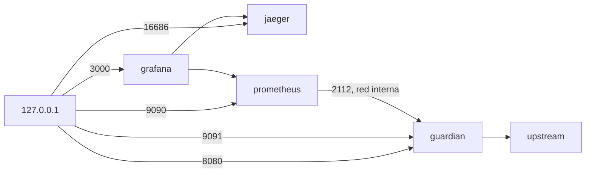

`deploy/compose/config/guardian.yml` es el YAML de ejemplo con el upstream en `http://upstream:9000` y el bloque `tls` comentado, así que este stack no abre `:8443`. `redis_addr` sigue en `localhost:6379` y `tracing.endpoint` en `localhost:4318`. Dentro del contenedor esas direcciones son el propio guardian. Valkey es el servicio `valkey` y Jaeger recibe OTLP en `jaeger:4318`. Con el archivo tal como está, el límite de tasa usa el limitador en memoria y los spans no llegan a Jaeger.

Hace falta `deploy/compose/.env`, a partir de `.env.example`. Compose no arranca si faltan `GUARDIAN_PASS_KEYS`, `GRAFANA_ADMIN_PASSWORD`, `GUARDIAN_EVENT_SALT` o `GUARDIAN_ADMIN_TOKEN`. El YAML del stack deja `events.enabled` y `admin.enabled` en verdadero, así que la sal tiene que medir al menos 16 caracteres y el token al menos 32. El valor de ejemplo del token hay que cambiarlo: con menos de 32 caracteres guardian no arranca. El `.env` no se versiona.

```bash
cd deploy/compose
cp .env.example .env
# GUARDIAN_PASS_KEYS=k1:$(openssl rand -base64 32 | tr -d '\n')
# GUARDIAN_EVENT_SALT=$(openssl rand -hex 32)
# GUARDIAN_ADMIN_TOKEN=$(openssl rand -hex 32)
docker compose up --build
```

El perfil `demo` pega tres peticiones cada 0,3 segundos: `Mozilla/5.0` a `/api/prices`, `curl` sin otro user-agent a `/api/prices`, y `Mozilla/5.0` a `/`.

```bash
docker compose --profile demo up --build
```

Grafana provisiona Prometheus como datasource por defecto y Jaeger en `http://jaeger:16686`. El dashboard `guardian · overview` (`uid` `guardian-overview`) refresca cada 10 segundos y mira los últimos 30 minutos: requests por ruta, ratio de 5xx, latencia p50/p95/p99, decisiones por tipo, modo y shadow, bloqueos que habrían ocurrido en shadow, las cinco señales más frecuentes, fail-open por motivo, requests en curso, eventos encolados frente a descartados, lotes por segundo con su tamaño medio, y reintentos frente a eventos perdidos. La UI no puede borrar ni editar ese dashboard.

### Floci

El perfil `aws` añade Floci `2.4.0` y un init que crea la cola y el stream `guardian-events`. Floci escucha en `127.0.0.1:4566` y dentro de la red en `http://floci:4566`. No monta el socket de Docker: SQS y Kinesis corren dentro del proceso, y el aviso de que Docker no está disponible es el comportamiento esperado. El init usa la imagen `amazon/aws-cli:2.40.3`, la región `us-east-1` y las credenciales `test` / `test`.

`deploy/compose/config/guardian.yml` sigue con sink `log`. Para mandar los eventos a Floci se superpone `docker-compose.aws.yml`, que arranca guardian con `config/guardian.sqs.yml` o, con `GUARDIAN_EVENTS_SINK=kinesis`, `guardian.kinesis.yml`. Los dos apuntan Valkey a `valkey:6379` y las trazas a `jaeger:4318`. `guardian.sqs.yml` deja `ja4.source` en `cloudfront` y enciende `reputation`. `guardian.kinesis.yml` deja `ja4.source` en `none`. La cola de SQS es `http://floci:4566/000000000000/guardian-events`. El perfil `aws` es obligatorio: `floci` y `aws-init` viven ahí, y guardian espera a que el init termine bien.

El mismo override levanta `cmd/aggregator`. Siempre lee `config/guardian.sqs.yml`, espera a Valkey sano y al init, y no publica puertos. Corre en solo lectura, sin capabilities y con `no-new-privileges`. Con `GUARDIAN_EVENTS_SINK=kinesis`, guardian escribe en el stream y el aggregator sigue leyendo la cola SQS.

### Kafka local

`docker-compose.kafka.yml` no usa el perfil `aws`. Levanta Apache Kafka `4.4.0` en KRaft, un solo proceso que es broker y controller, sin ZooKeeper y sin autenticación. Los contenedores lo ven en `kafka:9092`. El portátil lo ve en `127.0.0.1:9094`. El listener de controller queda en `:9093` y no se publica. `kafka-init` crea el topic `guardian-events` con 6 particiones, factor de réplica 1 y retención de un día. El broker no crea topics por su cuenta.

Guardian y el aggregator leen `config/guardian.kafka.yml`. Ese archivo enciende la reputación con peso 50, deja `ja4.source` en `cloudfront` y apunta Valkey a `valkey:6379` y las trazas a `jaeger:4318`. Los `trusted_proxies` suman `172.16.0.0/12` y `192.168.65.0/24` a la loopback. El sink es `kafka`, el broker es `kafka:9092`, la key es `ip_hash` y el grupo es `guardian-aggregator`.

```bash
cd deploy/compose
docker compose -f docker-compose.yml -f docker-compose.kafka.yml up -d --build
```

```bash
cd deploy/compose
docker compose --profile aws -f docker-compose.yml -f docker-compose.aws.yml up -d --build --force-recreate guardian
GUARDIAN_EVENTS_SINK=kinesis docker compose --profile aws -f docker-compose.yml -f docker-compose.aws.yml up -d --force-recreate guardian
```

Para mirar la cola y el stream sin instalar el AWS CLI, esta función corre el CLI dentro de la red de Compose. Vale solo para esa sesión de terminal:

```bash
awsl() { docker compose --profile aws run --rm -T --no-deps --entrypoint aws aws-init --endpoint-url http://floci:4566 "$@"; }
awsl sqs list-queues
awsl kinesis list-streams
```

`deploy/compose/prometheus/alerts.yml` define siete alertas del job `guardian`:

| Alerta | Condición | Durante | Severidad |
| --- | --- | --- | --- |
| `GuardianDown` | `up == 0` | 1 minuto | `critical` |
| `GuardianHighErrorRate` | más del 5 % de los requests en 5xx | 5 minutos | `critical` |
| `GuardianHighLatencyP99` | p99 por encima de 500 ms | 10 minutos | `warning` |
| `GuardianFailOpen` | algún `guardian_fail_open_total` en la ventana de 5 minutos | 2 minutos | `warning` |
| `GuardianConfigReloadFailing` | `guardian_config_last_reload_successful == 0` | 5 minutos | `warning` |
| `GuardianAdminAuthFailures` | más de 20 `401` de la Admin API en 10 minutos | al momento | `warning` |
| `GuardianACLLookupErrors` | algún `guardian_acl_lookup_errors_total` en la ventana de 5 minutos | 5 minutos | `warning` |

`alerts_test.yml` es la prueba de `promtool` y Prometheus no la carga. Se corre desde `deploy/compose/prometheus`:

```bash
docker run --rm -v "$PWD":/work -w /work prom/prometheus:v3.16.0 promtool test rules alerts_test.yml
```
